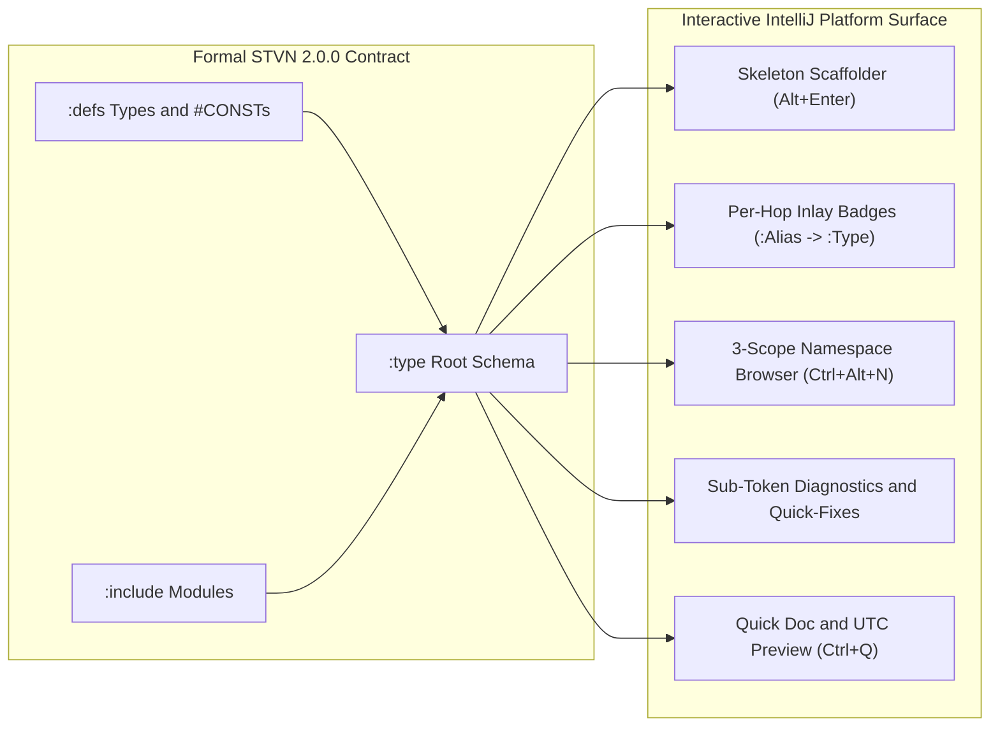
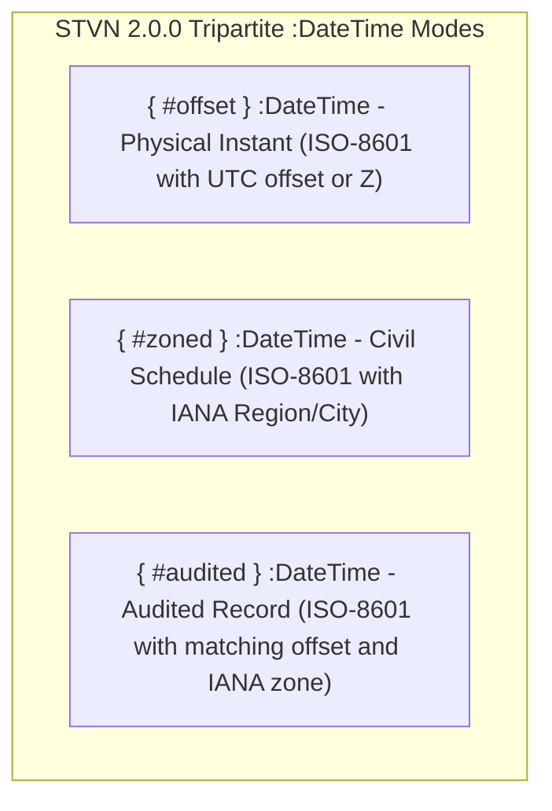

# STVN IDE Authoring Guide & Feature Handbook

- **Strongly Typed Value Notation (STVN 2.0.0) for IntelliJ Platform**
- *An Authoritative, Example-Driven Guide for Software Engineers, Data Engineers, and System Architects*

---

**Table of Contents**

<!-- TOC -->
* [STVN IDE Authoring Guide & Feature Handbook](#stvn-ide-authoring-guide--feature-handbook)
  * [1. Core Philosophy & Quick Start](#1-core-philosophy--quick-start)
    * [1.1 Mathematical Typing Meets IDE Ergonomics](#11-mathematical-typing-meets-ide-ergonomics)
    * [1.2 The Dual-Track Lexical Partition (Colon `:` vs. Hash `#`)](#12-the-dual-track-lexical-partition-colon--vs-hash-)
    * [1.3 Comparison Matrix: JSON vs. YAML vs. TOML vs. STVN 2.0.0](#13-comparison-matrix-json-vs-yaml-vs-toml-vs-stvn-200)
    * [1.4 60-Second Quick Start: Your First Valid STVN 2.0.0 Document](#14-60-second-quick-start-your-first-valid-stvn-200-document)
  * [2. Interactive Authoring & Scaffolding](#2-interactive-authoring--scaffolding)
    * [2.1 Schema-Driven Skeleton Generator (`Alt+Enter` on `:body`)](#21-schema-driven-skeleton-generator-altenter-on-body)
    * [2.2 Trap 2 Map Auto-Healer (`Alt+Enter` on Flat Lists in `:Map` Slots)](#22-trap-2-map-auto-healer-altenter-on-flat-lists-in-map-slots)
    * [2.3 Enum Subset Variant Reordering (`Alt+Enter` on Out-of-Order Filter Lists)](#23-enum-subset-variant-reordering-altenter-on-out-of-order-filter-lists)
    * [2.4 Resilient Payload Value Quick-Fixes & Container Layout Intentions](#24-resilient-payload-value-quick-fixes--container-layout-intentions)
  * [3. Visual Grammar & Inlay Hint Badging Guide](#3-visual-grammar--inlay-hint-badging-guide)
    * [3.1 Explicit vs. Inferred Sum Variant Tags](#31-explicit-vs-inferred-sum-variant-tags)
    * [3.2 Unified Renamed `:use` Alias Head Hops & Per-Hop `Ctrl+Click` Navigation](#32-unified-renamed-use-alias-head-hops--per-hop-ctrlclick-navigation)
    * [3.3 Temporal Primitives Inlay Hints & Four-Locus Hover Inspection](#33-temporal-primitives-inlay-hints--four-locus-hover-inspection)
    * [3.4 Container Closing Delimiter Signatures & `AliasExpansionMode` Settings](#34-container-closing-delimiter-signatures--aliasexpansionmode-settings)
    * [3.5 Enum Subset Domain Completion & Inlay Badging](#35-enum-subset-domain-completion--inlay-badging)
  * [4. Sub-Token Precision Diagnostics & Real-Time Inspections](#4-sub-token-precision-diagnostics--real-time-inspections)
    * [4.1 Pinpoint Leaf-Token Error Targeting](#41-pinpoint-leaf-token-error-targeting)
    * [4.2 Structural Immunity for `:meta`, `:defs`, `:type`, and Root Enclosures](#42-structural-immunity-for-meta-defs-type-and-root-enclosures)
    * [4.3 Real-Time Semantic & Governance Checkpoints](#43-real-time-semantic--governance-checkpoints)
    * [4.4 STVN 2.0.0 Structural, Validity & Governance Inspections](#44-stvn-200-structural-validity--governance-inspections)
  * [5. Navigation, Namespace Browser, Quick Documentation & Polyglot Fenced Strings](#5-navigation-namespace-browser-quick-documentation--polyglot-fenced-strings)
    * [5.1 Two-Hop `:use` Navigation & Module Hierarchies (`Ctrl+Click` / `Ctrl+B`)](#51-two-hop-use-navigation--module-hierarchies-ctrlclick--ctrlb)
    * [5.2 Interactive 3-Scope Namespace Dependencies Browser (`Ctrl+Alt+N`)](#52-interactive-3-scope-namespace-dependencies-browser-ctrlaltn)
    * [5.3 Quick Documentation & Nominal Lineage (`Ctrl+Q` / Hover)](#53-quick-documentation--nominal-lineage-ctrlq--hover)
    * [5.4 Polyglot Fenced Strings (Rule STR-04)](#54-polyglot-fenced-strings-rule-str-04)
    * [5.5 VOP Projection & Canonicalization Menu Matrix (`STVN >`)](#55-vop-projection--canonicalization-menu-matrix-stvn-)
    * [5.6 Package Enclaves (`:package`) & Lexical Imports (`:use`)](#56-package-enclaves-package--lexical-imports-use)
    * [5.7 Canonical 6-File Taxonomy (`.stvn`, `.stvn_i`, `.stvn_d`, `.stvn_di`, `.stvn_b`, `.stvn_bd`)](#57-canonical-6-file-taxonomy-stvn-stvn_i-stvn_d-stvn_di-stvn_b-stvn_bd)
    * [5.8 Sum Disambiguation, Hash Sigil Completion & Fault Isolation](#58-sum-disambiguation-hash-sigil-completion--fault-isolation)
  * [6. STVN 2.0.0 Data Type Cheat Sheet for Data Engineers](#6-stvn-200-data-type-cheat-sheet-for-data-engineers)
    * [6.1 Atomic Primitives & Metadata Facet Qualifications](#61-atomic-primitives--metadata-facet-qualifications)
    * [6.2 Composite & Collection Constructors: Tuples, Maps, Sequences & Sets](#62-composite--collection-constructors-tuples-maps-sequences--sets)
    * [6.3 Algebraic Sum Constructors: Options, Eithers & Unions](#63-algebraic-sum-constructors-options-eithers--unions)
    * [6.4 Enumerations & Subset Filter Facets (`#filterIncl`, `#filterExcl`)](#64-enumerations--subset-filter-facets-filterincl-filterexcl)
    * [6.5 Temporal Types: `:TimeEpoch` Scales & Tripartite `:DateTime` Modes](#65-temporal-types-timeepoch-scales--tripartite-datetime-modes)
  * [7. Keyboard Shortcut Quick Reference](#7-keyboard-shortcut-quick-reference)
<!-- TOC -->

---

## 1. Core Philosophy & Quick Start

### 1.1 Mathematical Typing Meets IDE Ergonomics

Strongly Typed Value Notation (STVN 2.0.0) is a deterministic, human-readable data serialization language and algebraic type system governed by Value-Oriented Programming (VOP). Every payload compilation unit (`.stvn` or `.stvn_i`) establishes a single-pass verified contract between its root metadata (`:meta`), optional definitions (`:defs`), root schema (`:type`), and data payload (`:body`).

The STVN IntelliJ Platform Plugin (`ij_stvnadore_plugin`) couples directly to the immutable `org.stvnadore.core.ir` model to provide real-time authoring assistance:
* **Generates complete data skeletons** matching nominal and composite `:type` schemas with interactive tab-stops.
* **Renders multi-hop nominal and renamed `:use` alias inlay badges** with independent per-hop `Ctrl+Click` navigation and inferred sum-tag materialization.
* **Inspects symbol closures interactively** across `:defs`, `:type`, and `:body` scopes in a 5-column Namespace Dependencies Browser (`Ctrl+Alt+N`).
* **Pinpoints syntax, constraint, and trait violations** directly to the offending leaf token with 1-click remediation quick-fixes.



---

### 1.2 The Dual-Track Lexical Partition (Colon `:` vs. Hash `#`)

STVN partitions all symbolic identifiers into two disjoint lexical tracks:

1. **The Typic Track (`:`)**: Every structural section keyword, built-in type constructor, package path, and nominal type identifier begins with `:` (`:meta`, `:defs`, `:type`, `:body`, `:Int`, `:Float`, `:String`, `:Boolean`, `:TimeEpoch`, `:DateTime`, `:Tuple`, `:Seq`, `:Set`, `:Map`, `:Option`, `:Either`, `:Union`, `:Enum`, `:UserId`).
2. **The Value & Facet Track (`#`)**: Every boolean literal, algebraic sum constructor tag, enumeration variant, named constant, and metadata constraint facet begins with `#` (`#TRUE`, `#FALSE`, `#Some`, `#None`, `#Left`, `#Right`, `#1`, `#2`, `#ADMIN`, `#MAX_RETRIES`, `#unsigned`, `#size`, `#minSize`, `#maxSize`, `#preserveIndent`).

```stvn
{
  :meta {
    #name   "service_status"
    #domain "telemetry"
    #kind   #BODY
  }
  :defs {
    :Status :Option({ #minSize 1 #maxSize 64 } :String)
  }
  :type :Status
  :body #Some "active"
}
```

---

### 1.3 Comparison Matrix: JSON vs. YAML vs. TOML vs. STVN 2.0.0

| Feature / Dimension    | JSON                          | YAML                            | TOML                    | STVN 2.0.0 (`.stvn` / `.stvn_i`)                  |
|:-----------------------|:------------------------------|:--------------------------------|:------------------------|:--------------------------------------------------|
| **Type Rigor**         | Untyped                       | Implicit (Loose)                | Primitive Tables        | Algebraic Sum & Product Types + Opaque Nominals   |
| **Schema Binding**     | Out-of-band (JSON Schema)     | Out-of-band (SchemaStore)       | None                    | Embedded `:type` & Modular `:include` / `:use`    |
| **Sum Types (Unions)** | Ad-hoc discriminator fields   | Tagged union conventions        | Unsupported             | First-Class (`:Option`, `:Either`, `:Union`)      |
| **Map Syntax**         | `{"k": "v"}`                  | `k: v` (Indentation-sensitive)  | `k = "v"`               | `{["k" "v"]}` (Ordered Unique Key-Value Pairs)    |
| **Null Safety**        | Ambiguous `null`              | Multi-form (`null`, `~`, empty) | Omitted keys            | Explicit `:Option` (`#Some` / `#None`), Zero Null |
| **Multiline Strings**  | Escaped `\n` only             | Indentation block scalars       | Triple quotes           | Rule `STR-04` Tagged Fences (`"""[TAG]...[TAG]"""`)|
| **Editor Inlays**      | None                          | Limited                         | None                    | Per-Hop Nominal Chains & Inferred `[#Tag]` Badges |

---

### 1.4 60-Second Quick Start: Your First Valid STVN 2.0.0 Document

Create `user_profile.identity.stvn` and author the following document:

```stvn
{
  :meta {
    #name   "user_profile"
    #domain "identity"
    #kind   #BODY
  }
  :defs {
    :UserId       { #unsigned #size 64 } :Int
    :NonEmptyText { #minSize 1 #maxSize 256 } :String
    :UserRole     :Enum[#ADMIN #ENGINEER #ANALYST]
    :Coordinates  :Tuple(:Float :Float)
  }
  :type :Tuple(
    :UserId
    :NonEmptyText
    :UserRole
    :Coordinates
    :Option(:NonEmptyText)
  )
  :body (
    10042
    "ada.lovelace@stvnadore.org"
    #ENGINEER
    (51.5074 -0.1278)
    "London Office"
  )
}
```

The IDE validates every slot in real time:
* `10042` satisfies `:UserId` (`{ #unsigned #size 64 } :Int`).
* `"ada.lovelace@stvnadore.org"` satisfies `:NonEmptyText` (`{ #minSize 1 #maxSize 256 } :String`).
* `#ENGINEER` resolves directly to `:UserRole` (`:Enum[#ADMIN #ENGINEER #ANALYST]`).
* `(51.5074 -0.1278)` matches `:Coordinates` (`:Tuple(:Float :Float)`).
* `"London Office"` is inferred under Rule A as `#Some "London Office"` and displays the clickable inlay badge `:Option(:NonEmptyText) [#Some] (-> :NonEmptyText -> :String)`.

---

## 2. Interactive Authoring & Scaffolding

### 2.1 Schema-Driven Skeleton Generator (`Alt+Enter` on `:body`)

When authoring a nested STVN payload, place the caret on an empty `:body` section (or an empty `:body ()` placeholder) and press `Alt+Enter` (macOS: `⌥Enter`) to invoke **Generate STVN data skeleton** (family: *Generate schema data skeleton*).

`StvnSchemaSkeletonScaffolder` traverses the resolved `:type` contract across local `:defs`, `:package` / `:use` imports, and `:include` modules to emit a canonically indented payload attached to interactive `TemplateBuilderImpl` tab-stops:
* `:Tuple(...)` &rarr; `(...)`
* `:Map(:K :V)` &rarr; `{[key val]}`
* `:Seq(:T)` / `:Set(:T)` &rarr; `[item]`
* `:Option(:T)` &rarr; `#Some val`
* `:Either(:L :R)` &rarr; `#Right val`
* `:Union(:T1 :T2 ...)` &rarr; `#1 val`
* `:Enum[#A #B ...]` &rarr; `#A`
* Scalars &rarr; `0`, `0.0`, `"placeholder"`, `#FALSE`, `"2026-08-18T18:00:00-05:00"` (`{ #offset } :DateTime`), `"2026-08-18T18:00:00[America/Chicago]"` (`{ #zoned } :DateTime`), `"2026-08-18T18:00:00-05:00[America/Chicago]"` (`{ #audited } :DateTime`).

```stvn
{
  :meta {
    #name   "metrics"
    #domain "telemetry"
    #kind   #BODY
  }
  :defs {
    :MetricPoint :Tuple(:String :Float :Boolean)
  }
  :type :Map(:String :MetricPoint)
  :body {
    ["placeholder" (
      "placeholder"
      0.0
      #FALSE
    )]
  }
}
```

Use **`Tab`** and **`Shift+Tab`** to step across generated placeholders and **`Enter`** or **`Esc`** to finish.

---

### 2.2 Trap 2 Map Auto-Healer (`Alt+Enter` on Flat Lists in `:Map` Slots)

Under STVN 2.0.0 Specification § 5.5.1, a `:Map` literal is an ordered sequence of bracketed `[key value]` pairs enclosed in braces `{ ... }`. Supplying a flat list `[k1 v1 k2 v2]` in a `:Map` slot triggers `StvnMapStructuralInspection`:

```stvn
// Invalid flat list in a :Map slot:
:type :Map(:String :Int)
:body ["api_port" 8080 "grpc_port" 9090]

// After pressing Alt+Enter -> "Convert flat list to canonical map literal '{ [ ... ] }'":
:type :Map(:String :Int)
:body {["api_port" 8080] ["grpc_port" 9090]}
```

---

### 2.3 Enum Subset Variant Reordering (`Alt+Enter` on Out-of-Order Filter Lists)

Under STVN 2.0.0 Specification § 4.8, `#filterIncl` and `#filterExcl` lists must preserve the declaration order of the root `:Enum` (`StvnReorderEnumFilterVariantsQuickFix` swaps only the individual variant tokens right-to-left with an exact `0`-character width delta, preserving all authored bracket spacing, column alignment, and comments):

```stvn
:defs {
  :Priority      :Enum[#LOW #MEDIUM #HIGH #CRITICAL]
  // Before Quick-Fix (E015 order violation):
  :AlertPriority { #filterIncl [#CRITICAL #MEDIUM] } :Priority
  // After Alt+Enter -> "Sort variants to match root enum declaration order":
  :FixedPriority { #filterIncl [#MEDIUM #CRITICAL] } :Priority
}
```

Transitive subset derivations resolve back to the root `:Enum` declaration automatically:

```stvn
:defs {
  :LifecycleState :Enum[#PENDING #ACTIVE #SUSPENDED #DELETED]
  :WorkingState   { #filterExcl [#DELETED] } :LifecycleState
  :UrgentState    { #filterIncl [#ACTIVE #SUSPENDED] } :WorkingState
}
```

---

### 2.4 Resilient Payload Value Quick-Fixes & Container Layout Intentions

* **Prohibited Numeric Underscore Removal (`E002`):** Strips `_` separators from numeric literals (`Remove prohibited underscores from numeric literal '...'`).
* **Exact Decimal Precision Rounding & Truncation (`E012`):** On `{ #exact #maxSize N } :Float` overflow, offers `Round value to #maxSize N significant digits '...'` (`Priority.TOP`) and `Truncate value to #maxSize N significant digits '...'` (`Priority.HIGH`).
* **Container Layout Intentions (`Alt+Enter`):**
  * **Expand container to multi-line** (`StvnExpandContainerIntention`)
  * **Collapse container to single line** (`StvnCollapseContainerIntention`)
  * **Collapse child elements to single line each** (`StvnCollapseChildElementsIntention`)

---

## 3. Visual Grammar & Inlay Hint Badging Guide

### 3.1 Explicit vs. Inferred Sum Variant Tags

* **Unbracketed Tag (`#Some`, `#Right`, `#2`)**: Explicitly authored in `:body` (or inside a referenced `#CONST`).
* **Bracketed Tag (`[#Some]`, `[#Right]`, `[#2]`)**: Inferred by the STVN 2.0.0 sum-inference rules. Clicking a `:body`-level `[#Tag]` segment in the inlay badge materializes the explicit tag directly into the buffer.

| `:defs` Declaration                           | `:body` Value | Rendered Inlay Badge (`FULL`)        | Interpretation                         |
|:----------------------------------------------|:--------------|:-------------------------------------|:---------------------------------------|
| `:OptDesc :Option(:String)`                   | `#Some "ok"`  | `:OptDesc #Some (-> :String)`        | Explicit `:Option` `#Some`             |
| `:OptDesc :Option(:String)`                   | `"ok"`        | `:OptDesc [#Some] (-> :String)`      | Rule A inferred `#Some`                |
| `:OptDesc :Option(:String)`                   | `#None`       | `:OptDesc #None`                     | Explicit `:Option` `#None`             |
| `:Outcome :Either(:Int :String)`              | `#Left -1`    | `:Outcome #Left (-> :Int)`           | Explicit `:Either` `#Left`             |
| `:Outcome :Either(:Int :String)`              | `"ok"`        | `:Outcome [#Right] (-> :String)`     | Rule B inferred `#Right`               |
| `:Payload :Union(:Int :String :Boolean)`      | `#1 100`      | `:Payload #1 (-> :Int)`              | Explicit `:Union` branch `#1`          |
| `:Payload :Union(:Int :String :Boolean)`      | `"data"`      | `:Payload [#2] (-> :String)`         | Rule C inferred `:Union` branch `#2`   |

---

### 3.2 Unified Renamed `:use` Alias Head Hops & Per-Hop `Ctrl+Click` Navigation

When a document imports a packaged type via a renamed `UseMapAlias` (`localSimpleName != targetSimpleName`), every `:body` inlay slot (scalar, `:Enum`, temporal, sum outer/branch, composite `#CONST`, composite literal, and degraded `⚠ ` badge) begins with the in-scope local alias and traces through the upstream FQNI to the terminal base type across both Clean Pass 3 (`State A`) and Pass-3-Suspended (`State B`) editing:

```stvn
{
  :meta {
    #name   "manifold_probe"
    #domain "cooling"
    #kind   #BODY
  }
  :defs {
    :package :cooling/manifold {
      :CoolantValveMode :Enum[#OPEN #BYPASS #CLOSED]
      :ManifoldTempC    { #minIncl -40 #maxExcl 250 } :Int
      :FlowTargetLpm    { #minIncl 0 #maxExcl 1000 } :Int
      #DEFAULT_VALVE    :CoolantValveMode #OPEN
    }

    :use [
      :cooling/manifold {
        :CoolantValveMode :ValveMode
        :ManifoldTempC    :LoopTempC
        :FlowTargetLpm    :LoopFlowLpm
        #DEFAULT_VALVE    #INIT_VALVE
      }
    ]

    :ZoneFlowMap    :Map(:String :LoopFlowLpm)
    :ManifoldReport :Tuple(:ValveMode :LoopTempC :ZoneFlowMap)
  }
  :type :ManifoldReport
  :body (
    #INIT_VALVE          // Inlay: :ValveMode (-> :cooling/manifold/CoolantValveMode -> :Enum)
    120                  // Inlay: :LoopTempC (-> :cooling/manifold/ManifoldTempC -> :Int)
    {["zone_a" 480]}     // 480 Inlay: :LoopFlowLpm (-> :cooling/manifold/FlowTargetLpm -> :Int)
  )
}
```

* **Per-Hop `Ctrl+Click` Navigation:** Clicking `:ValveMode` in the inlay badge jumps to `:ValveMode` inside `:use`; clicking `:cooling/manifold/CoolantValveMode` jumps directly to `:CoolantValveMode` inside `:package :cooling/manifold` (or its external `.stvn_d` / `.stvn_di` file).
* **Zero Duplicate-Hop Stutter:** Unrenamed `{ #strip }` imports (`:neutrino/optics/Photoelectrons (-> :Int)`) and identity `:Port :Port` projections (`:Port` for Prelude `:org/stvnadore/prelude/Port`) omit redundant head hops.

---

### 3.3 Temporal Primitives Inlay Hints & Four-Locus Hover Inspection

STVN 2.0.0 represents epoch counters via `:TimeEpoch` qualified by a mandatory scale flag (`#s`, `#ms`, `#us`, `#ns`) and calendar timestamps via `:DateTime` qualified by a mandatory mode flag (`#offset`, `#zoned`, `#audited`):

```stvn
{
  :meta {
    #name   "audit_window"
    #domain "chronology"
    #kind   #BODY
  }
  :defs {
    :InstantUtc   { #offset } :DateTime
    :ScheduleWall { #zoned } :DateTime
    :AuditStamp   { #audited } :DateTime
    :EpochMillis  { #ms } :TimeEpoch
  }
  :type :Tuple(:InstantUtc :ScheduleWall :AuditStamp :EpochMillis)
  :body (
    "2026-08-18T18:00:00-05:00"
    "2026-08-18T18:00:00[America/Chicago]"
    "2026-08-18T18:00:00-05:00[America/Chicago]"
    1787094000000
  )
}
```

Hovering (`Ctrl+Q`) over temporal `#CONST` declarations, `#CONST` RHS values, `:body` `#CONST` references, or `:body` literals displays deterministic ISO-8601 `UTC Preview` and configurable 12-hour / 24-hour `UTC Time` rows while validating DST spring-forward gaps and `#audited` offset-vs-IANA-zone consistency.

---

### 3.4 Container Closing Delimiter Signatures & `AliasExpansionMode` Settings

Multi-line composite literals project closing delimiter signatures (`):ManifoldReport`, `]:Seq(:Int)`, `}:ZoneFlowMap`). Configure nominal chain verbosity under **Settings | Languages & Frameworks | STVN | Nominal type alias expansion display mode**:
* `FULL`: `:ValveMode (-> :cooling/manifold/CoolantValveMode -> :Enum)`
* `FIRST_HOP`: `:ValveMode (-> :cooling/manifold/CoolantValveMode)`
* `ALIAS_TO_BASE`: `:ValveMode (-> ... -> :Enum)`
* `SYMBOL_ONLY`: `:ValveMode`
* `NONE`: Base constructor hints only

---

### 3.5 Enum Subset Domain Completion & Inlay Badging

* **Filter Bracket Completion:** Inside `#filterIncl [<caret>]` or `#filterExcl [<caret>]`, `StvnValueCompletionContributor` suggests only parent variants not yet listed, sorted in canonical root `:Enum` order.
* **Payload Domain Filtering:** In `:body` and `#CONST` slots governed by an enum subset, completion offers only active allowed variants with `(k/N)` cardinality tail text.

---

## 4. Sub-Token Precision Diagnostics & Real-Time Inspections

### 4.1 Pinpoint Leaf-Token Error Targeting

`StvnExternalAnnotator` maps `StvnDiagnostic` byte/character spans directly to the offending leaf literal without painting enclosing containers red:

```stvn
{
  :meta {
    #name   "union_check"
    #domain "diagnostics"
    #kind   #BODY
  }
  :defs {
    :DisjointUnion :Union(:Int :Boolean :Float :String)
  }
  :type :Tuple(:DisjointUnion)
  :body (
    #1 1024.0 // Error highlights strictly 1024.0: Expected :Int, got :Float
  )
}
```

### 4.2 Structural Immunity for `:meta`, `:defs`, `:type`, and Root Enclosures

Errors inside `:body` values never highlight root braces `{ ... }`, `:meta`, `:defs`, or `:type`. Diagnostics originating inside an `:include` module route directly to the matching `:include` path literal with a 1-click `OpenIncludedFileQuickFix`.

### 4.3 Real-Time Semantic & Governance Checkpoints

* **Collection Cardinality Bounds (`#minSize` / `#maxSize`):** Empty collections `[]` or `{}` supplied to `{ #minSize 1 } :Seq(:String)` or `{ #minSize 1 } :Map(:String :Int)` highlight immediately (`E012`).
* **Unique `:Map` Keys & `#invertible` Values (§ 5.5.1 & § 6.1):** Duplicate keys in `:Map` and duplicate values in `{ #invertible } :Map` highlight at the colliding entry.
* **Zero-Shadowing (§ 4.2):** Duplicate `:Type` or `#CONST` bindings across local `:defs`, `:use` projections, and `:include` modules highlight immediately.

### 4.4 STVN 2.0.0 Structural, Validity & Governance Inspections

The plugin registers **27** real-time local inspections synchronized 1:1 with `stvnadore-core` diagnostic codes (`[stvn-(core|plugin):<CODE>-<SYMBOLIC_ID>]`), including:
* **`StvnMetadataOrder` (`ERROR`):** Enforces 3-tier `:meta` ordering (`#name -> #domain -> #kind`) and 5-tier schema `MetadataMap` ordering (§ 6.1) with comment-preserving 1-click reordering.
* **`StvnDiscreteInterval` (`ERROR`):** Enforces half-open discrete intervals `[#minIncl, #maxExcl)` on `:Int`, `{ #exact } :Float`, `:TimeEpoch`, and `:DateTime`, offering `#maxIncl N -> #maxExcl N+1` and bound-swap quick-fixes.
* **`StvnTemporalMode` (`ERROR`):** Requires explicit scale flags (`#s`, `#ms`, `#us`, `#ns`) on `:TimeEpoch` and explicit mode flags (`#offset`, `#zoned`, `#audited`) on `:DateTime`.
* **`StvnStringCardinality` & `StvnStringCapacity` (`ERROR` / `WARNING`):** Prohibits `#size` on `:String` (converting to `#maxSize` / `#minSize`) and governs explicit `#maxSize` bounds in Unicode Scalar Values.
* **`StvnStringEscapeScrutiny` (`WARNING`):** Flags hazardous control, bidirectional text-direction, and invisible format escapes (`PW007`) across `:meta`, `:include`, `:defs`, `:type`, and `:body`, and warns by default on shorthand `\r` escapes (`PW008`) with 1-click **`Replace '\r' with explicit '\u000D'`** quick-fixes while exempting explicit `\u000D`, emoji joiners (`\u200C`, `\u200D`), and printable escapes.
* **`StvnFlatDocumentInclude` (`ERROR`):** Flags illegal `:include` statements (`E005`) and unresolved external `:use` packages (`E035`) in hermetic `.stvn` and `.stvn_d` documents, and offers 3-tier `:use` package remediation (`Include '<path>'`, interactive package locator popup, or `:use` target removal) in modular `.stvn_i` and `.stvn_di` units.

---

## 5. Navigation, Namespace Browser, Quick Documentation & Polyglot Fenced Strings

### 5.1 Two-Hop `:use` Navigation & Module Hierarchies (`Ctrl+Click` / `Ctrl+B`)

* **Hop 1 (Usage Site &rarr; Local `UseMapAlias`):** `Ctrl+Click` on a renamed `:use` symbol (`:ValveMode`, `#INIT_VALVE`) in `:defs`, `:type`, or `:body` jumps to the local alias binding inside `:use`.
* **Hop 2 (`UseMapAlias` &rarr; Upstream Declaration):** `Ctrl+Click` on either token inside `:use { :CoolantValveMode :ValveMode }` jumps directly to the upstream declaration in `:package` or an included `.stvn_d` / `.stvn_di` module.
* **1-Hop `#strip` & FQNI Resolution:** Unrenamed `{ #strip }` imports and explicit FQNIs (`:cooling/manifold/CoolantValveMode`) jump directly to the upstream declaration in 1 hop.

---

### 5.2 Interactive 3-Scope Namespace Dependencies Browser (`Ctrl+Alt+N`)

Press **`Ctrl+Alt+N`** (macOS: **`Cmd+Alt+N`**) or click any section gutter icon (`:defs`, `:type`, `:body`) to launch **STVN Namespace Dependencies**:

* **Static Title, Flush-Left Bold Prefixes, `Alt+P` Prelude Toggle & Type-Anywhere Filter:** Displays a static **STVN Namespace Dependencies** popup title above three flush-left (`x = 0`) rows with bold metadata prefixes (`**File:**`, `**Scope:**`, `**Scope:**`) and regular-weight values: Row 1 (`**File:** <filename>` with a project-relative path tooltip + `Show Standard Library Prelude (Alt+P)` toggled via `Alt+P` / `⌥P` with STE hover tooltip), Row 2 (`**Scope:** <scope> — <title> (<count> symbols)` dynamic summary), and Row 3 (`**Scope:**` + clean `:defs` / `:type` / `:body` radio buttons via `Alt+1..3` + live `SearchTextField` via `Alt+F` or `Ctrl+F` / `Cmd+F`). Typing any unmodified STVN character (`[A-Za-z0-9:#/_.-]`) or `BackSpace` anywhere inside the popup focuses `SearchTextField` directly without opening a competing floating speed-search bubble, ranks matches by `Name -> Upstream Target -> Source -> Resolved Type`, and keeps `Up` / `Down` / `PageUp` / `PageDown` / `Enter` navigating the symbol table seamlessly. On `#DEFS` / `#DEFS_INCLUDE` schemas, `:type` and `:body` remain disabled with explanatory STE tooltips and `Alt+2` / `Alt+3` act as strict no-ops.
* **Spreadsheet-Grade Column Sizing, Finder-Style `…` Cell Ellipses & Multi-Column Water-Filling Window Fit:** Supports native left-aligned `JBTableHeader` column headers (`Name` through `Resolved Type`), independent manual column resizing down to `56px` with horizontal scrolling as needed, Unicode-code-point-safe single-glyph `…` (`U+2026`) cell truncation (`Middle — Preserve Prefix & Suffix (Default)` with configurable `[4, 32]` trailing suffix length or `Trailing — Preserve Prefix Only` under **Settings | Languages & Frameworks | STVN | Namespace Dependencies Browser**) paired with full-value hover tooltips on truncated cells, a compact default-locked right-aligned `Use Depth` column with header lock icon and dynamic scope-aware header tooltip, double-click header divider right-sizing without toggling column sort order, a 2-stage progressive `Alt+R` (`⌥R`) shortcut (Press 1 expands unlocked columns to full unconstrained widths with horizontal scrolling; Press 2 water-fills and fits the popup window), a direct 1-step `Alt+Shift+R` (`⌥⇧R`) water-filling window-fit shortcut (keeping narrow columns at `100%` natural width, capping only overflowing wide columns so `Use Depth` remains `100%` visible with zero horizontal scrollbar, and cycling cleanly with `Alt+R`), and a 4-item right-click column header context menu (`Lock Column Width`, `Right-Size Column`, `Right-Size All Unlocked Columns (Alt+R)`, `Fit Window to Rows & Columns (Alt+Shift+R)`).
* **5-Column Closure Schema:**
  1. **`Name`**: In-scope local identifier (`:ValveMode`, `#INIT_VALVE`, `:ManifoldReport`).
  2. **`Source`**: Origin module, `:package` enclave (`:cooling/manifold`), or Prelude.
  3. **`Upstream Target`**: Canonical upstream FQNI (`:cooling/manifold/CoolantValveMode`), or `—` for local root `:defs` declarations.
  4. **`Resolved Type`**: Zero-bracket-padded STVN 2.0.0 schema signature (`:Enum[#OPEN #BYPASS #CLOSED]`, `{ #minSize 4 #maxSize 24 #minIncl "PKT-0000" #maxIncl "PKT-ZZZZ" #preserveIndent #TRUE #regex "^PKT-[A-Z0-9-]+$" } :String`) rendered strictly in § 6.1 5-tier decimal facet order (`1.1.1` through `5.0`), with derived nominal `TypeDefinition`s merging inherited and overridden facets and preserving full nominal parent lineage (`{ #unsigned #size 16 #minIncl 100 #maxExcl 500 } :RepeaterId (-> :Int)`, `{ #filterIncl [#LOCKED #DEGRADED] } :PoweredLaserState (-> :LaserState -> :Enum)`).
  5. **`Use Depth`**: Scope-aware symbol depth — **Bottom-Up VOP Grounding Depth** in `:defs` (`0` when grounded on built-in primitives or root `:Enum`; `1 + max(referenced symbol depths)` across derived types, subsets, composites, and constants via Tarjan SCC condensation) and **Top-Down Root Reachability Depth** in `:type` and `:body` (`0` for root `:type`; shortest-path named `:Type` or `#CONST` hops from `:type` / `:body`).

---

### 5.3 Quick Documentation & Nominal Lineage (`Ctrl+Q` / Hover)

Press **`Ctrl+Q`** (macOS: **`F1`**) or hover over any `:Type`, `#CONST`, `#VARIANT`, facet keyword, `:body` literal, or backslash escape sequence (`\...`) inside `"..."` to inspect:
* **Nominal Resolution Path & Effective Facets Table:** Displays inherited, overridden, and default 5-tier facets and `#equatable` / `#comparable` traits with status badges and verified `Exemplar Value` previews.
* **`:body` Slot Compliance Cards:** Shows `Slot Schema`, `Compliance Status` (`Satisfied`, `In Violation`, or `Suspended`), active diagnostic codes, and `Expanded Value` sum spines on `#CONST` references.
* **String Escape Sequence Glyph & Emoji Hover Preview:** Hovering strictly inside a valid escape sequence (`\n`, `\r`, `\u000D`, `\u2705`, paired UTF-16 surrogates `\uD83D\uDE80`, or multi-codepoint ZWJ / variation-selector emoji clusters such as `"\uD83D\uDC68\u200D\uD83D\uDCBB"` and `"👨\u200D💻"`) renders the color glyph or `[Non-Printable / Invisible Character]` indicator, composed grapheme preview, source escape, Unicode scalar ID, character name, UTF-8 byte sequence, and STE hygiene notes while preserving standard slot/facet hover cards on surrounding characters.

---

### 5.4 Polyglot Fenced Strings (Rule STR-04)

Under STVN 2.0.0 Specification § 5.3 (**Rule `STR-04`**):
1. **Opening Delimiter:** `"""[TAG]` followed by optional horizontal spaces/tabs and a mandatory line break (`\r\n`, standalone `\r`, or `\n`), with all fenced line endings normalized uniformly to `LF` (`U+000A`).
2. **Closing Delimiter:** Matching `[TAG]"""` (`TAG` matches `^[a-zA-Z0-9_.-]{1,256}$`).
3. **Indentation Stripping:** By default (`#preserveIndent #FALSE`), common leading ASCII space (`0x20`) indentation across non-empty lines is stripped while preserving horizontal tabs (`0x09`) verbatim; `{ #preserveIndent } :String` retains all leading spaces verbatim.

```stvn
{
  :meta {
    #name   "analytics_query"
    #domain "reporting"
    #kind   #BODY
  }
  :defs {
    :QueryPair :Tuple(:String :String)
  }
  :type :QueryPair
  :body (
    "active_users"
    """[SQL]
      SELECT u.user_id, u.email
      FROM users u
      WHERE u.active = 1;
    [SQL]"""
  )
}
```

* **Enter-Key Auto-Closing:** Pressing `Enter` after `"""[SQL]` inserts the matching `[SQL]"""` closing delimiter using your configured **Fenced string Enter-key auto-closing style** (`EXPANDED_THREE_LINE` or `TIGHT_TWO_LINE`).
* **Symmetric Simple, Escaped & Fenced String Conversion Intentions (`Alt+Enter`, `Priority.TOP`):**
  * On an escape-free `"..."` simple string literal (or incomplete fenced opener) that round-trips losslessly under `StvnStringCharacterPolicy.canRepresentVerbatimInFencedString`, invoke **Convert string literal to fenced string block** (`StvnCreateFencedStringIntention`) to convert into `"""[RAW]...[RAW]"""` (or `"""[REGEX]...[REGEX]"""` on `#regex` facets and `*REGEX` constants) with automatic collision-safe tag escalation (`RAW_1`, `REGEX_1`).
  * On an escaped `"..."` string containing `\"`, `\\`, `\/`, `\n`, `\t`, or printable `\uXXXX` / emoji escapes (`"🚀\n👨‍💻"`), invoke **Convert escaped string to fenced string** (`StvnConvertEscapedStringToFencedIntention`). The two forward fencing intentions are strictly mutually exclusive, exclude all `:DateTime`, `:meta`, and `:include` literals, and reject strings containing `\r` (`\r` or `\u000D`), hazardous control/bidi/invisible scalars, unpaired surrogates, or unpreserved leading spaces.
  * On any valid `"""[TAG]...[TAG]"""` fenced string block, invoke **Convert fenced string to escaped string** (`StvnConvertFencedStringToSimpleIntention`) to decode the fenced body using context-sensitive `#preserveIndent` rules (always stripping common leading ASCII spaces on inline `#regex` and string bound facets per § 5.3 item 6) and emit a canonically escaped `"..."` literal. Leaf string conversion intentions rank #1 (`Priority.TOP`) ahead of enclosing container expand/collapse actions.
* **Synchronized Tag Rename (`Shift+F6`):** Renames both `"""[TAG]` and `[TAG]"""` simultaneously with payload collision protection.

---

### 5.5 VOP Projection & Canonicalization Menu Matrix (`STVN >`)

Right-click any textual STVN unit (`.stvn`, `.stvn_i`, `.stvn_d`, `.stvn_di`) and open **STVN >**:
1. **Extract Hermetic Schema (`.stvn_d` — `#DEFS` Only):** Copies or exports a flattened `#DEFS` schema in **Pretty** or **Compact CAS** format.
2. **Extract Hermetic Payload (`.stvn` — Includes `:body`):** Copies or exports a self-contained `#BODY` payload in **Pretty** or **Compact** format.
3. **Canonicalize Active Buffer In-Place:** Replaces the active editor buffer with **Pretty IR** or **Compact IR** (guarded when comments or authoring sugar would be removed, undoable via `Ctrl+Z`).

---

### 5.6 Package Enclaves (`:package`) & Lexical Imports (`:use`)

Package enclaves declare hierarchical namespace paths directly with `:org/stvnadore/domain` typic path tokens (never bracketed lists), and `:use` imports selected symbols via `{ #strip }` and/or `{ :Remote :Local #REMOTE #LOCAL }` alias maps:

```stvn
{
  :meta {
    #name   "ledger_entry"
    #domain "finance"
    #kind   #DEFS
  }
  :defs {
    :package :acme/telemetry {
      :SpanId  { #minSize 16 #maxSize 32 } :String
      :TraceId { #minSize 32 #maxSize 32 } :String
    }

    :use [
      :org/stvnadore/prelude {
        :Uuid :RequestUuid
      }
      :acme/telemetry {
        :SpanId  :LocalSpanId
        :TraceId :LocalTraceId
      }
    ]

    :TransactionEnvelope :Tuple(:RequestUuid :LocalSpanId :LocalTraceId)
  }
}
```

---

### 5.7 Canonical 6-File Taxonomy (`.stvn`, `.stvn_i`, `.stvn_d`, `.stvn_di`, `.stvn_b`, `.stvn_bd`)

| Extension  | `:meta` `#kind` | `:include` Allowed? | Purpose                                                |
|:-----------|:----------------|:-------------------:|:-------------------------------------------------------|
| `.stvn`    | `#BODY`         |         No          | Hermetic self-contained payload document               |
| `.stvn_i`  | `#BODY_INCLUDE` |         Yes         | Modular payload document importing `.stvn_d`/`.stvn_di`|
| `.stvn_d`  | `#DEFS`         |         No          | Hermetic self-contained definitions schema             |
| `.stvn_di` | `#DEFS_INCLUDE` |         Yes         | Modular definitions schema with `:include` DAGs        |
| `.stvn_b`  | Binary `#BODY`  |         No          | Zero-trust binary wire payload                         |
| `.stvn_bd` | Binary `#DEFS`  |         No          | Zero-trust binary definitions archive                  |

---

### 5.8 Sum Disambiguation, Hash Sigil Completion & Fault Isolation

* **Ambiguous Sum Wrapping (`E024`):** When an untagged literal matches multiple branches of `:Either` or `:Union`, `Alt+Enter` offers `Wrap with #Right (-> ...)` / `Wrap with #Left (-> ...)` or `Wrap with #k (-> ...)`.
* **Bare `#` Completion Quick-Fixes:** Typing `#` in a sum or enum slot triggers immediate tag completion and `Complete with #Right` / `Complete with #k` quick-fixes without cascading arity errors onto enclosing tuples.
* **Strict Hover Boundary Guard:** Hovering over whitespace, comments, or incomplete sigils (`#`, `:`, `/`) returns `null` and never leaks parent container documentation.

---

## 6. STVN 2.0.0 Data Type Cheat Sheet for Data Engineers

### 6.1 Atomic Primitives & Metadata Facet Qualifications

STVN 2.0.0 defines **6** built-in atomic types qualified by canonical metadata facet blocks (`{ ... }`):

| STVN 2.0.0 Type Expression                   | Physical Domain / Semantics                     | Example Literal            | Notes & Facet Rules (§ 5.1 & § 6.1)            |
|:---------------------------------------------|:------------------------------------------------|:---------------------------|:-----------------------------------------------|
| `:Boolean`                                   | Logical truth value                             | `#TRUE`, `#FALSE` (`#T`/`#F`)| Uppercase value keywords only                 |
| `:Int`                                       | Default signed 32-bit integer                   | `0`, `-42`, `0xFF`         | Default `#size 32`; discrete `[#minIncl, #maxExcl)` |
| `{ #size 64 } :Int`                          | Signed `N`-bit integer (`1 <= N <= 128`)        | `9223372036854775807`      | Arbitrary bit width `1..128`                   |
| `{ #unsigned #size 16 } :Int`                | Unsigned `N`-bit integer (`[0, 2^N)`)           | `8080`, `65535`            | Standalone `#unsigned` bare flag               |
| `:Float`                                     | IEEE-754 64-bit binary floating-point           | `3.14159`, `-0.5`          | `#size 32` or `#size 64`; `#equatable #FALSE`  |
| `{ #exact #maxSize 38 } :Float`              | Arbitrary-precision exact decimal               | `1099.995`                 | Restores `#equatable #TRUE` & discrete bounds  |
| `:String`                                    | UTF-8 text (`#minSize 0 #maxSize 16777216`)     | `"hello"`                  | Prohibits `#size`; use `#minSize` / `#maxSize` |
| `{ #minSize 1 #maxSize 64 } :String`         | Non-empty bounded UTF-8 string                  | `"alpha"`                  | Unicode code-point cardinality                 |
| `{ #minSize 2 #maxSize 2 } :String`          | Fixed-length 2-character UTF-8 string           | `"US"`                     | Exact cardinality via `#minSize == #maxSize`   |
| `{ #preserveIndent } :String`                | Verbatim indentation-preserving string          | `"""[RAW]\n  x[RAW]"""`    | Retains leading ASCII spaces in fenced strings |

---

### 6.2 Composite & Collection Constructors: Tuples, Maps, Sequences & Sets

| Constructor                           | Delimiters                  | Payload Example               | Description                                |
|:--------------------------------------|:----------------------------|:------------------------------|:-------------------------------------------|
| `:Tuple(:T1 :T2 ...)`                 | Parentheses `(...)`         | `(100 "active" #TRUE)`        | Heterogeneous fixed-arity product          |
| `:Seq(:T)`                            | Brackets `[...]`            | `[10 20 30]`                  | Ordered homogeneous sequence               |
| `{ #minSize 1 } :Seq(:T)`             | Brackets `[...]`            | `[10]`                        | Non-empty sequence via `#minSize 1`        |
| `:Set(:T)`                            | Brackets `[...]`            | `["a" "b" "c"]`               | Unique homogeneous set (`T` `#equatable`)  |
| `:Map(:K :V)`                         | Braces + Brackets `{[k v]}` | `{["k1" 10] ["k2" 20]}`       | Unique-key ordered map (`K` `#equatable`)  |
| `{ #invertible } :Map(:K :V)`         | Braces + Brackets `{[k v]}` | `{["k1" 10] ["k2" 20]}`       | Bijective map (`K` and `V` `#equatable`)   |

---

### 6.3 Algebraic Sum Constructors: Options, Eithers & Unions

| Sum Constructor         | Explicit Syntax             | Inferred Syntax        | Inlay Badge (`FULL`)                 |
|:------------------------|:----------------------------|:-----------------------|:-------------------------------------|
| `:Option(:T)`           | `#Some "value"` / `#None`   | `"value"` (Rule A)     | `:Option(:T) [#Some]` / `#None`      |
| `:Either(:L :R)`        | `#Left 400` / `#Right "ok"` | `"ok"` (Rule B)        | `:Either(:L :R) #Left` / `[#Right]`  |
| `:Union(:T1 :T2 ...)`   | `#1 100` / `#2 "text"`      | `100` / `"text"` (Rule C)| `:Union(...) [#1]` / `[#2]`        |

---

### 6.4 Enumerations & Subset Filter Facets (`#filterIncl`, `#filterExcl`)

Enumerations use bracketed uppercase variant lists (`:Enum[#VARIANT_A #VARIANT_B]`):

```stvn
{
  :meta {
    #name   "task_workflow"
    #domain "ops"
    #kind   #BODY
  }
  :defs {
    :TaskStatus      :Enum[#BACKLOG #TODO #IN_PROGRESS #REVIEW #DONE #CANCELLED]
    :ActiveStatus    { #filterExcl [#BACKLOG #DONE #CANCELLED] } :TaskStatus
    :ExecutionStatus { #filterIncl [#TODO #IN_PROGRESS] } :ActiveStatus
  }
  :type :ExecutionStatus
  :body #IN_PROGRESS
}
```

---

### 6.5 Temporal Types: `:TimeEpoch` Scales & Tripartite `:DateTime` Modes

STVN 2.0.0 represents temporal types directly via `:TimeEpoch` and `:DateTime` qualified by mandatory standalone bare flags (§ 5.6):

| STVN 2.0.0 Temporal Schema  | Semantic Role                        | Example Literal                                 | Key Compiler Invariant                             |
|:----------------------------|:-------------------------------------|:------------------------------------------------|:---------------------------------------------------|
| `{ #s } :TimeEpoch`         | Unix epoch seconds                   | `1773792000`                                    | Signed integer seconds since `1970-01-01T00:00:00Z`|
| `{ #ms } :TimeEpoch`        | Unix epoch milliseconds              | `1773792000000`                                 | Millisecond telemetry timestamp                    |
| `{ #us } :TimeEpoch`        | Unix epoch microseconds              | `1773792000000000`                              | Microsecond event timestamp                        |
| `{ #ns } :TimeEpoch`        | Unix epoch nanoseconds               | `1773792000000000000`                           | Nanosecond trace timestamp                         |
| `{ #offset } :DateTime`     | Physical universal timeline instant  | `"2026-08-18T18:00:00-05:00"`                   | Requires `±HH:mm` or `Z`; prohibits `[Zone]`       |
| `{ #zoned } :DateTime`      | Civil wall-clock jurisdictional time | `"2026-08-18T18:00:00[America/Chicago]"`        | Requires `[Region/City]`; rejects DST gaps         |
| `{ #audited } :DateTime`    | Audited regulatory compliance record | `"2026-08-18T18:00:00-05:00[America/Chicago]"`  | Requires both offset and `[Region/City]` parity    |



---

## 7. Keyboard Shortcut Quick Reference

| Feature                             | Action Name                                         | Windows / Linux         | macOS                      |
|:------------------------------------|:----------------------------------------------------|:------------------------|:---------------------------|
| **Browse Namespace Dependencies**   | `STVN Namespace Dependencies` (`:defs`/`:type`/`:body`) | `Ctrl+Alt+N`        | `Cmd+Alt+N`                |
| **Switch Browser Scope**            | Scope `:defs` / `:type` / `:body` inside popup      | `Alt+1` / `Alt+2` / `Alt+3` | `⌥1` / `⌥2` / `⌥3`    |
| **Focus Browser Symbol Filter**     | Focus & select symbol filter inside popup           | `Alt+F` / `Ctrl+F`      | `⌥F` / `⌘F`               |
| **Toggle Standard Library Prelude** | Show or hide Prelude definitions inside popup       | `Alt+P`                 | `⌥P`                       |
| **Right-Size Columns / Fit Window** | 2-stage unconstrained right-size <-> water-fill fit | `Alt+R`                 | `⌥R`                       |
| **Fit Browser Window Directly**     | Water-fill `Fit Window to Rows & Columns`           | `Alt+Shift+R`           | `⌥⇧R`                      |
| **Initialize Document Structure**   | Initialize STVN document structure                  | `Alt+Enter`             | `⌥Enter`                   |
| **Scaffold Data Skeleton**          | Generate schema data skeleton                       | `Alt+Enter`             | `⌥Enter`                   |
| **Convert Simple / Fenced String**  | Convert string literal / escaped / fenced string    | `Alt+Enter`             | `⌥Enter`                   |
| **Expand / Collapse Container**     | Expand or collapse single/multi-line container      | `Alt+Enter`             | `⌥Enter`                   |
| **Heal Flat Map List**              | Convert flat list to canonical map literal          | `Alt+Enter`             | `⌥Enter`                   |
| **Reorder Metadata / Enum Variants**| Canonical facet or enum filter reordering           | `Alt+Enter`             | `⌥Enter`                   |
| **Reformat STVN Document**          | Native / Core Source Formatter                      | `Ctrl+Alt+L`            | `Cmd+Alt+L`                |
| **Quick Documentation**             | Show Schema Lineage, Compliance & UTC Preview       | `Ctrl+Q`                | `F1` / `Ctrl+J`            |
| **Jump to Definition**              | Two-Hop `:use` & Per-Hop Inlay Declaration Jump     | `Ctrl+B` / `Ctrl+Click` | `⌘B` / `⌘Click`            |
| **Rename Symbol or Fence Tag**      | Bare-Identifier Symbol / Synchronized Fence Rename  | `Shift+F6`              | `⇧F6`                      |

---

*Authored by the STVN Lead Technical Documentation Architecture & IntelliJ Platform SDK Engineering Team.*
