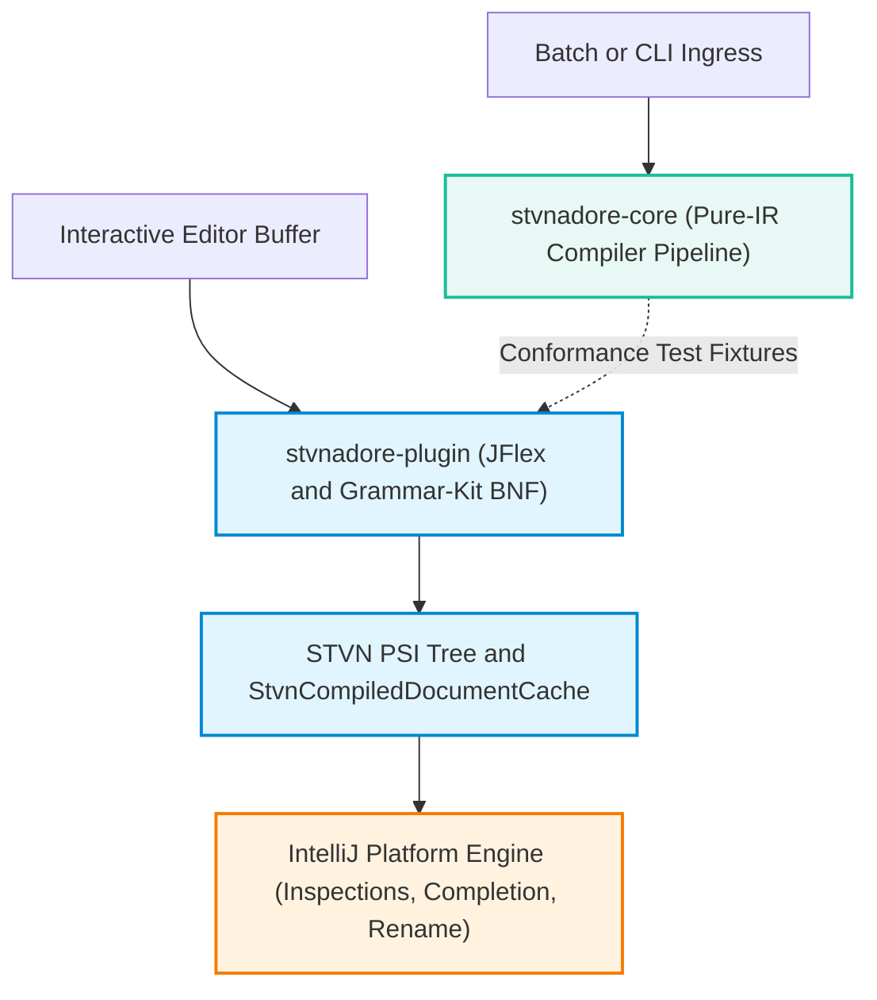
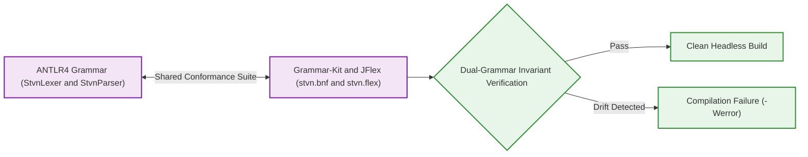
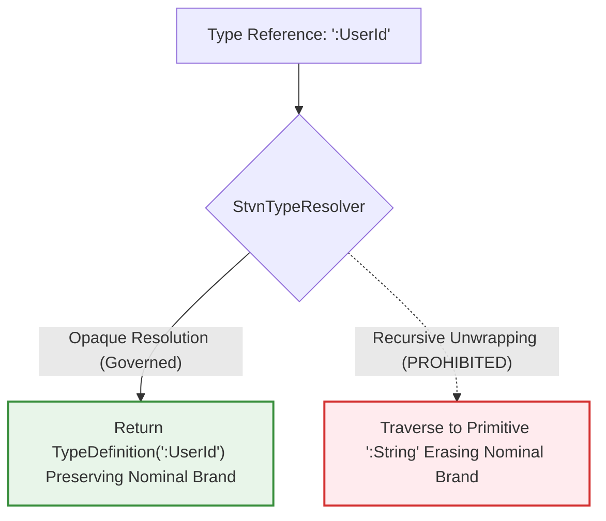
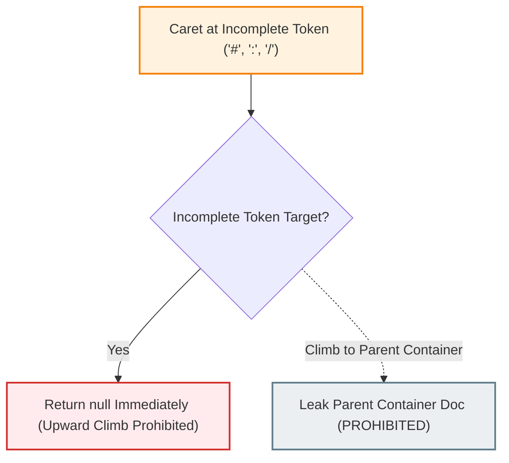
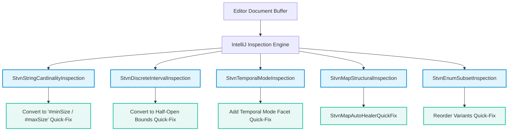

# STVN Architecture Specification: IntelliJ Platform Plugin & Interactive PSI Governance

**Document ID:** `STVN-SPEC-PLUGIN-01`  
**Status:** Canonical Architecture Specification  
**Version:** `2.0.0`  
**Target Repository:** `stvnadore-plugin` (`ij_stvnadore_plugin`)  
**Target Version Baseline:** `2.0.0-SNAPSHOT`  
**Governing Standard:** Simplified Technical English (STE-01 through STE-07)  
**Foundational Baselines:**  
- `STVN_LANGUAGE_SPEC.md` (STVN 2.0.0 baseline)  
- `STVN-VOP-MANIFESTO.md` (Value-Oriented Programming Canonical Foundations)  
- [`docs/architecture/STVN_REPOSITORY_SPEC.md`](file:///c:/Projects/Java/stvnadore/ij_stvnadore_repository/docs/architecture/STVN_REPOSITORY_SPEC.md) (STVN 2.0.0 baseline)  
- [`docs/architecture/STVN_CHESS_SHOWCASE_SPEC.md`](file:///c:/Projects/Java/stvnadore/ij_stvnadore_example_chess/docs/architecture/STVN_CHESS_SHOWCASE_SPEC.md) (STVN 2.0.0 baseline)  
**Toolchain:** Java 21 LTS | Gradle 8.x / 9.x (Configuration Cache Enabled) | IntelliJ Platform SDK 2025.3  

---

## 1. Scope & Dual-Grammar Synchronization Invariant

### 1.1 The Ecosystem Role of the IntelliJ Plugin

The STVN IntelliJ Platform plugin (`stvnadore-plugin`) serves as the interactive developer experience (DX) surface for the STVN ecosystem. While the upstream compiler (`stvnadore-core`) operates in headless, batch, or CLI contexts, the plugin executes inside the interactive IntelliJ editor thread under partial, unclosed, and syntactically incomplete keystroke sequences.

The plugin provides six primary capabilities:
1. **Interactive Lexical & Syntax Highlighting:** Provides token-accurate lexical classification via JFlex (`stvn.flex`) and Grammar-Kit BNF (`stvn.bnf`).
2. **Program Structure Interface (PSI) Tree Construction:** Builds an incremental PSI representation enabling code folding, navigation, and structural search.
3. **Opaque Nominal Reference Resolution:** Resolves cross-file and intra-file type references while strictly preserving opaque nominal type wrappers.
4. **Context-Aware In-Flight Auto-Completion:** Contributes schema-directed value templates, enum variants, and sum constructors without leaking parent container scopes.
5. **Real-Time Inspections & Automated Quick-Fixes:** Flags syntax violations, invalid facets, discrete bound errors, and structural layout mistakes directly in the editor buffer.
6. **Value-Oriented Rename Refactoring:** Executes atomic symbol renaming across schema declarations, usage sites, and standard library namespaces.

### 1.2 The Dual-Grammar Synchronization Invariant

The STVN ecosystem enforces a strict dual-grammar architecture:
- **Headless Authority:** ANTLR4 (`StvnLexer.g4` and `StvnParser.g4` in `stvnadore-core`).
- **Interactive Authority:** Grammar-Kit BNF (`stvn.bnf`) and JFlex (`stvn.flex` in `stvnadore-plugin`).

To prevent architectural drift and syntax divergence, the plugin adheres to the **Dual-Grammar Synchronization Invariant**:

$$\mathcal{T}_{\text{ANTLR4}} \equiv \mathcal{T}_{\text{JFlex}} \quad \land \quad \mathcal{P}_{\text{ANTLR4}}(s) \cong \mathcal{P}_{\text{Grammar-Kit}}(s)$$

For every source document $s \in \Sigma^*$:
1. **Token Taxonomy Identity:** Every terminal token recognized by `StvnLexer.g4` must have an exact equivalent token in `stvn.flex` with identical boundary rules.
2. **Parse Tree Homomorphism:** The hierarchical structure of the ANTLR4 parse tree must map homomorphically to the Grammar-Kit generated PSI tree.
3. **Compound Token Elimination:** All legacy compound tokens removed from ANTLR4 in STVN 2.0.0 (`:Uint4`, `:Int16`, `:String8`, `:StringFixed36`, `:SeqNonEmpty`, `:MapInv`) must be removed from `stvn.bnf` and `stvn.flex`. Both grammars parse base types qualified by metadata facet blocks.
4. **Strict Fenced String Delimiter & `MALFORMED_FENCE` Slot Isolation Invariant (Rule STR-04):** Both ANTLR4 (`StvnLexer.g4` / `StvnParser.g4`) and JFlex / Grammar-Kit (`stvn.flex` / `stvn.bnf`) strictly enforce delimiter pattern `"""[TAG]` without directional arrow syntax. Malformed triple-quoted openings (`"""->[TAG]`, inline `"""..."""`, untagged `"""\n...\n"""`, or invalid `[tag]`) and valid `"""[TAG_A]\n` blocks closed at depth 0 by a mismatched `[TAG_B]"""` delimiter (balancing any nested valid `"""[INNER]\n...[INNER]"""` blocks via a stateless method-local stack and enforcing negated bracket class `~[\r\n\[\]]*` before `]"""`) scan as a single `MALFORMED_FENCE` token admitted into `string_literal` so enclosing `:Tuple`, `:Seq`, `:Map`, and `MetadataMap` slots preserve exact sibling positional arity while unclosed fences reaching `EOF` fail closed with `BAD_CHARACTER`.
5. **27-Keyword `reserved_facet_keyword` Lookahead Boundary:** In `stvn.bnf`, `metadata_value` guards `facet_const_ref` with `!reserved_facet_keyword` across all 24 schema constraint facets plus `#name`, `#domain`, and `#kind`, preventing bare boolean traits (`#preserveIndent`, `#equatable`, `#comparable`) from consuming a following sibling facet as a `#CONST` argument.
6. **Layered Single-Line Escape Highlighting Invariant:** `StvnParserDefinition.createLexer()` preserves single-token `StvnTypes.LITERAL_STRING_SIMPLE` PSI `StringLiteral` nodes for exact AST homology with `StvnParser.g4`, whereas `StvnSyntaxHighlighter.getHighlightingLexer()` wraps `FlexAdapter(_StvnLexer)` in an IntelliJ `LayeredLexer` registering `StvnSimpleStringHighlightingLexer` strictly on `StvnTypes.LITERAL_STRING_SIMPLE`. Valid STVN escapes (`\"`, `\\`, `\/`, `\b`, `\f`, `\n`, `\r`, `\t`, `\uXXXX`) emit `StringEscapesTokenTypes.VALID_STRING_ESCAPE_TOKEN` (`VALID_STRING_ESCAPE`), invalid 2-character escapes emit `INVALID_CHARACTER_ESCAPE_TOKEN` (`[i, i + 2)`), malformed `\u` escapes inspect up to `4` characters halting strictly before `\`, `"`, `\r`, `\n`, or `\t` to emit `INVALID_UNICODE_ESCAPE_TOKEN` with 1:1 `[startOffset, endOffset)` span parity with Core `E002` (`STVN_LANGUAGE_SPEC.md` § 5.3.1), and Rule STR-04 verbatim fenced strings (`LITERAL_STRING_FENCED`, `MALFORMED_FENCE`) remain completely unsplit.

---

## 2. PSI Accessor & Opaque Nominal Resolution Governance

### 2.1 The Prohibition of Recursive Nominal Unwrapping

Under Value-Oriented Programming (VOP), nominal types represent distinct domain entities even when their structural definitions are identical:
$$\text{NominalSchema}(:UserId) \neq \text{NominalSchema}(:AccountId)$$

Legacy PSI resolvers implemented recursive schema unwrapping inside `StvnTypeResolver.resolveNominalSchema`. When resolving a nominal alias, the resolver repeatedly traversed the reference chain until reaching a primitive base type. This recursive unwrapping produced three severe architectural defects:
1. **Nominal Erasure:** Collapsed unique domain types into bare primitives (`:String`), destroying nominal boundaries in type inference.
2. **False Type Equivalence:** Treated `:UserId` and `:AccountId` as interchangeable types during auto-completion and validation.
3. **Cyclic Traversal Loops:** Induced editor thread hangs on recursive type definitions.

**Governance Mandate:** Recursive nominal unwrapping is prohibited. `StvnTypeResolver.resolveNominalSchema` must execute shallow resolution:
- When given a nominal reference (e.g. `:UserId`), the resolver must resolve to the authoritative `TypeDefinition` node representing that alias.
- The resolver must retain the nominal wrapper (`:UserId`) as an opaque type brand.
- The underlying structural schema is accessed only when evaluating physical payload conformance or formatting underlying type documentation.

### 2.2 PSI Navigation Contracts & Mixin Taxonomy

The plugin structures PSI nodes using dedicated mixins and navigation interfaces:

| Interface / Mixin | Implementing PSI Node | Architectural Role | Navigation & Reference Contract |
|:---|:---|:---|:---|
| `StvnTypeDefinitionMixin` | `TypeDefinition` (`:defs`) | Root type definition in `:defs`. | Implements `PsiNamedElement`, `StvnTypeDefinitionNode`. Provides `getName()`, `setName()`, and `getPresentation()`. |
| `StvnSchemaTypeMixin` | `SchemaType` (`:type`, `:defs`) | Schema expression container. | Resolves underlying constructor (`AtomicType`, `CollectionType`, `ProductType`, `SumType`) or nominal `TypeKeyword`. |
| `StvnConstantDefinitionMixin`| `ConstantDefinition` (`:defs`) | Value constant declaration. | Implements `PsiNameIdentifierOwner`. Enables navigation to constant references in `:body`. |
| `StvnUseMapAliasMixin` | `UseMapAlias` (`:use`) | Namespace-level import alias. | Implements `PsiNamedElement`. Maps fully qualified namespace identifiers. |

### 2.3 Pure-IR Compilation Cache & Diagnostic Routing Governance

The plugin enforces a strict pure-IR boundary (`HYGIENE-PLUGIN-03`) between IntelliJ PSI services and `stvnadore-core`:
- **Single-Pass Workspace Snapshot (`StvnCompiledDocumentCache`):** Compiles the active `PsiFile` and unsaved `:include` workspace overlays once per modification stamp into an immutable `StvnCompilationResult<StvnDocument>` snapshot (`StvnDefsCatalog`, `StvnSchema`, `StvnValue`, and `List<StvnDiagnostic>`). Zero ANTLR CST, `core.parser`, `core.ast`, or `core.lowering` classes cross into plugin source sets.
- **Multi-Hop Sum-Type Trajectory (`StvnSumTrajectory` & `StvnTypeResolver`):** Computes arbitrary-depth explicit and implicit `:Option`, `:Either`, and `:Union` step trajectories across both anonymous nested sum constructors (`:DeepTrajectory [#Some] [#Right] [#2] (-> :AckToken -> :String)`) and nominal intermediate coproduct aliases (`:OuterOpt [#Some] (-> :MidEither [#Right] (-> :LeafUnion [#2] (-> :AckToken -> :String)))`) over pure-IR `StvnValue` (`StvnOption`, `StvnEither`, `StvnUnion`) nodes with PSI fallback. Each step records its `anchorPsiValue` so clicking inferred step `k` in `StvnInlayHintsCollector` materializes all unmaterialized prefix steps `0..k` in reverse offset order without triggering `E024 / ERR_AMBIGUOUS_SUM_INFERENCE`.
- **Cross-File Diagnostic Attribution (`StvnDiagnostic.sourcePath()`):** `StvnExternalAnnotator` compares normalized `diag.sourcePath()` against the active editor file path. Diagnostics originating in an included `.stvn_d` or `.stvn_di` module route directly to the matching `:include` `StringLiteral` with `OpenIncludedFileQuickFix`, while `StvnDiagnosticAnnotatorMapping` resolves governing local inspections by prioritizing `diag.symbolicId()` over many-to-one `diag.canonicalCode()` buckets.

### 2.4 Two-Hop `:use` Alias Navigation, Transitive Constant Hover & Nearest-Explicit `#VARIANT` Navigation

- **Two-Hop `:use` Alias Navigation (`StvnGotoDeclarationHandler`):**
  - **Hop 1 (Usage Site -> Local Alias):** Invoking `Goto Declaration` (`Ctrl+Click` / `Ctrl+B`) on a renamed `:use` symbol (`#ACTIVE_RELEASE`, `:ReleaseTag`) across `:defs`, `:type`, or `:body` navigates first to the local `UseMapAlias` RHS (`index 1`) declaration token.
  - **Hop 2 (Alias -> Upstream Declaration):** Invoking `Goto Declaration` on either the LHS (`index 0`) or RHS (`index 1`) token inside `UseMapAlias` navigates directly to the upstream `ConstantDefinition` or `TypeDefinition` across transitive and diamond `:include` module graphs or the Standard Library Prelude.
  - **Diamond Module & § 4.2 Eviction Cascade Parity (`StvnTypeReference` & `StvnConstantReference`):** Per-branch cycle-safe `visited` sets and `PsiManager.areElementsEquivalent` target deduplication resolve diamond `:include` graphs (`10C -> 10A` and `10C -> 10B -> 10A`) unambiguously while enforcing combined `{ #strip } { :Orig :Alias #ORIG #ALIAS }` LHS eviction (Asymmetric Alias vs. Raw and Dual Alias Eviction).
  - **1-Hop `#strip` & FQNI Direct Resolution:** Unrenamed `{ #strip }` projections (`:SettlementEntry`) and package-qualified FQNIs (`#acme/security/SEC_CONTACT`) continue to navigate directly to the upstream declaration in 1 hop.
  - **`PsiReference.resolve()` Caller Isolation:** `StvnTypeReference.resolve()` and `StvnConstantReference.resolve()` continue returning the local `UseMapAlias` RHS token on renamed aliases so `Shift+F6` Rename and `Find Usages` rename only local alias bindings without mutating upstream package declarations. Package-local `:use` directives remain isolated inside their enclosing `PackageEnclosure` and never leak into top-level file lookups.
- **Transitive `:use` Constant & `:body` `#ENUM`/`#CONST` Hover Compliance Parity (`StvnDocumentationProvider`):** Hovering on a `:use`-imported `#CONST` reference displays `Renamed Reference: #LOCAL -> #pkg/REMOTE` (using canonical `#` value sigils via `StvnConstantReference.buildPackageConstantFqni`) chained with the full upstream `ConstantDefinition` documentation card (`Typed Constant`, `Type`, terminal `Value`, and Four-Locus temporal `UTC Preview` / `UTC Time`). When hovering any non-degraded `#ENUM` variant or `#CONST` reference inside `:body`, `StvnDocumentationProvider` renders `<nobr><b>Slot Schema:</b> <code>...</code></nobr>` (formatted with any active multi-hop sum trajectory) and `<b>Compliance Status:</b>` (`Satisfied` in green when clean, or `In Violation` in red with active-file-filtered `StvnDiagnostic` prose and verified `Exemplar Value:` when violated), while strictly omitting `:body` rows on `:defs` declarations and references.
- **Nearest-Explicit `#VARIANT` Navigation Guarded by `#filterExcl` (`StvnTypeResolver.resolveEnumVariantNavigationTarget`):**
  - **Root `:Enum[...]` & Unconstrained Projections:** Navigating from `#VARIANT` in `:body` or `ConstantDefinition` RHS governed by a root `:Enum[...]`, an unconstrained nominal alias, an implicit sum wrapper (`:Option(:SettlementState)`), or a `#strip` import lands directly on the `#VARIANT` `ValueKeyword` inside `:Enum[...]`.
  - **Positive `#filterIncl` Two-Hop Narrowing:** When governed by a schema declaring `#filterIncl [...]` (without `#filterExcl`), Hop 1 lands on the matching `#VARIANT` inside `#filterIncl [...]`; Hop 2 from `#filterIncl [...]` lands on the ancestor `#filterIncl` or root `:Enum[...]` `#VARIANT`.
  - **Negative `#filterExcl` & Degraded Mutex Guard:** When the nearest restricting schema declares `#filterExcl [...]` (or conflicting `#filterIncl` + `#filterExcl`), `#VARIANT` is not positively listed on that subtype, so navigation halts at the restricting `TypeDefinition` (or inline `SchemaType`) rather than bypassing the exclusion boundary.

---

## 3. Interactive In-Flight DX & Caret Resolution Invariants

### 3.1 Strict Upward Traversal Prohibition

During typing, an author frequently leaves tokens in an incomplete state (such as `#`, `:`, `/`, or unclosed quotes `"`). 

**The Strict Upward Traversal Invariant:** When resolving the caret context or hover documentation for an incomplete token, PSI visitors and documentation providers must never climb the AST to parent container nodes.

If the element under the caret matches any of the following conditions:
1. An unadorned sigil token (`#` or `:`),
2. A path separator token (`/`),
3. A `TokenType.BAD_CHARACTER`,
4. A `PsiErrorElement`,
5. Interior whitespace within a container literal (`PsiWhiteSpace`),

The resolver must immediately return `null`. It must not ascend to the enclosing `TupleLiteral`, `ListLiteral`, `MapLiteral`, or `BodyEntry`.

### 3.2 Container Documentation Isolation

Hovering over interior whitespace, delimiters, or incomplete elements within a collection literal must never display the documentation of the parent collection. Documentation is isolated strictly to:
- Explicit container boundary delimiters (when hovering directly on `(` or `{`),
- Fully completed inner elements.

### 3.3 Sigil Prefix Matching Discipline

Code completion must adhere to strict sigil prefix matching:
- Typing numeric digits (e.g. `1`, `2`) must never pro-offer `#`-prefixed auto-completion items (such as `#1`, `#2`, or enum variants) unless the author has explicitly typed the `#` sigil.
- The plugin enforces this discipline via `StvnSigilPrefixMatcher`, which wraps the IntelliJ platform `PrefixMatcher` and filters out `#` suggestions for numeric inputs.

### 3.4 Degraded Schema Sentinel Preservation

When a schema in `:defs` contains constraint errors (such as discrete bound violations, conflicting mutually exclusive facets, incomplete trait facets, invalid facets, or syntax errors), the PSI resolver must not crash with `NullPointerException` or discard the schema entirely.

The plugin treats the schema as a **Degraded Schema Sentinel**:
- Concise base-type formatting (`StvnSchemaFormatter.formatDegradedUnderlyingBaseIr` / `formatDegradedUnderlyingBasePsi`) collapses degraded `:Enum` and `:EnumSubset` schemas to `:Enum` without inline variant lists across `PW006`, `:type` warnings, and hover banners.
- Hovering over a `:body` value governed directly by a degraded or ungrounded schema — or nested inside an enclosing `:body` container (`:Seq`, `:Set`, `:Map`, `:Tuple`, `:Option`, `:Either`, `:Union`) whose container schema is degraded — routes `StvnDocumentationProvider` to the governed `Value` compliance card, rendering the yellow **Degraded Schema Warning** banner and `Compliance Status: Suspended (Degraded Schema)` (omitting `Exemplar Value:` and never falsely reporting `Satisfied`) while keeping `PsiReference.resolve()` (`Ctrl+Click`) symbol navigation intact:
  > **⚠️ Degraded Schema Warning**  
  > Nominal type `:<alias>` contains constraint errors in `:defs` (underlying base type: `:<base>`).  
  > Payload evaluation is suspended.
- Payloads in `:body` continue to receive syntax highlighting, multi-hop degraded type traces (`⚠ :Child -> :Parent -> :Enum`), and basic base-type auto-completion based on the fallback schema.
- When a `:body` value references a `:defs` `ConstantDefinition` that is poisoned by a circular constant reference (`E023`) or an invalid constant definition, `StvnExternalAnnotator` emits `[stvn-plugin:PW006-WARN_POISONED_CONSTANT_USAGE]` (`HighlightSeverity.WARNING`, `count == 1` across `Pass A` and `Pass B`) with 1-click `JumpToConstantDeclarationIntention` (`Jump to '<#CONST>' declaration in :defs`), `StvnDegradedSchemaInspection` yields to prevent stacked `PW006` warnings on already-degraded slots, and `StvnTypeResolver` / `StvnInlayHintsCollector` render degraded `⚠ <SlotType>` inlay badges (`⚠ :Int`, `⚠ :SensorGainCode (-> :Int)`, `⚠ :CouplerPairTuple (-> :Tuple)`, `⚠ :OptAltitudeCm`) across State A and State B while suppressing inlays on `E027`, `E028`, and `E030` error slots.

### 3.5 Four-Locus Temporal `UTC Preview` / `UTC Time`, Anti-Wrap `<nobr>` & Concise `Default (:Enum)` Origin Contracts

- **Four-Locus Temporal Hover Parity (`:TimeEpoch` & `:DateTime`):** `StvnDocumentationProvider` renders deterministic ISO-8601 `UTC Preview` and human-readable `UTC Time` (`HOUR_12` / `HOUR_24` user preference via `StvnTimeEpochFormatter.formatInstantHumanUtc`) rows across all four temporal authoring and reference loci:
  1. `:defs` LHS `#CONST` declaration (`ConstantDefinition` card),
  2. `:defs` RHS literal or chained `#CONST` value (`Constant Value` card with `Locus: Constant Definition (:defs clause)`),
  3. `:body` `#CONST` reference across top-level, nested `:Tuple`/`:Seq`/`:Set`/`:Map`, and implicit `:Option`/`:Either`/`:Union` slots (`Slot Schema` + `Temporal Scale` / `Temporal Mode` + `UTC Preview` + `UTC Time`), and
  4. `:body` direct integer or string literal (`Payload Value` card).
- **Four-Locus Suspicious Epoch Magnitude Parity (`StvnSuspiciousEpochMagnitudeInspection` <-> `StvnDocumentationProvider`):** Both the hover `Suspicious Epoch Magnitude Warning` banner and editor `PW006 / WARN_SUSPICIOUS_EPOCH_MAGNITUDE` squigglies delegate to `StvnTimeEpochFormatter.format` (`isMagnitudeMismatch() || isCivilWindowViolation()`, STE singular/plural `"1 digit"` vs. `"<N> digits"`, gated by `StvnSettings.showEpochMagnitudeWarnings`). In `:defs`, warnings pin to the LHS `ConstantDefinition` `#CONST` identifier (with on-the-fly `INFORMATION` rescale/scale fixes on direct RHS integer literals); in `:body`, warnings pin directly to `#CONST` `ValueKeyword` references and `IntegerLiteral` tokens.
- **Schema Header `<nobr>` Anti-Wrap Protection:** Single-line schema metadata rows (`Type:`, `Slot Schema:`, `Temporal Scale:`, `Temporal Mode:`, `Value Type:`, and `Governing Schema:`) wrap their `<b>Label:</b> <code>...</code>` segments in `<nobr>...</nobr>` so Swing `HTMLEditorKit` never splits compound signatures such as `{ #offset } :DateTime` across lines.
- **Canonical Quoted Fenced `[REGEX]` Hover Presentation:** Fenced string `#regex` facets and `:String` bounds (`"""[REGEX]...[REGEX]"""` in `prelude.stvn_core.stvn_d` and user schemas) are decoded via `StvnPsiLiteralEvaluator.decodeStringLiteral(..., false)` (`Rule STR-04`) and rendered in hover tables and constraint headers as compact canonically escaped double-quoted strings via `StvnPsiLiteralEvaluator.formatCanonicalQuotedString(...)`.
- **128-Bit Floor-Adjusted Epoch & DST-Gap Safety:** `StvnTimeEpochFormatter` parses decimal, underscore, hexadecimal (`0x`), binary (`0b`), and octal (`0o`) tick literals via `StvnPsiLiteralEvaluator.parseBigInteger`, floor-adjusts negative sub-second remainders (`-1` `#ms` -> `1969-12-31T23:59:59.999Z`), and converts arbitrary-precision 128-bit ticks into proleptic Gregorian ISO-8601 UTC strings using pure-`BigInteger` 400-year (`146,097`-day) era arithmetic without `Instant` range overflow. For `:DateTime` (`#offset`, `#zoned`, `#audited`), `UTC Preview` and `UTC Time` render strictly when `StvnCompiler.validateDateTimeLiteral(rawQuoted, mode).isEmpty()`, suppressing nonexistent Spring-forward DST-gap timestamps and mismatched `#audited` offsets without throwing exceptions.
- **Concise `Default (:Enum)` Origin:** In `Effective Facets & Traits` hover tables, `formatDefaultOriginBaseType` normalizes `:Enum [...]` constructor signatures to `:Enum` so default trait rows display `Default (:Enum)` (`STE-07`) while `Underlying Structure:` continues to display the full active variant list.

---

## 4. Live Inspection & Intention Quick-Fix Contracts

The plugin provides real-time in-editor inspections and automated intention quick-fixes to maintain language standards:

### 4.1 `StvnStringCardinalityInspection`
- **Target Locus:** `TypeDefinition`, `ConstantDefinition`, and inline `SchemaType` nodes resolving to `:String`.
- **Defect Detection:** Detects `#size` applied to `:String` with 1:1 compiler coordinate and STE prose parity (`Facet '#size' is prohibited on :String; use '#minSize' and '#maxSize' (e.g. { #minSize N #maxSize N } :String)`).
- **Diagnostic Code:** `E008 / ERR_STRING_CARDINALITY_PROHIBITED`.
- **Intention Quick-Fixes:** Across both `Pass A` (`StvnExternalAnnotator`) and `Pass B` (`StvnStringCardinalityInspection`) on root `:String` constructors with positive `<N>` (`IntegerLiteral` or `#CONST`), offers primary `Convert '#size <N>' to '#maxSize <N>'` (`Priority.TOP`, preserving compatible `#minSize <= <N>` and suppressed when an existing `#minSize > <N>` would create `E009`), secondary `Convert '#size <N>' to '#minSize 1 #maxSize <N>'` (`Priority.HIGH`), and fixed-length `Convert '#size <N>' to '#minSize <N> #maxSize <N>'` (`Priority.NORMAL`, deduplicated when `<N> == 1`). When `<N> == 16777216` (`StvnVocabulary.DEFAULT_MAX_SIZE`), offers `Use default 16777216 ':String' capacity (remove '#size <N>')` (`Priority.TOP`), `Convert '#size <N>' to '#minSize 1'` (`Priority.HIGH`), and `Convert '#size <N>' to '#minSize <N>'` (`Priority.NORMAL`) to avoid redundant `#maxSize 16777216` (`W003`). Non-positive `#size 0` / negative values and derived nominal `:String` aliases offer strictly `Remove prohibited facet '#size ...'` (`Priority.HIGH`).

### 4.2 `StvnDiscreteIntervalInspection`
- **Target Locus:** `TypeDefinition`, `ConstantDefinition`, and inline `SchemaType` nodes declaring discrete or ordered intervals across `:Int`, `:Float` (continuous and `{ #exact }`), `:String` (unsigned UTF-8 byte order), `:TimeEpoch`, and `:DateTime`.
- **Defect Detection:**
  - Flags closed upper bounds (`#maxIncl`) and open lower bounds (`#minExcl`) on discrete domains (`:Int`, `{ #exact } :Float`, `:TimeEpoch`, `:DateTime`). STVN 2.0.0 enforces half-open intervals $[minIncl, maxExcl)$ on discrete types.
  - Flags empty interval domains (`ERR_EMPTY_INTERVAL_DOMAIN`) and inverted bound ranges (`ERR_INVERTED_RANGE`) with 1:1 `StvnDefsLowerer.resolveBoundPairSpan` coordinate pinning: adjacent local bounds (`|minIdx - maxIdx| == 1`) pin `metaMap` sub-range `[earlier .. later)` so `{`, `}`, and sibling facets remain clear; non-adjacent local bounds (`|minIdx - maxIdx| > 1`) pin `later` (`MetadataEntry`) with a silent `INFORMATION` quick-fix anchor on `earlier`.
  - Validates `:DateTime` bounds against effective `DateTimeMode` (`OFFSET`, `ZONED`, `AUDITED`) via `StvnCompiler.validateDateTimeLiteral` prior to instant comparison, deferring mode/format violations cleanly to Core `E019` / `E028`.
- **Diagnostic Codes:** `ERR_DISCRETE_BOUND_KIND_PROHIBITED` (`E011`), `ERR_EMPTY_INTERVAL_DOMAIN` (`E009`), `ERR_INVERTED_RANGE` (`E009`), `MUTUALLY_EXCLUSIVE_BOUNDS` (`E008`).
- **Intention Quick-Fixes (`IntentionPreviewInfo.DIFF` Safe):**
  - Converts `#maxIncl <N>` to `#maxExcl <N+1>` and `#minExcl <N>` to `#minIncl <N+1>`.
  - `SwapInvertedBoundsQuickFix` (`LocalQuickFixAndIntentionActionOnPsiElement`) swaps inverted value bounds (`#minIncl`/`#minExcl` vs. `#maxIncl`/`#maxExcl`) and cardinality bounds (`#minSize` vs. `#maxSize`) in place with full `IntentionPreviewInfo.DIFF` preview support.

### 4.3 `StvnTemporalModeInspection`
- **Target Locus:** Declarations of `:TimeEpoch` and `:DateTime`.
- **Defect Detection:**
  - Flags bare `:TimeEpoch` lacking an explicit standalone scale flag (`#ns`, `#us`, `#ms`, `#s`), pinned directly to the `:TimeEpoch` `AtomicType` token.
  - Flags bare `:DateTime` lacking an explicit mode facet (`#offset`, `#zoned`, `#audited`), pinned directly to the `:DateTime` `AtomicType` token.
  - Flags mutually exclusive temporal scale or mode facets declared simultaneously in the same metadata block, pinning `GENERIC_ERROR` strictly to conflicting facets (`i >= 1`) while exposing silent `INFORMATION`-level `Alt+Enter` fixes on `i == 0`.
- **Diagnostic Codes:** `ERR_MISSING_TEMPORAL_FACET` (`E008`), `MUTUALLY_EXCLUSIVE_BOUNDS` (`E008`).
- **Intention Quick-Fixes:** Inserts default standalone temporal flags (`{ #ms } :TimeEpoch` or `{ #offset } :DateTime`), keeps only the selected facet, or removes a conflicting facet (`Remove conflicting facet '<facet>'`).

### 4.4 `StvnMapStructuralInspection`
- **Target Locus:** Map literals and map collection type declarations.
- **Defect Detection:**
  - Flags flat list literals (`[ k v k v ]`) supplied to map slots.
  - Enforces canonical map literal envelope `{ [ key value ] }`.
  - Enforces `#invertible` dual-set uniqueness on map payloads.
- **Diagnostic Code:** `ERR_MAP_STRUCTURE_INVALID`.
- **Intention Quick-Fix:** `StvnMapAutoHealerQuickFix` automatically restructures flat list entries into paired bracket tuples `[ key value ]` inside outer curly braces.

### 4.5 `StvnEnumSubsetInspection` & Per-Variant Enum Quick-Fixes
- **Target Locus:** `TypeDefinition`, `ConstantDefinition`, and standalone/inline `SchemaType` nodes declaring `#filterIncl` or `#filterExcl`, plus `:body` and `ConstantDefinition` values governed by `:Enum` or `:EnumSubset` schemas.
- **Defect Detection:**
  - Enforces monotonic narrowing (`E014 / ENUM_SUBSET_NOT_SUBSET`), root declaration ordering (`E015 / ENUM_SUBSET_ORDER_VIOLATION`), duplicate filter variant detection (`E008 / ERR_FILTER_DUPLICATE_VARIANT`), non-empty filter lists (`E016 / ERR_FILTER_EMPTY_LIST`), non-empty active subsets (`E016 / ENUM_SUBSET_EMPTY`), prohibited filter attachments (`E008 / ERR_FILTER_ON_INLINE_ENUM`, `ERR_FILTER_ON_NON_ENUM`, `ERR_FILTER_ON_CONSTANT` deconflicted with `StvnMetadataFacetInspection`), and `#filterIncl` / `#filterExcl` mutual exclusivity (`E008 / MUTUALLY_EXCLUSIVE_BOUNDS` pinned to `i >= 1`).
  - Flags subset-excluded variants with `E012 / ERR_CONSTRAINT_VIOLATION` and undeclared variants with `E028 / ERR_TYPE_MISMATCH` across both `:body` slots and nominal `#CONST` RHS values while exempting declared `#CONST` references.
- **Intention Quick-Fixes:** Across both `Pass A` and `Pass B`, `StvnReorderEnumFilterVariantsQuickFix` sorts filter variants into root declaration order; `StvnRemoveFilterVariantQuickFix` (`Remove '<#VARIANT>' from '<#filterIncl|#filterExcl>'`) and `StvnRemoveDuplicateFilterVariantQuickFix` (`Remove duplicate variant '<#VARIANT>'`) excise offending tokens with zero interior bracket padding (`[#A #B]`); `RemoveRedundantFacetQuickFix.createRemoveFacetFix` (`Remove '<facetSnippet>' facet`) removes 1-token invalid filters, empty filter lists (with disjoint `#filterIncl` <-> `[]` `INFORMATION` reachability), complete-exclusion filters, and prohibited filter attachments while excising sole comment-free `{}` blocks; `Remove conflicting facet '<facet>'` resolves mutual exclusivity; and `StvnPayloadValueQuickFixProvider` offers ordered per-variant `Replace with '<#VARIANT>'` actions across all active variants.

### 4.6 `RemoveInvertibleFacetQuickFix` & Co-Located Inverted Map Trait Actions
- **Target Locus:** `#invertible` `MetadataEntry` nodes, inline `:Float` map values, inline composite/coproduct value constructors (`:Union`, `:Tuple`, `:Option`, `:Either`, `:Seq`), and nominal value schemas (`:SampleReading`) in inverted map declarations (`{ #invertible ... } :Map(...)`).
- **Defect Detection:** Intercepts `ERR_TRAIT_VIOLATION` with diagnostic message `"Inverted map values require types to be #equatable #TRUE"`.
- **Resolution Behavior:** Removes the `#invertible` facet from nominal map definitions or anonymous map constructors (`PriorityAction`, `equals`/`hashCode`, `@SafeFieldForPreview` `IntentionPreviewInfo.DIFF` and cross-file `IntentionPreviewInfo.CustomDiff` safe).
- **Syntax Hygiene Guard:** If `#invertible` is the sole comment-free entry in the metadata block, the fix deletes the entire `{}` block to prevent `ERR_EMPTY_METADATA_BLOCK` (STVN Spec § 3.5.1).
- **Co-Located Availability:** When the caret sits directly inside `#invertible` or its enclosing `MetadataMap`, offers `RemoveInvertibleFacetQuickFix`; when the caret sits on an offending value schema (nominal or nested inline composite/coproduct), offers local inline capability restoration (`RestoreInlineSchemaEquatableQuickFix` where applicable), deduplicated non-equatable constituent fixes (`JumpToNominalTraitDeclarationIntention` `EMPTY`, guard-checked `AddExactConstraintQuickFix` `#exact`, 5-tier-ordered `ChangeNominalOverrideQuickFix` `#equatable #TRUE`), **and** co-located `RemoveInvertibleFacetQuickFix` (`0` conformant constituent leaks).

### 4.7 `AddExactConstraintQuickFix` & Canonical 5-Tier Trait Insertion
- **Target Locus:** Direct built-in continuous `:Float` `SchemaType` leaves (matched strictly via `ctor.getAtomicType()` rather than substring `.contains(":Float")` on enclosing `:Union`/`:Tuple` wrappers) and nominal continuous `:Float` `TypeDefinition` declarations in `:defs` referenced from equatability-requiring positions (`#invertible` map values, standard map keys, set elements, and nested inline composite/coproduct leaves).
- **Defect Detection:** Intercepts `ERR_TRAIT_VIOLATION` targeting inline continuous `:Float` (`Add '{ #exact }' constraint to :Float`, disambiguated as `... (Field #k)` when `>= 2` inline `:Float` leaves co-exist inside one wrapper) or nominal `:Float` alias lineages free of conflicting `#size`, `#minExcl`, and `#maxIncl` facets (`Add '#exact' to <Type> in :defs`), alongside `Add '{ #equatable #TRUE }' to inline :Float` (`RestoreInlineSchemaEquatableQuickFix`).
- **Resolution Behavior:** Replaces unadorned `:Float` with `{ #exact } :Float`, or inserts `#exact` (`1120`) and `#equatable #TRUE` (`2100`) at their canonical § 6.1 5-tier rank via `StvnMetadataFacetInsertionUtil.insertOrReplaceSingleFacet` without introducing secondary `E008 / ERR_FACET_ORDER_VIOLATION` diagnostics, with cross-file `IntentionPreviewInfo.CustomDiff` previews on included modules.
- **Capability Restoration:** Under STVN Spec § 6.2, `#exact` elevates `:Float` to discrete arbitrary-precision decimal representation, restoring `#equatable #TRUE`.
- **Conflict Prevention:** Purges any conflicting `#size` facet on inline `:Float` per STVN Spec § 6.1 mutual exclusivity rules, and suppresses `#exact` offers whenever inline `:Float` declares `#minExcl` / `#maxIncl` or any alias along a nominal lineage declares `#size`, `#minExcl`, or `#maxIncl`.

### 4.8 Comment-Preserving `:meta` & `MetadataMap` Reordering and `:meta` Token Authority
- **Target Locus:** Root `:meta` sections (`StvnMetadataOrderInspection` / `StvnReorderMetaEntriesQuickFix`), schema `MetadataMap` constraint blocks (`StvnReorderMetadataFacetsQuickFix`), `Ctrl+Alt+L` pre/post-format processors (`StvnMetadataOrderPreFormatProcessor`, `StvnCoreDelegationPostFormatProcessor`), and root `:meta` identity inspections (`StvnMissingMetaInspection`, `StvnStemMismatchInspection`).
- **Comment & Blank-Line Slice Invariant (Golden Quartet #14 Parity):**
  - Partitioning attaches contiguous standalone `//` comments and same-line `//` comments to each `:meta` or `MetadataMap` entry slice (`CommentedEntrySlice`) while preserving trailing footer `//` comments before `}`.
  - Blank lines emit strictly when `newlinesSincePrevItem >= 2`; consecutive standalone `//` comments (`newlines == 1`) never fabricate blank lines, and enclosure-top blank lines immediately after `{` (`entryIdx == 0`) never fabricate inter-entry blank lines after permutation.
  - In `PSI_STRUCTURE_PRESERVING` mode, `StvnMetadataOrderPreFormatProcessor` snapshots pre-format coordinates so `StvnBlock` and `StvnCoreDelegationPostFormatProcessor.reanchorAlignedTrailingComments` collapse interior multi-spaces and pad aligned trailing comments (`>= 2` authored spaces) to their original target columns, matching `StvnSourceFormatter` (`source_pretty/14_comment_preserving_meta_and_facet_reordering.core_fmt.stvn_i` and `source_pretty/15_const_trait_facets_and_temporal_enum_comments.core_fmt.stvn_i`) byte-for-byte.
  - **Mutex-Group Rank Stabilization (`createMutexStabilizedEntryRanker`):** Across all 6 mutually exclusive facet groups (`#ns..#s`, `#offset..#audited`, `#size`/`#exact`, `#minIncl`/`#minExcl`, `#maxIncl`/`#maxExcl`, `#filterIncl`/`#filterExcl`), `StvnMetadataOrderInspection` suppresses secondary `E037 / ERR_FACET_ORDER_VIOLATION` cascades on 2nd+ co-occurring group members and stabilizes their sort rank to the first encountered group member so `Ctrl+Alt+L` and `StvnReorderMetadataFacetsQuickFix` never flip reverse-ordered mutually exclusive pairs (`{ #s #ms }`).
- **Authoritative 5-Character `KW_META` Pinning, Keyword-Token `:meta` `E008` Pinning & `MetaUnknownFacet` Homology:**
  - `W002` (`WARN_DOCUMENT_DOMAIN_OMITTED_IN_META`) and non-empty `:meta` omitted-`#kind` `E031` (`ERR_DOCUMENT_KIND_MISMATCH`) anchor strictly to the 5-character `KW_META` (`:meta`) token across both `StvnExternalAnnotator` (via upstream `stvnadore-core`) and governed local inspections (`StvnStemMismatchInspection`, `StvnMissingMetaInspection`) with zero downstream coordinate clamping and zero duplicate highlights.
  - Both root `:meta` 3-tier (`KW_META_NAME`, `KW_META_DOMAIN`, `KW_META_KIND`) and schema `MetadataMap` 5-tier (`resolveMetadataEntryKeywordPsi`) `E008` (`ERR_FACET_ORDER_VIOLATION`) diagnostics pin strictly to the offending facet keyword token (`[kw.startOffset, kw.endOffset)`), guaranteeing `kw.endOffset <= val.startOffset` (`0` overlap with `W001`, `W002`, `E038`, invalid-POSIX `E008`, or trailing `MetadataValue` / `VariantList` arguments).
  - In `stvn.bnf`, `meta_name_facet`, `meta_domain_facet`, and `meta_kind_facet` omit premature `pin=1` and `meta_unknown_facet` guards its optional argument with `!meta_facet_boundary` (`RBRACE | KW_META_NAME | KW_META_DOMAIN | KW_META_KIND`). Non-conforming entries such as `#name 42` fall through cleanly to `MetaUnknownFacet`, record `#name`/`#domain`/`#kind` in `seenMetaFacets` (`StvnMetadataFacetInspection`) and `seenTiers` (`StvnMetadataOrderInspection`), and suppress secondary `E031` cascades during active `#kind` typing (`StvnMissingMetaInspection`).

### 4.9 `StvnRedundantFacetOverrideInspection` (`W003 / WARN_REDUNDANT_METADATA_FACET` 1:1 Deconfliction)
- **Target Locus:** All schema `MetadataMap` blocks across `:defs` (`TypeDefinition`, `ConstantDefinition`), root `:type` (`TypeEntry`), and inline schema constructors (`SchemaType`).
- **1:1 Core Deconfliction:** Mapped in `StvnDiagnosticAnnotatorMapping` to `DiagnosticBag.WARN_REDUNDANT_METADATA_FACET` (`W003`). When enabled, `StvnExternalAnnotator` yields `W003` emission exclusively to `StvnRedundantFacetOverrideInspection` (`[stvn-plugin:W003-WARN_REDUNDANT_METADATA_FACET]` + `RemoveRedundantFacetQuickFix`), and `hasOverlappingFatalDiagnostic` exempts non-poisoning `ERR_FACET_ORDER_VIOLATION` so co-located `E008` + `W003` entries (`{ #minIncl 10 #size 32 } :Int`) emit identically across `Pass A` and `Pass B`. When disabled in the user's inspection profile, `StvnExternalAnnotator` surfaces the identical `[startOffset, endOffset)` `MetadataEntry` spans and STE prose as `[stvn-core:W003-WARN_REDUNDANT_METADATA_FACET]` with zero stacked warnings (`count(range, code) == 1`).
- **Pure-PSI Fallback:** When unrelated Pass 1 syntax errors prevent full Pass 2 compilation, the inspection evaluates root tautologies (`#size 32` on `:Int`, `#size 64` on continuous `:Float`, `#minSize 0`, `#maxSize 16777216`, `#preserveIndent #FALSE` on `:String`, natural bit-width bounds, intrinsic `#equatable` / `#comparable` traits) and nominal-parent overrides across `:Int`, `:Float`, `:String`, `:TimeEpoch`, `:DateTime`, and `:Enum` `#filterIncl` subsets directly over PSI and `#CONST` chains.

### 4.10 `StvnFlatDocumentIncludeInspection` & `StvnUnresolvedUsePackageQuickFixProvider` (Hermetic `:include` `E005` & Unresolved `:use` `E030` / `E035` 1:1 Governance)
- **Target Locus:** `IncludeStmt` in hermetic compilation units (`.stvn`, `.stvn_d`, `.stvn_b`, `.stvn_bd`, or explicit `:meta` `#kind #BODY` / `#DEFS`) and unresolved `UseTarget` package nodes across both modular units (`E030 / UNDEFINED_TYPE` in `.stvn_i` / `.stvn_di`) and hermetic units (`E035 / ERR_UNRESOLVED_PACKAGE_IN_HERMETIC_DOCUMENT` in `.stvn` / `.stvn_d`).
- **Defect Detection & 1:1 Core Parity:**
  - Flags `:include` statements in hermetic units via `prohibitsIncludeStatements(file)` with exact `StvnDefsLowerer` coordinate and STE prose parity (`Hermetic document or schema (.stvn, .stvn_d, .stvn_b, .stvn_bd) cannot contain include statements: <fileName>`, `E005 / ERR_INCLUDES_PROHIBITED_IN_FLAT_DOCUMENT`), while suppressing secondary duplicate `:defs` cascades via `StvnMetaTemplateUtil.isInSecondaryRootSection`.
  - Flags scoped `:use` directives in hermetic documents targeting packages outside `StvnPrelude.isPreludePackageTarget(target)` and locally declared non-reserved `:defs` packages (`:package :pkg`, `:pkg/Type`, `#pkg/CONST` with hierarchical prefix matching and `StvnNamespaceRules.isReservedPackage` exclusion), pinned strictly to `useElement.getUseTarget()` (`E035 / ERR_UNRESOLVED_PACKAGE_IN_HERMETIC_DOCUMENT`) while suppressing secondary emission when `StvnTrailingSlashInspection.hasTrailingSlash(useTarget)` (`E002`) or incomplete bare `:` tokens are present.
  - Modular include units (`.stvn_i` and `.stvn_di`) remain governed by `StvnExternalAnnotator` (`E030 / UNDEFINED_TYPE`) across transitive `:include` graphs, while `StvnUnresolvedUsePackageQuickFixProvider` attaches identical quick-fix lists across `Pass A` (`StvnExternalAnnotator`) and `Pass B` (`StvnFlatDocumentIncludeInspection`) with `0` duplicate highlights or intentions.
- **Three-Tier Unresolved `:use` Remediation Suite (`UUPG-01`):**
  - **Fix 1 — Direct Workspace Auto-`:include` (`StvnIncludeModuleForPackageQuickFix`, `Priority.TOP`, Modular `.stvn_i` / `.stvn_di`):** Scans non-cyclic workspace `.stvn_d` and `.stvn_di` modules (deduplicated via `StvnTypeReference.resolveIncludeFile` normalized `VirtualFile` identity and `./`-stripped relative paths, preserving leading `./` sibling conventions) and offers `Include '<relPath>' for package '<:pkg>'` with `IntentionPreviewInfo.DIFF`, appending `"<relPath>"` into primary `:include [...]` or inserting `:include [ "<relPath>" ]` at the top of primary `:defs`.
  - **Fix 2 — Interactive Package Search / Locator (`StvnSearchAvailablePackagesQuickFix` & `StvnUsePackageLocatorPopup`, `Priority.HIGH`):** Opens a searchable `JBPopupFactory` + `SearchTextField` + `JBTable` locator (`StvnPrioritizedTableSpeedSearch`) indexing `[Prelude]`, `[Local :defs]`, `[Included: <file>]`, and `[Workspace: <relPath> — adds :include | locate declaration]` with exported `:Type` / `#CONST` counts and previews; `Enter` executes a single undoable `WriteCommandAction` replacing `UseTarget` before inserting `:include` (`0` offset drift) or locates external declarations in hermetic units, while `F4` jumps to any `:package` declaration.
  - **Fix 3 — Element-Scoped / Sole-Directive `:use` Removal (`StvnRemoveUnresolvedUsePackageQuickFix`, `Priority.NORMAL`):** Offers `Remove unresolved package '<:pkg>' from :use` (`IntentionPreviewInfo.DIFF`), removing only the offending `UseElement` inside multi-element `:use [...]` while preserving siblings and same-line `//` comments, or removing sole-element `UseStmt` directives cleanly (omitting empty comment-free `:defs` in `#BODY`/`#BODY_INCLUDE` and retaining `:defs {\n  }` in `#DEFS`/`#DEFS_INCLUDE`).
  - **Modular Format Conversion (`StvnConvertToModularQuickFix`, `Priority.LOW`):** Offered strictly on textual `.stvn` and `.stvn_d` units when the target modular filename does not collide in the directory, updating `#kind` (`#BODY_INCLUDE` / `#DEFS_INCLUDE`), synthesizing `Rule STR-STEM` `:meta` when omitted, and rendering a VFS-safe `IntentionPreviewInfo.CustomDiff` preview (`<oldName> -> <newName>`). `StvnPackageCompletionContributor` filters `:use` completion items in hermetic units to Prelude and local non-reserved `:defs` packages.

### 4.11 `StvnConvertEscapedStringToFencedIntention` (1-Click Escaped-to-Fenced String Conversion)
- **Target Locus:** Escaped simple `StringLiteral` (`LITERAL_STRING_SIMPLE`) tokens in `MetadataEntry` string facets (`#regex`, `#minIncl`, `#minExcl`, `#maxIncl`, `#maxExcl`), `ConstantDefinition` RHS values, and `:body` payload values.
- **Availability & Lossless Round-Trip Soundness Guards (`Rule STR-04`):**
  - Strictly excludes root `:meta` entries (`MetaEntry`), `:include` path strings (`IncludeStmt`), and `:DateTime` bounds/literals (which require simple double-quoted literals under the STVN grammar).
  - Decodes simple string escapes strictly across the STVN escape set (`\"`, `\\`, `\/`, `\b`, `\f`, `\n`, `\r`, `\t`, `\uXXXX`) via `StvnPsiLiteralEvaluator.decodeStringLiteral` and evaluates `StvnPsiLiteralEvaluator.shouldEmitFencedPretty(decoded, preserveIndent)` (`1:1` parity with `AstPrettyPrinter`: requires `\n`, `\t`, `\"`, or `\\`, rejects `\r` and control chars `< 0x20` other than `\n`/`\t`, and under `#preserveIndent #FALSE` rejects ASCII-space-only strings, space-only interior lines, and strings where `trimCommonIndent(decoded)` strips common leading spaces).
- **Tag Selection, Local Formatting & Sibling Isolation:**
  - Selects `"""[REGEX]` on `#regex` facets and `*REGEX` / `*_REGEX` constants (`StvnPsiLiteralEvaluator.isRegexConstantIdentifier`), and `"""[RAW]` elsewhere, escalating deterministically via `StvnPsiLiteralEvaluator.chooseSafeFenceTag` (`[RAW_1]`, `[REGEX_1]`, ...) when `[TAG]"""` collides with content.
  - Expands enclosing single-line `MetadataMap` (`{ #regex "..." }`) or single-line payload containers (`[...]`, `(...)`, `{ [ ... ] }`) directly with canonical `+2`-space STVN indentation (leaving unrelated sibling declarations and out-of-order metadata blocks in `:defs` byte-for-byte untouched), and aligns the body margin to `ownerIndent + 2` (`#preserveIndent #FALSE`) or verbatim `0` (`#preserveIndent #TRUE`).

### 4.12 3-Submenu VOP Projection & Canonicalization Menu Matrix (`StvnEditorPopupMenuGroup` & `StvnVopProjectionService`)
- **Orthogonal 3-Submenu Topology (`EditorPopupMenu`, `ProjectViewPopupMenu` & `BuildMenu`):** `StvnEditorPopupMenuGroup` (`STVN >`, `/icons/stvn_file.svg`, `ActionUpdateThread.BGT`) is visible strictly on textual STVN units (`.stvn`, `.stvn_i`, `.stvn_d`, `.stvn_di`) and hidden on binary archives (`.stvn_b`, `.stvn_bd`) and non-STVN files. Literal `.stvn_d` labels escape underscores as `.stvn__d` in `plugin.xml` and invoke `Presentation.setText(exactText, false)` to prevent `TextWithMnemonic` from stripping `_d`. Below `StvnBrowseNamespaceAction` (`Browse Namespace Dependencies`, `Ctrl+Alt+N`), three `<separator/>`-divided submenus separate Artifact Kind, Format Profile, and Output Sink across 10 explicit actions:
  1. **Submenu 1 — `Extract Hermetic Schema (.stvn_d — #DEFS Only)` (`StvnExtractSchemaMenuGroup`):** `Copy to Clipboard (Pretty)`, `Copy to Clipboard (Compact CAS)`, `<separator/>`, `Export Sibling .stvn_d File (Pretty)`, and `Export Sibling .stvn_d File (Compact CAS)` (plus `BuildMenu` entry `StvnBuildExportSchemaCompactCasAction` labeled `Export Hermetic STVN Schema (.stvn_d, Compact CAS)`). Resolves workspace `:include` DAGs via `StvnSchemaFlattener.flatten`, validates via `StvnCompiler.compileToResult` (aborting with `showEmptySchemaDefsWarning` when zero non-prelude `:defs` exist to prevent invalid `E002` `:defs{}` files), and enforces the `.stvn_d` Self-Overwrite Guard (`enabled = false` on `.stvn_d` for sibling file exports).
  2. **Submenu 2 — `Extract Hermetic Payload (.stvn — Includes :body)` (`StvnExtractPayloadMenuGroup`):** `Copy to Clipboard (Pretty)`, `Copy to Clipboard (Compact)`, `<separator/>`, `Export Sibling .stvn File (Pretty)`, and `Export Sibling .stvn File (Compact)`. Disabled on `.stvn_d` and `.stvn_di` schemas; enforces the `.stvn` Self-Overwrite Guard on `.stvn` for sibling exports; reconstructs `StvnDocument` via pure `org.stvnadore.core.ir` records (`StvnDocumentKind.BODY` when `meta.isPresent()`, `hasIncludes = false`) so `.stvn_i -> .stvn` projections never leak `#kind #BODY_INCLUDE` (`E031`).
  3. **Submenu 3 — `Canonicalize Active Buffer In-Place` (`StvnCanonicalizeInPlaceMenuGroup`):** `Replace Buffer with Pretty IR` and `Replace Buffer with Compact IR`. Disabled on read-only and synthetic Prelude files; guarded post-`commitDocument` on EDT by `StvnCanonicalizationGuard.detectDestructiveConstructs` across 7 itemized authoring construct categories (`COMMENTS`, `INCLUDE_DIRECTIVES`, `PACKAGE_ENCLOSURES`, `USE_DIRECTIVES`, `CONSTANT_DEFINITIONS` including schema facet/chained `#CONST` inlining, package/FQNI/`UseMapAlias`-aware `UNREFERENCED_DEFINITIONS`, and `REDUNDANT_METADATA_FACETS` `W003`), controlled by `StvnProjectSettings.State.confirmDestructiveCanonicalization` (`Settings -> Tools -> STVN`, saving `DoNotAskOption` strictly when `exitCode == Messages.YES`); stages multi-root unsaved workspace `:include` graphs under cancellable modal `ProgressManager` execution; preserves the active file's extension-compatible `#kind`; verifies post-printed IR via `StvnCompiler.compileToResult` before mutating `document` (aborting with `showEmptyInPlaceDefsWarning` if desugaring empties `:defs`); and mutates via undoable `WriteCommandAction` (`Ctrl+Z`) in both `EditorPopupMenu` and `ProjectViewPopupMenu`.
- **Modal Progress, Overwrite Guard & Undoable VFS Persistence:** Workspace buffer traversal (`ReadAction`), `:include` staging, and `StvnCompiler` / `StvnSchemaFlattener` execution run inside `StvnVopProjectionService.computeUnderProgress` (`ProgressManager.runProcessWithProgressSynchronously`). All `.stvn_d` and `.stvn` sibling exports prompt for confirmation before overwriting an existing sibling file, execute inside an undoable `WriteCommandAction` (`Ctrl+Z`) with UTF-8 LF normalization, `FileDocumentManager` sync, `VfsUtil.markDirty`, and `FileBasedIndex.getInstance().requestReindex`, and emit exact artifact/kind/format/sink balloons via `StvnWorkspaceNotificationHelper`.

### 4.13 `StvnStringCapacityInspection` Root-Constructor Scope, 5-Tier Placement & `E013` `#regex` Removal
- **Derived Nominal Alias Suppression (`E040` Guard):** Suppresses `PW001`–`PW003` capacity warnings and `Set nominal capacity to ...` quick-fixes whenever `schemaType.getSchemaConstructor() == null` (`:Child ... :ParentNominal` or `:type :ParentNominal`), because Tier-1 `#minSize`/`#maxSize` are permanently locked on the root constructor (`STVN_LANGUAGE_SPEC.md` § 6.1 & § 9.1.1).
- **Immutable `ConstantDefinition` Unadorned Suppression:** Suppresses unadorned capacity warnings (`PW001`/`PW002`) on `ConstantDefinition` inline schemas (`#FRAME_ID_REGEX :String "..."`, `#CONST :Seq(:Int) [...]`, both at top-level `:defs` and inside `:package`) because constant payloads have fixed compile-time cardinality, while retaining `PW003` when explicit `#maxSize` exceeds `thresholdCapacity`.
- **Facet Bleed-Through Isolation & Canonical 5-Tier Insertion:** Pins capacity descriptors strictly to LHS `TypeDefTarget` and RHS constructor tokens (`:String`, `:Seq`, `:Set`, `:Map`)—never to `MetadataMap`—and inserts `#minSize`/`#maxSize` at canonical § 6.1 rank (`1510`/`1520`) before Tier 2–5 facets (`#equatable`, `#minIncl`..`#maxExcl`, `#preserveIndent`, `#regex`) using exact `RBRACE` token offset tracking in `StvnMetadataFacetInsertionUtil`.
- **`E013 / INVALID_REGEX_PATTERN` Quick-Fix:** `StvnExternalAnnotator` attaches `Remove invalid '#regex' facet` (`Priority.HIGH`, `IntentionPreviewInfo.DIFF`) across inline and `#CONST` `#regex` entries, excising comment-free sole-entry `{}` blocks to prevent `E003`.

### 4.14 Rule `STR-04` Untagged & Malformed Fence Quick-Fixes (`ConvertToFencedStringIntentionAction` & `ConvertToSimpleStringIntentionAction`)
- **Strict Prefix Partition:** `StvnFencedStringInspection` governs `"""[` and `"""->` tokens (including unclosed opening `[` and inline `"""[TAG]...` missing mandatory `\n`); untagged `"""..."""` tokens route to `StvnExternalAnnotator` (`E025 / FENCE_DELIMITER_MISMATCH`) with zero duplicate highlights.
- **Rule `STR-04` Fenced & Simple String Conversions:** `ConvertToFencedStringIntentionAction` (`Priority.HIGH`) selects a collision-safe tag via `chooseSafeFenceTag`, emits mandatory `\n` after `"""[TAG]`, indents body lines per effective `#preserveIndent`, and places `[TAG]"""` inline when the inner payload lacks a trailing `\n` (or on the next line when empty or `\n`-terminated). Single-line untagged `"""inline..."""` tokens additionally offer `ConvertToSimpleStringIntentionAction` (`Convert to simple string '"inline..."'`, `Priority.NORMAL`).

### 4.15 Constraint-Verified `:String` Payload Clamping & Exemplar Synthesis (`StvnStringConstraintUtil`)
- **Direction-Ordered Bound & Length Clamping (`E012`):** `StvnPayloadValueQuickFixProvider` computes Unicode code-point `#maxSize` truncations, `#minSize` paddings, inclusive `#minIncl`/`#maxIncl` bounds, and printable ASCII `#minExcl` lexical successors (`"B0"` -> `"B1"`) / `#maxExcl` lexical predecessors (`"ZZ99"` -> `"ZZ98"`), ordered by violation direction and verified 100% against `StringConstraintProfile` (including compiled `#regex`).
- **Verified `:String` Exemplar Generation (`E012`, `E013`, `E028` & Hover):** `StvnExemplarValueGenerator` synthesizes inhabitants across bound neighbors, Prelude presets, and anchored regex patterns via `StvnStringConstraintUtil`, returning `null` when uninhabited so invalid `"example"` strings are never offered or displayed.

### 4.16 Metadata Ordering Quick-Fix Anchor Coverage (`StvnMetadataOrderInspection`)
- **Visible `E008` Span Invariance:** Pins both root `:meta` (`KW_META_NAME`, `KW_META_DOMAIN`, `KW_META_KIND`) and schema `MetadataMap` 5-tier (`resolveMetadataEntryKeywordPsi` across `MetadataBool`, `MetadataTrait`, `MetadataFilter`, `MetadataBareFlag`, `MetadataDirective`, `MetadataUnknownEntry`, and flattened `metadata_num` / `metadata_string`) `ProblemHighlightType.GENERIC_ERROR` (`E008 / ERR_FACET_ORDER_VIOLATION`) spans strictly to `[kw.startOffset, kw.endOffset)` with immediate-predecessor `lastRank` and `seenKeywords` duplicate deferral, maintaining 1:1 `Pass A` (`0`-inspection) and `Pass B` (`26`-inspection) highlight parity.
- **Silent `""` `isOnTheFly` `INFORMATION` Anchors & Disjoint Value-Child Coverage:** Whenever a `MetadataMap` (without illegal facets) or `:meta` `MetaBlock` contains at least one `E008` order violation and `isOnTheFly` is `true`, both `StvnMetadataOrderInspection` (`Pass B`) and `StvnExternalAnnotator.emitPassADisorderedBlockAnchors` (`Pass A`) register silent `ProblemHighlightType.INFORMATION` descriptors with an empty description `""` (`0` spurious hover tooltip lines) across the owning declaration target (`TypeDefTarget`, `ConstantDefinition` `ValueKeyword`, `TypeEntry` `KW_TYPE`, or `MetaEntry` `KW_META`), `{` (`LBRACE`), `}` (`RBRACE`), unflagged entries, trailing schema facet arguments (`MetadataValue` and `VariantList`, including non-whitespace/non-comment `VariantList` children on partial `ERROR` overlap), and the non-errored keyword/value child (`StringLiteral` or `MetaKindValue`) of partially errored `:meta` entries (`count == 1` with `IntentionPreviewInfo.DIFF` everywhere).

### 4.17 `StvnVariantStyleInspection` & Full-Spine Pure-IR Sum-Tag Redundancy Soundness (`PW006`)
- **Target Locus:** Explicit `:Option`, `:Either`, and `:Union` variant tags (`ExplicitOptionValue`, `ExplicitEitherValue`, `ExplicitUnionValue`) and `:Boolean` literals (`BooleanValue`) across primary `:body` slots and primary `:defs` `ConstantDefinition` RHS values (excluding synthetic Prelude files and secondary duplicate root sections).
- **Full-Spine Batched Pure-IR Equivalence (`StvnSumTagRedundancyEngine` & `StvnSumTagRedundancyPsiBridge`):** Evaluates candidate tag removals over the complete enclosing slot `Value` spine $E_{\text{slot}}$ governed by $S_{\text{root}}$ only when $E_{\text{slot}}$ has `0` compilation errors, `0` `StvnErrorValue` nodes, and a non-poisoned schema. Groups candidate probes across the file by `(StvnSchema, constantBindingSignature)` into a single cached in-memory `:Tuple(:Seq(:Tuple(<S_g>)) ...)` `StvnCompiler.compile` invocation per modification stamp (`< 5 ms` on `sum_type_torture.stvn`).
- **Inner-to-Outer Composable Multi-Tag Invariant:** Selects tag index $i$ (iterating innermost to outermost, skipping non-inferable `#Left`/`#L` and direct control-keyword string or enum collisions such as `#Right "#Left"` and `#2 #1` on `:Enum`) strictly when singleton `{i}`, joint `R U {i}`, all ascending prefixes, and all descending suffixes compile with `0` errors to $V_{\text{cand}}$ satisfying `V_cand.equals(V_orig)`. Irreducible chains (`#Some #None`, `#Right #None`, `#Right #Left "..."`) emit `0` warnings; over-specified chains (`#Some #Right #None` -> `[#Right]`, `#Some #Right #Some #Left "..."` -> `[1st #Some, 2nd #Some]`) flag only a batch-composable subset aligned 1:1 with canonical `AstPrettyPrinter` retention.
- **Live `applyFix`, `BatchQuickFix` & `IntentionPreviewInfo.DIFF` Guard:** `StripVariantTagQuickFix` implements `BatchQuickFix` (applying descriptors innermost-to-outermost in descending offset order so outer `parent.replace(inner)` calls never detach inner tags), re-verifies live Pure-IR equivalence on both physical buffers and non-physical `IntentionPreviewInfo.DIFF` preview copies before mutating PSI, and hoists any interior `//` `PsiComment` nodes between a stripped tag and its child `Value`. `StvnVopProjectionService` and `StvnCoreDelegationPostFormatProcessor` additionally enforce post-print `isDocumentsPayloadAndConstantsEquivalent` parity before mutating buffers or exporting files.

### 4.18 Simple String Multi-Escape Recovery, Corrupt Literal Hover & 26-Inspection Cascade Suppression (§ 5.3.1)
- **1:1 `LayeredLexer` & `StvnExternalAnnotator` Span Parity (`TB-01`):** `StvnSimpleStringHighlightingLexer` and `StvnExternalAnnotator` pin every invalid escape inside `LITERAL_STRING_SIMPLE` to identical disjoint `[startOffset, endOffset)` spans (`[i, i + 2)` on illegal `\x`, and `[i, j)` up to `4` post-`\u` characters halting strictly before `\`, `"`, `\r`, `\n`, `\t`, and token end) while guaranteeing strict `tokenEnd > tokenStart` lexer progress.
- **Fail-Closed Corrupt String Hover & Decoder Discipline (`TB-02`):** `StvnPsiLiteralEvaluator.decodeStringLiteral` rejects raw control characters (`< 0x20`), unescaped inner quotes, and non-ASCII-hex `\u` digits, returning `Optional.empty()`. Callers (`StvnDocumentationProvider`, `StvnStringCapacityInspection`, `StvnPayloadValueQuickFixProvider`, `StvnExemplarValueGenerator`, `StvnConvertEscapedStringToFencedIntention`) never strip outer quotes from undecodable `Optional.empty()` strings to claim capacity or regex compliance. When a scalar `Value` (`:String` or `:DateTime` in `:body` or `:defs` `ConstantDefinition` RHS, or a `:body` `#CONST` reference to a corrupt constant) fails decoding or contains sub-token `DiagnosticSeverity.ERROR` diagnostics within `[range.getStartOffset(), range.getEndOffset())`, `StvnDocumentationProvider` renders red `Violated` / `In Violation` status with all active-file error messages in source order while preserving `Suspended (Ungrounded Schema)` and `Suspended (Degraded Schema)` precedence on lexically valid `:body` literals. Valid escaped `:DateTime` literals decode via `decodeStringLiteral` prior to `#minIncl`/`#maxExcl` instant bound checks.
- **26-Local-Inspection Cascade Suppression (`TB-03`):** `StvnStemMismatchInspection` and `StvnMetadataFacetInspection` decode `:meta` `#name` and `#domain` literals via `StvnPsiLiteralEvaluator.decodeStringLiteral(..., true)` and bail out on `Optional.empty()`, `StvnExternalAnnotator` skips its `:DateTime` recovery loop when a simple string is lexically corrupt or already carries a contained `ERROR`, and `StvnTypeReference.resolveIncludeFile` fails closed on undecodable `:include` paths, maintaining 1:1 `0`-vs-`26` local-inspection parity with `stvnadore-core`.

### 4.19 Gauntlet v9 Batch 2 — Contiguous Bound Pinning, Mismatched Fence Recovery & Tripartite `:DateTime` Suspension Parity (`PB-01` .. `PB-04`)
- **Surgical `E009` Bound-Pair Coordinate Pinning & `TC-BIJECT-07` Overlap (`PB-01`):** `StvnDiscreteIntervalInspection` mirrors `StvnDefsLowerer.resolveBoundPairSpan` (`STVN_LANGUAGE_SPEC.md` § 7.3), pinning contiguous local bound pairs (`|minIdx - maxIdx| == 1`) to `TextRange(earlier.startOffset - mapStart, later.endOffset - mapStart)` on `metaMap` and non-adjacent local pairs (`|minIdx - maxIdx| > 1`) strictly to `later` (`MetadataEntry`) with a non-empty `ProblemHighlightType.INFORMATION` quick-fix anchor on `earlier`. `StvnExternalAnnotator` attaches `SwapInvertedBoundsQuickFix(..., cardinalityBounds = true)` on `#minSize > #maxSize` (`E009`) with a deferred `HighlightSeverity.INFORMATION` anchor on non-adjacent earlier `#minSize`/`#maxSize` entries. `StvnRedundantFacetOverrideInspection.hasOverlappingFatalDiagnostic` suppresses co-located `W003` on adjacent `[#minIncl .. #maxExcl)` spans while preserving `W003` on un-pinned earlier bounds when non-adjacent across both cached-IR and pure-PSI fallback paths.
- **Stateless Depth-Aware JFlex Mismatched Fence Recovery (`PB-02`):** `_StvnLexer` (`stvn.flex`) remains strictly single-state (`<YYINITIAL>`) for incremental re-lexing safety while `findDepthZeroCandidateCloseEnd` scans `zzBuffer[zzMarkedPos .. zzEndRead)` using a method-local `ArrayDeque<String>` to balance nested well-formed `"""[INNER]\n...[INNER]"""` blocks and match depth-0 candidate closing delimiters via negated bracket class `~[\r\n\[\]]*` before `]"""`, emitting `StvnTypes.MALFORMED_FENCE` to preserve sibling `:body` slot arity. `StvnFencedStringInspection` gates `BalanceOpeningTagQuickFix` on `VALID_TAG_PATTERN` and shares `LocalQuickFixAndIntentionActionOnPsiElement` balance quick-fixes with `StvnExternalAnnotator` in `Pass A`.
- **Tripartite `:DateTime` Schema Bound Mode Parity & `:body` Suspension (`PB-03`):** `StvnTypeResolver.FATAL_SCHEMA_DIAGNOSTIC_CODES` includes `E019`–`E022` and all `:DateTime` bound mode/format symbolic IDs while preserving non-poisoning `ERR_FACET_ORDER_VIOLATION` (`STVN_LANGUAGE_SPEC.md` § 7.3.5 Item 4). `StvnExternalAnnotator` and `StvnDocumentationProvider` guard `:body` `:DateTime` validation and hover rendering via `StvnTypeResolver.isDegradedOrUngroundedSchema` and `hasDegradedEnclosingValueAncestor`, suspending `:body` validation across nominal, adorned, inline, and container-enclosed poisoned `:DateTime` schemas.

### 4.20 Gauntlet v9 Batch 3 — Constructor Homology, Multi-Element `:use` PSI Governance & Stage 7 Degraded Hover Parity (`PB3-01` .. `PB3-04`)
- **Zero-Cascade Schema Constructor Homology (`PB3-01` / `EC-01`):** `stvn.bnf` aligns all 7 parenthesized schema constructors (`:Seq`, `:Set`, `:Map`, `:Tuple`, `:Option`, `:Either`, `:Union`) to `ctor_schema_arg*` (guarded by `!directive_or_section_boundary` so unclosed constructors halt before `:meta`, `:defs`, `:type`, `:body`, `:include`, `:package`, and `:use`), `:Enum[...]` to `value_keyword*`, and `tuple_literal` to `value*`. `StvnExternalAnnotator` routes authoritative `[ctor.start, ctor.end)` `E010 / MALFORMED_SCHEMA` and `E002 / STVN_SYNTAX_ERROR` diagnostics directly without legacy Pass 1 range expansion.
- **Multi-Element `:use [ use_element+ ]` PSI, Completion & Formatter Parity (`PB3-02` / `EC-02`):** `stvn.bnf` defines `use_stmt ::= KW_USE LBRACK use_element+ RBRACK {pin=1}` and `use_option ::= KW_STRIP standalone_facet_illegal_arg? {pin=1}`. All reference resolvers (`StvnTypeReference`, `StvnConstantReference`), hover providers, inspections (`StvnFlatDocumentIncludeInspection`, `StvnMetadataFacetInspection`, `StvnStringCapacityInspection`, `StvnUnresolvedTypeInspection`), Namespace Browser collectors, quick-fixes (`StvnImportUseQuickFix`), `StvnPackageCompletionContributor` (`:package` path, `{ #strip }`, and exported `:Old` / `#OLD` LHS completion on 1st, 2nd, ... `UseElement`), and pure-PSI formatters (`StvnBlock`, `StvnFormattingModelBuilder` across Layout 1 and Layout 2 for Golden Quartet `#19`) evaluate `UseElement` entries in left-to-right declaration order with per-element fault isolation.
- **Stage 7 Degraded Hover Suppression, Coordinate-Overlap `Status: Invalid` & Inductive Constituent Traits (`PB3-03` / `EC-03`):** `StvnExemplarValueGenerator` and `StvnDocumentationProvider` suppress `Exemplar Value` across both Case A ungrounded and Case B grounded `PoisonedSchema` definitions (preserving guarded recursive `:TreeNode` back-edges) while synthesizing `minSize` compliant inhabitants on valid `:Seq`, `:Set`, and `:Map` collections. `buildEffectiveFacetsTable` marks facets `Invalid` via active-file `ERROR` coordinate overlap, packaged FQNI matching, and pure-PSI bound inversion fallback, and evaluates inductive constituent `#equatable` / `#comparable` traits across `:Set`, `:Seq`, `:Tuple`, `:Option`, `:Either`, `:Union`, and `:Map` (`invertible ? keyEq && valEq : keyEq`) when `irSchema == null`.

### 4.21 Gauntlet v9 Batch 3 Remediation — `:Union()` Branch Arity Sync, `package_path_illegal` Homology, `#CONST` `E027` & Suspended Hover, Trait-Violation Usage Hover & Wrapper-Spine Halt (`PB3R-01` .. `PB3R-05`)
- **`:Union()` Minimum 2-Branch Diagnostic Sync & Malformed-Arity Constructor Hover (`PB3R-01` & `PB3R-05c`):** Synchronizes `:Union()` / `:Union (   )` diagnostic assertions with `STVN_LANGUAGE_SPEC.md` § 5.8 (`"STVN Syntax Error: empty composite argument list: :Union() requires at least 2 schema types"`, preserving `:Tuple()` `"requires at least one schema type"`), mirrors all `9` Track A `shared-fixtures/` deltas, and renders `Effective Value: —`, `Origin: Malformed constructor (<requirement>)`, and `Status: Invalid` on `#equatable` and `#comparable` across all `8` constructors when under-arity or over-arity (`0`-branch `:Union()`, `0`-field `:Tuple()`, `0`-variant `:Enum[]`, and wrong-arity `:Option`/`:Either`/`:Seq`/`:Set`/`:Map`).
- **Grammar-Kit `package_path_illegal` PEG Homology & Trailing-Slash Isolation (`PB3R-02`):** `stvn.bnf` defines `package_path ::= package_path_illegal | type_keyword` and `package_path_illegal ::= type_keyword FSLASH+` (placing `package_path_illegal` first under Grammar-Kit PEG ordered choice so `:package :propulsion/trailing_slash/ { :SlashInt :Int }` closes its `{ ... }` block cleanly without fracturing downstream `:defs`, `:type`, or `:body` PSI). `StvnTrailingSlashInspection` skips `NestedPackageIllegal` parents (`0` stacked `E002` highlights), provides `IntentionPreviewInfo.DIFF`-safe `RemoveTrailingSlashQuickFix`, normalizes local package paths in `StvnFlatDocumentIncludeInspection` (`0` false `E035`), suppresses unqualified-Prelude warnings and bogus `StvnTypeReference` bindings inside `PackagePathIllegal` and `UseTargetIllegal`, and isolates `hasIllegalTrailingSlash` package enclosures across all symbol resolvers and collectors (`0` corrupt `//` FQNIs).
- **`:body` `#CONST` Opaque Nominal Branding (`E027`), Homonym FQNI Disambiguation & `Suspended (Document Errors)` Guard (`PB3R-03`):** On `:body` `ConstantDefinition` hover cards, appends canonical packaged FQNIs (` (<code>:propulsion/...</code>)`) immediately after `<nobr><b>Type:</b> <code>...</code></nobr>` and `<nobr><b>Slot Schema:</b> <code>...</code></nobr>` whenever packaged FQNIs differ from local surface names, evaluates pure-PSI § 9.1 nominal brand compatibility (`verifyPurePsiConstantNominalBrandCompatibility` across direct brands, sum branch inference, and composite element brands) when `Pass 3` is unavailable, and renders amber `Compliance Status: Suspended (Document Errors)` (omitting `Exemplar Value`) strictly inside `BodyEntry` when `snapshot.document().flatMap(StvnDocument::payload).isEmpty()` and no compiler or pure-PSI violation is detected.
- **Usage-Site Trait Violation Banner, `Status: Invalid` Provenance & 1-Click Navigation (`PB3R-04` & `G10B3-01`):** Threads `originalElement` end-to-end through `StvnDocumentationProvider` (`getDocumentationElement` -> `buildTargetDocumentation` -> `UseMapAlias` -> `renderLhsTypeAliasCard` -> `buildEffectiveFacetsTable`). `resolveTraitViolationContainerContext` ascends nested anonymous inline wrapper constructors (`ProductType`, `SumType`, and `:Seq` `CollectionType`, up to depth `16`) while halting immediately on restored `#equatable #TRUE` inline overrides and non-invertible `:Map` value slots. When hovering a non-equatable nominal type directly or nested inside a trait-requiring container slot (`:Set` element, `:Map` key, or `#invertible :Map` value, such as `:RawLidarSlope` inside `:Set(:Union(:AltitudeCm :RawLidarSlope))`), prepends a red `Trait Violation at Usage Site` banner with a clickable `psi_element://TypeDefinition/<alias>` hyperlink, marks `#equatable` `Status: Invalid` with `Derived from :Float (continuous float lacks #equatable)` or `Inherited from <parent>` provenance, and suppresses `Exemplar Value` while keeping conformant sibling hovers (`:AltitudeCm` -> `Default` + `Exemplar Value`) and declaration-site hover cards (`Default (:Float) | Default` + `Exemplar Value: 0.0`) completely clean.
- **Explicit Sum Wrapper-Spine Validation on `#3 #TRUE` (`PB3R-05a`):** `validateExplicitWrapperSpine` validates `#<k>`, `#Left`/`#Right`, and `#Some`/`#None` wrapper tags against target sum schemas before unwrapping in `renderPayloadValueCard` and inspects wrapper-spine `ERROR` spans in `evaluateValueCompliance`, ensuring `#3 #TRUE` on a 2-branch `:Union` reports red `Compliance Status: Violated` (`Union variant tag '#3' exceeds branch count (2)`) whether hovering `#3` or `#TRUE`.

### 4.22 Diagnostic Suffix Totality, `:Union` Valid Lexical Hover & `:defs` `#CONST` Sum-Spine Hover (`PDST-01` .. `PDST-04`)
- **100% Standardized `[stvn-(core|plugin):<CODE>-<SYMBOLIC_ID>]` Suffix Totality (`PDST-01` & Safeguards 1–2):** Every `public static final String` constant in `StvnDiagnosticCodes` (`83` constants) conforms to `^(?:E0[0-9]{2}|W00[1-3]|PW0[0-9]{2})-[A-Z0-9_]+$` and is verified 1:1 against `DiagnosticBag.resolveCanonicalCode(bareSymbolic)` with zero exemptions. `StvnDiagnosticFormatter` normalizes legacy partial `[stvn-(core|plugin):...]` suffixes and formats `StvnDiagnostic` records via `diagnostic.code().or(diagnostic::canonicalCode)`. `StvnSemanticAnnotator` unwraps nominal aliases, implicit `:Option` (`Rule A`), implicit `:Either` right-branches (`Rule B`), and enclosing explicit sum wrappers to emit `[stvn-core:E028-UNION_BRANCH_OVERFLOW]` on overflowing `ExplicitUnionValue` tags in coordinated deconfliction with `StvnExternalAnnotator`. `StvnExternalAnnotator` attributes `:DateTime` failures (`failure.canonicalCode()`), degraded `:type` warnings (`PW006-WARN_DEGRADED_SCHEMA_USAGE`), and `:include` hierarchy errors/tooltips (`[stvn-core:E005-MODULE_IMPORT_FAILED]`), while all `26` local inspections route exclusively through `StvnDiagnosticCodes.*` (`0` bare `DiagnosticBag.*` call sites).
- **Hover Violation Suffix Totality & `:Union` / Composite Valid Lexical Forms (`PDST-02` & Safeguard 2):** `StvnDocumentationProvider` formats 100% of compiler-bridged, wrapper-spine (`validateExplicitWrapperSpine` across multi-layer explicit `#Some`/`#Left`/`#Right`/`#k` and implicit `Rule A` / `Rule B` / `Rule C` wrappers), and pure-PSI fallback `Violated`, `In Violation`, and `Satisfied (Precision Loss)` (`[stvn-plugin:PW006-WARN_FLOAT_PRECISION_LOSS]`) explanations with `[stvn-(core|plugin):<CODE>-<SYMBOLIC_ID>]`. `buildSchemaValidLexicalForms` replaces prohibited numeric underscore examples (`1000000`) and renders concrete `:Union` branch forms (`Branch #1` .. `Branch #n` with exemplars + `Implicit Unambiguous Branch (Rule C)`), `:Option` (`Rule A`), `:Either` (`Rule E` / `Rule B`), `:Tuple`, `:Seq`/`:Set`, and `:Map` syntax forms.
- **`:defs` `#CONST` & RHS `Value` Pure-IR Sum-Spine Hover (`PDST-03` & Safeguard 3):** `StvnCompiledDocumentCache.recoverDefsCatalog` and `StvnSumTagRedundancyPsiBridge` invoke `StvnCompiler.compileDefsCatalog` for `:body`-isolated `:defs` catalog recovery. `StvnTypeResolver.resolveCoreValue` (`CORE_VALUES_KEY`) indexes `:defs` `ConstantDefinition` RHS `Value` trees via `StvnDefsCatalog.findConstant(pkgPath, constName)` while keeping `StvnInlayHintsCollector` strictly `:body`-only (`StvnPsiUtils.isInsideBody`). `StvnConstantSumSpineRenderer` renders `Expanded Value:`, `Inferred Defaults:`, and clickable `Resolution Path:` (`psi_element://TypeDefinition/<fqni>`) across `:defs` LHS, `:defs` RHS `Value`, and `:body` `#CONST` hover cards strictly on well-typed sum-governed constants, keeping healthy `:defs` LHS cards free of `Compliance Status:` rows.

### 4.23 Hover Trait-Violation Gating, Constructor-Accurate Constituent Labels & Named Leaf Attribution (`HTVG-01` .. `HTVG-03`)
- **Strict 3-Case Gating of Red `Non-Conforming Constituents:` (`HTVG-01` & `G10B3-02`):** `StvnDocumentationProvider.resolveTraitViolationConstituentsSection` and `buildInlineConstructorContractHtml` restrict the red `Non-Conforming Constituents:` breakdown strictly to genuine trait violations: (1) **Case 1 — Intrinsic Container Trait Violation (`E008 / TRAIT_VIOLATION`)** on `:Set(T)` with `!equatable(T)`, `:Map(K V)` with `!equatable(K)`, or `#invertible :Map(K V)` with `!equatable(V)` across direct, multi-hop nominal (`hasIntrinsicContainerTraitViolation`), and standalone inline `:Set`/`:Map` constructor cards (`buildInlineCollectionContractHtml`); (2) **Case 2 — Illegal Explicit Trait Override (`E008 / TRAIT_VIOLATION`)** when a composite, collection, or sum explicitly declares `#equatable #TRUE` or `#comparable #TRUE` causing a trait violation error (`'#comparable #TRUE' requires '#equatable #TRUE'`, rendering `"Constituents lacking <code>#equatable #TRUE</code> required by declared <code>#comparable #TRUE</code> override:"` and listing strictly `!isSchemaTypeEquatable` constituents such as `Branch #1: :RawLidarSlope` while excluding conformant siblings such as `Branch #2: :Set(:AltitudeCm)`), marking the offending override row `Status: Invalid` while preserving valid capability-restoration overrides (`:Values { #equatable #TRUE } :Tuple(:Int :Float)`, `TC-TUP-04`) as green `Active Override` with `0` red sections; and (3) **Case 3 — Trait-Violating Usage Site (`PB3R-04`)** when a non-equatable composite/sum alias is hovered directly or nested inside a trait-requiring container slot (`:Set` element, `:Map` key, or `#invertible :Map` value). All healthy inductive schemas (`0` trait violations and not hovered at a violating usage site, including Stage 8 `:TelemetryBranch`, `:InnerOutcome`, `:OuterDispatchEnvelope`, `:Tuple(:Int :ConfidenceRatio)`, and `:Tuple(:Int :Set(:Int))`) omit `Non-Conforming Constituents:` and all red hex spans completely, leaving neutral `Status: Derived` (`#9E9E9E`).
- **Constructor-Accurate STE Constituent Role Labels (`HTVG-02`):** `StvnTraitViolationQuickFixProvider.resolveConstituentSlotRoleLabel` and `ConstituentInfo(index, slotRoleLabel, label, schema)` replace generic `"Field #k"` labels across non-tuple constructors with exact STE constituent roles in both hover breakdowns and `JumpToNonConformingConstituentIntention`: `Element` (`:Set`, `:Seq`, `:Option`), `Key` / `Value` (`:Map`), `Left branch` / `Right branch` (`:Either`), `Branch #k` (`:Union`), and `Field #k` (`:Tuple`).
- **Named Constituent & Atomic Leaf Attribution (`HTVG-02`):** `collectAttributedNonEquatableLeaves` and `collectAttributedNonComparableLeaves` stop immediately at named `TypeKeyword` references (`:SampleReading`, `:InnerOutcome`, `:TelemetryBranchAlias`, `:FloatExactA`) and `AtomicType` scalars (`:Float`), descending only anonymous inline wrapper constructors (`:Option(:Either(:RetryMillis :InnerOutcome))` -> `Derived (non-equatable: :InnerOutcome)`; `:Set(:Tuple({ #exact } :Float :Float))` -> `Element: :Float`; `:Tuple(:Int :Set(:Int))` -> `Derived (non-comparable: :Set)`), while `buildConstituentLinkHref` supports both same-file `psi_element://offset/<offset>` and cross-file `:include` `psi_element://file_offset/<file>/<offset>` navigation.

### 4.24 Pure `:include` Ingestion Homology, Stage 10 Cross-File Hover Parity, Stage 12 Atomic `:meta` File Rename & Menu Actions Hardening (`PPII-01` .. `PPII-03`)
- **Pure `:include [ string_literal+ ]` Grammar-Kit Homology & Balanced Recovery (`PPII-01`):** `stvn.bnf` defines `include_stmt ::= KW_INCLUDE LBRACK include_element* RBRACK {pin=2 recoverWhile=include_list_recover}` and `include_element ::= string_literal {pin=1}`, excising `include_options_block`, `include_option`, `include_alias_block`, `include_map_alias`, and `StvnIncludeMapAliasMixin`. `include_item_recover` consumes illegal `{ ... }` blocks inside `[ ... ]` while halting strictly before `RBRACK`, subsequent `string_literal` entries, and root/directive keywords (`:meta`, `:defs`, `:type`, `:body`, `:include`, `:package`, `:use`), preventing `:defs` brace collapse and routing `E002 / STVN_SYNTAX_ERROR` (`':include' accepts only module path string literals; use ':package' and ':use' for '#strip' or symbol aliasing`) cleanly through `StvnExternalAnnotator`. `build.gradle.kts` uses `Sync` and pre-generation `src/main/gen/org/stvnadore/psi` cleanup so excised fixtures and PSI classes never linger across incremental builds.
- **Stage 10 Cross-File `:package` + `:use` Hover & PSI Parity (`PPII-01`):** `StvnDocumentationProvider.isGoverningSchemaUngrounded` resolves cross-file packaged and `:use`-projected `TypeKeyword` references via `StvnTypeReference.resolveTypeAcrossScope(refKw, govSchema.getContainingFile())` before checking `StvnPreludeBridge`, eliminating false `Suspended (Ungrounded Schema)` hover statuses when `Pass 3` payload lowering is suspended on cross-file `:package` + `:use` compilation units (`stage10c_diamond_top` and `stage10_cross_file_package_brand_mismatch`). `StvnFormattingModelBuilder` and `StvnBlock` format multi-line pure `:include` lists (Golden Quartet `#20`) byte-for-byte identically to `StvnSourceFormatter`.
- **Stage 12 Atomic `:meta` File Rename, `#kind` Extension Rename & Collision Feedback (`PPII-02`):** Whenever `>= 2` valid root `:meta` identity components (`#name`, `#domain`, `#kind`) mismatch the active physical filename, `StvnStemMismatchInspection`, `StvnMissingMetaInspection`, and Pass A `StvnExternalAnnotator` offer `StvnMatchMetaFileRenameQuickFix` (`Rename file to '<name>[.<domain>].<ext>' (match :meta)`, `Priority.TOP`) across every mismatching `:meta` facet, renaming `scratch.stvn` atomically in a single undoable `WriteCommandAction`. `E031` `#kind` mismatches additionally offer `RenameFileExtensionToKindQuickFix` (`Rename file extension to '.<ext>' (rename to '<currentStem>.<ext>')`, `Priority.HIGH`) ahead of `Update '#kind' to match file extension` (`Priority.NORMAL`), while `StvnMetadataFacetInspection.RemoveElementQuickFix` and `StvnFileRenameExecutor.isCaretWithinFacet` prevent any `"Remove"` quick-fix from appearing on mandatory primary `#name` or `#kind` facets while preserving mouse-hover tooltip quick-fixes and `getAllQuickFixes()`. All six file-renaming quick-fixes route through `StvnFileRenameExecutor.executeRenameWithCollisionFeedback`, checking sibling filename collisions prior to buffer mutation and surfacing explicit STE error feedback.
- **`STVN` Menu & Repository Actions Hardening (`PPII-03`):** `StvnVopProjectionService` executes workspace buffer reads (`ReadAction`) and compiler/flattener work inside `computeUnderProgress` (`ProgressManager.runProcessWithProgressSynchronously`), prompts before overwriting existing sibling `.stvn_d`/`.stvn` exports, and records sibling writes inside undoable `WriteCommandAction`s (`ACT-01`, `ACT-02`). `StvnCanonicalizationGuard.hasUnreferencedDefinitions` traces transitive `#CONST` references across `:type` and `:defs` `MetadataValue` constraint facets (`ACT-03`). `PublishSchemaAction` reuses `StvnVopProjectionService.collectWorkspaceSources`, validates schemas locally via `StvnCompiler.compileToResult` before network dispatch, and removes synthetic `#domain "default"` string splicing (`ACT-04`).

### 4.25 Composite, Collection & Sum `#CONST` Inlay-Hint Totality, Multi-Hop Clickable Chains & Namespace Browser Eviction Parity (`CCIH-01` & `CCIH-02`)
- **`:body` `#CONST` Structural Gate & 5-Category Totality (`CCIH-01` & `G10B4-02`):** `StvnTypeInferenceHelper.isStructurallyCompatible` unwraps multi-hop nominal chains via `StvnTypeResolver.unwrapNominalSchemaChain` and evaluates context-aware `ConstantDefinition` targets (`StvnTypeResolver.resolveContextAwareConstantDefinition`, guarded by `visitedConstants` and § 9.1 `hasConstantNominalBrandMismatch`) across `:Tuple`, `:Seq`, `:Set`, `:Map`, `:Option`, `:Either`, `:Union`, `:Enum`, and `:EnumSubset` slots while isolating `:Enum` variant literals (`resolveGoverningEnumVariant`, `0` duplicate badges). `StvnTypeResolver.isRecoverableCoreError` and `isStructurallyCompatible` suppress false slot badges on `E030` unresolved, `E028` structurally incompatible, and `E027` nominal-brand-mismatched `#CONST` references across both Clean Pass 3 (`State A`) and Pass-3-Suspended pure-PSI fallback (`State B`), while preserving `⚠ ` degraded-schema, `E012` facet-overflow, and poisoned-constant (`⚠ <SlotType>`) recovery.
- **State A / State B `AliasExpansionMode` Parity, `#CONST` Sum-Spine `[...]` Bracket Parity & `:body` Prefix Click Isolation (`CCIH-01` & `G10B3-03`):** `StvnTypeReference.extractClickableResolutionHops` and `StvnTypeResolver.formatCompositeConstantReferenceLabel` format `:body` composite and collection `#CONST` chains as `[UseMapAlias ->] NominalFQNI -> :Tuple|:Seq|:Set|:Map` (for example `:BridgeNavFix (-> :rov/nav/NavFix -> :Tuple)`) routed through `StvnTypePresentationUtil.formatAliasChain` across all five `AliasExpansionMode` settings (`FULL`, `FIRST_HOP`, `ALIAS_TO_BASE`, `SYMBOL_ONLY`, `NONE`) and `StvnProjectSettings.showTypeHints`. `StvnTypeResolver.unwrapConstantAtCurrentSumLayer` and `StvnConstantSumSpineRenderer.unwrapConstantForCurrentSumLayer` unwrap `#CONST` chains layer-by-layer across State A and State B so inferred `#CONST` sum wrappers render enclosed in `[...]` square brackets (`[#Some]`, `[#Right]`, `[#2]`) and explicitly authored `#CONST` sum wrappers render unbracketed (`#Some`, `#None`), matching hover `Expanded Value:` 1:1. `StvnTypeResolver.resolveConstBarrierStartInBadge` and `StvnInlayHintsCollector.extractBoundMaterializableTagSegments` bound clickable `materializeInferredSumStep` segments strictly to `:body`-level inferred prefix steps preceding the `#CONST` barrier (`0` materializing tags on whole-sum `#CONST` slots), preventing `#CONST`-internal `[#tag]` badges from mutating `:body`.
- **Per-Hop Clickable Inlay Presentations (`CCIH-01`):** `StvnTypeResolver.resolveClickableTypeTargetsForValue` collects `TraceHop` PSI declaration targets across outer nominal sum aliases, intermediate sum branches, and inner nominal or `:use`-aliased leaf schemas (unwrapping sum `#CONST` layers in both State A and State B), and `StvnInlayHintsCollector.buildInlayPresentation` binds each non-fundamental `:Type` token to its own `psiSingleReference` (`UseMapAlias` in consumer modules and `TypeDefinition` in provider modules) alongside `:body`-prefix-gated clickable `[#tag]` materializers inside `TextPreservingSequencePresentation`.
- **Namespace Browser `:use` Eviction, Transitive `:include` & Single-Line Schema Formatting (`CCIH-02`):** `StvnNamespaceSymbolCollector.resolveLocalImportedTypeName` resolves `:use` `UseMapAlias` renames ahead of `#strip` (`:rov/nav { #strip } { :NavFix :BridgeNavFix }` -> `:BridgeNavFix`), attributes `:body` `#CONST` entries to their enclosing `:package` path and formatted `SchemaType`, traverses `:include` DAGs transitively via cycle-guarded BFS, isolates package-local `:use` directives from root scope, and normalizes multi-line canonicalized schemas to single-line signatures via `StvnSchemaFormatter.formatCleanSchema`.

### 4.26 Unresolved `:use` Package 3-Tier Remediation, Interactive Package Locator & Itemized Canonicalization Guard (`UUPG-01` & `UUPG-02`)
- **1:1 Pass A / Pass B Unresolved `UseTarget` Quick-Fix Parity (`UUPG-01`):** `StvnUnresolvedUsePackageQuickFixProvider` unifies quick-fix attachment across `StvnExternalAnnotator` (`E030` `"Unresolved package in :use directive:"` in modular `.stvn_i`/`.stvn_di` and Pass-A `E035` in `.stvn`/`.stvn_d`) and `StvnFlatDocumentIncludeInspection` (Pass-B `E035`) with `0` duplicate highlights or intentions and full mouse-hover tooltip availability (`0` caret-line restrictions).
- **Auto-`:include`, Interactive Package Locator & Comment-Safe `:use` Removal (`UUPG-01`):** `StvnIncludeModuleForPackageQuickFix` (`Priority.TOP`) resolves existing `IncludeElement` targets via `StvnTypeReference.resolveIncludeFile` (preventing `./` duplicate includes while preserving `./` sibling path conventions and excluding cyclic `.stvn_di` modules). `StvnUsePackageLocatorPopup` (`Priority.HIGH`) indexes `[Prelude]`, `[Local :defs]`, `[Included: <file>]`, and `[Workspace: <relPath>]` packages with live `SearchTextField` filtering across package paths and exported `:Type`/`#CONST` previews, single-step undoable `WriteCommandAction` `UseTarget` replacement + `:include` insertion (`Enter`), `F4` declaration jump, editor focus restoration, and `@TestOnly setTestSelectionOverride`. `StvnRemoveUnresolvedUsePackageQuickFix` (`Priority.NORMAL`) deletes individual `UseElement` entries without erasing sibling elements or same-line `//` comments.
- **Itemized EDT Destructive Canonicalization Guard & Settings Transparency (`UUPG-02`):** `StvnProjectSettings.State.confirmDestructiveCanonicalization` (default `true`, exposed in `StvnConfigurable` while marking legacy `suppressCanonicalizationWarning` `@Transient`) eliminates stuck hidden XML latches. `StvnVopProjectionService.replaceActiveBufferInPlace` re-resolves the committed `PsiFile` after `commitDocument` and invokes `StvnCanonicalizationGuard.confirmCanonicalization(project, committedPsiFile, profile.label())`, itemizing detected `DestructiveConstruct` categories (`COMMENTS`, `INCLUDE_DIRECTIVES`, `PACKAGE_ENCLOSURES`, `USE_DIRECTIVES`, `CONSTANT_DEFINITIONS`, package/FQNI/`UseMapAlias`-aware `UNREFERENCED_DEFINITIONS`, and `REDUNDANT_METADATA_FACETS` `W003`) on EDT with `Ctrl+Z` Undo guidance and `@TestOnly setConfirmationOverride` verification hooks.

### 4.27 Gauntlet v10 Batch 1 — `:meta` `E038` & Invalid-POSIX Stem-Warning Suppression, Co-Errored Reorder Availability, `:Int` Constant Radix Hover & `:Float` `#size`/`#exact` Parity (`G10B1-01` .. `G10B1-05`)
- **`:meta` Disjoint Keyword-vs-Value Pinning, Zero-Whitespace-Bleed Stem Warnings & Disjoint Hover Cards (`G10B1-01` & `G10S1-PLUGIN-01..05`):** `StvnStemMismatchInspection` evaluates `W001` (`WARN_DOCUMENT_NAME_MISMATCH`) and `W002` (`WARN_DOCUMENT_DOMAIN_OMITTED_IN_FILENAME`) strictly on the first `#name` and first `#domain` occurrences in `MetaBlock` (including preceding `MetaUnknownFacet` `#name`/`#domain` tags), pinning warnings strictly to `StringLiteral` (`[val.start, val.end)`) with zero 1-character leading whitespace expansion in either `StvnStemMismatchInspection` or `StvnExternalAnnotator`. Because root `:meta` `E008` pins strictly to `[kw.start, kw.end)` (`kw.end <= val.start`), out-of-order `#name`/`#domain` keywords expose strictly `StvnReorderMetaEntriesQuickFix` (`count == 1`), disjoint `StringLiteral` values expose stem-alignment quick-fixes + silent `""` `INFORMATION` reorder (`count == 1` each), and in-order `#name`/`#domain` keywords expose silent `""` `INFORMATION` stem anchors on `[facet.start, Math.max(facet.start + 1, strLit.start - 1))` across `Pass A` and `Pass B`. `StvnDocumentationProvider` returns `null` on whitespace and comments, bounds `:meta` keyword hovers strictly to `KW_META_*` leaves (`Root Metadata Facet` with isolated `buildTargetDocumentation(preludeDef, null)`), and renders dedicated `Document Name Value` / `Document Domain Value` identity cards on `:meta` `StringLiteral` nodes.
- **Co-Errored `:meta` & `MetadataMap` Reorder Deduplication, `'#kind'` Quote Polish & `:StvnPosixId64` Exemplar (`G10B1-02`):** `StvnReorderMetaEntriesQuickFix` and `StvnReorderMetadataFacetsQuickFix` extend `LocalQuickFixAndIntentionActionOnPsiElement` (`Priority.HIGH`, `equals`/`hashCode` on target block, `IntentionPreviewInfo.DIFF`), `StvnMetadataFacetAllowlist.isFacetPermittedForOrdering` keeps `#size` orderable on `:Float` when `#exact` is active, and `StvnMetadataOrderInspection.appendReorderFixIfDisordered` plus `StvnExternalAnnotator` attach reorder quick-fixes directly to co-located `ERROR` descriptors/annotations (`E031` on `#kind #BODY_INCLUDE`, `E038`, `E008`, `E009`, `E010`, `E011`, `E014`–`E016`, `E040`) alongside `Pass A` `INFORMATION` anchors on non-error tokens (`count == 1` across every token). `StvnMissingMetaInspection` standardizes single-quoted `'#kind'` labels (`Update '#kind' to match file extension`, `Insert missing '#kind' facet`), and `StvnStringConstraintUtil` prioritizes `"example_id"` ahead of UUID/ULID/SHA-256 presets so `:StvnPosixId64` and `:PosixId` synthesize idiomatic POSIX identifiers while preserving UUID/ULID/SHA-256 exemplars.
- **`:Int` `Typed Constant` Radix/Chain Hover Enrichment & `:defs` RHS `Governing Schema:` Preservation (`G10B1-03`):** `StvnDocumentationProvider` enriches `:Int`-governed `ConstantDefinition` hover cards (excluding `:TimeEpoch`) with decoded decimal previews on non-decimal radix literals (`Value: 0x0064 (= 100)`, `-0b1000000 (= -64)`) and multi-hop constant chains (`Value: #BASE_MIN (-> 100)`), appends signed 4-radix `Valid Lexical & Syntax Forms:` (`Decimal`, `Hex`, `Binary`, `Octal`, using `-0x`/`-0b`/`-0o` on negative values) on valid constants while strictly omitting `Compliance Status:` on `:defs` LHS cards (§ 4.22), and preserves inline `MetadataMap` prefixes (`{ #unsigned #size 16 } :Int`) in `<nobr><b>Governing Schema:</b> <code>...</code></nobr>` on `:defs` RHS `Constant Value` cards.
- **1:1 `E010-FLOAT_INVALID_SIZE` Governance, Context-Aware `#size` Hover & Bidirectional `#exact` <-> `#size` Remediation (`G10B1-04` & `G10B1-05`):** `StvnDiagnosticCodes.ERR_FLOAT_INVALID_SIZE` (`E010-FLOAT_INVALID_SIZE`) maps to `StvnMetadataFacet` in `StvnDiagnosticAnnotatorMapping` for 1:1 `Pass A` / `Pass B` parity on direct primitive `:Float` (keeping derived nominal aliases on `E040`). `StvnFloatFacetQuickFixProvider` supplies `IntentionPreviewInfo.DIFF`-safe, comment-preserving, zero-`W003` quick-fixes for standalone invalid `:Float` `#size <N>` (`Change '#size <N>' to '#size 32'`, `Use default 64-bit ':Float' (remove '#size <N>')`, and bound-guarded `Replace '#size <N>' with '#exact'`) and bidirectional `#exact` <-> `#size` conflicts (`Remove conflicting facet '#size'`, `Remove conflicting facet '#exact'` on `#size 32`, `Use default 64-bit ':Float' (remove '#exact' and '#size <N>')`, and `Replace with '#size 32' (remove '#exact')`) across both `1st` and `2nd` conflicting facets, while `StvnDocumentationProvider.getFacetSpecificationDoc` renders IEEE-754 `:Float` `#size` guidance inside `:Float`-governed metadata blocks.

### 4.28 Gauntlet v10 Batch 2 — `:String` `#size` Primary `#maxSize` Conversion, `:DateTime` `:ss` Seconds & Schema Bound Remediation, and `:Enum` Filter Quick-Fix Parity (`G10B2-01` .. `G10B2-03`)
- **Primary `:String` `#maxSize <N>` Quick-Fix, `16777216` `W003` Guard & Pass A Parity (`G10B2-01`):** `StvnStringCardinalityInspection.createCardinalityQuickFixes` and `StvnExternalAnnotator` attach identical `IntentionPreviewInfo.DIFF`-safe quick-fixes on `E008-ERR_STRING_CARDINALITY_PROHIBITED` across `Pass A` (`0` inspections) and `Pass B` (`26` inspections) (`count == 1`). On root `:String` constructors with positive `<N>` (`IntegerLiteral` or `#CONST`), `Convert '#size <N>' to '#maxSize <N>'` (`Priority.TOP`) precedes `Convert '#size <N>' to '#minSize 1 #maxSize <N>'` (`Priority.HIGH`) and `Convert '#size <N>' to '#minSize <N> #maxSize <N>'` (`Priority.NORMAL`, deduplicated when `<N> == 1`), preserving compatible `#minSize <= <N>` and suppressing `#maxSize <N>` when an existing `#minSize > <N>` would trigger `E009`. When `<N> == 16777216` (`StvnVocabulary.DEFAULT_MAX_SIZE`), `DefaultCapacityStringBoundsQuickFix` and `StvnMetadataFacetInsertionUtil.replaceSizeWithOptionalMinOnly` offer `Use default 16777216 ':String' capacity (remove '#size <N>')` (`Priority.TOP`, excising sole comment-free `{}`), `Convert '#size <N>' to '#minSize 1'` (`Priority.HIGH`), and `Convert '#size <N>' to '#minSize <N>'` (`Priority.NORMAL`) with `0` `W003` warnings.
- **Mandatory `:ss` `:DateTime` Canonical Formatter & Schema `MetadataMap` Bound Remediation (`G10B2-02`):** `StvnPayloadValueQuickFixProvider.formatCanonicalLocalDateTime` (`uuuu-MM-dd'T'HH:mm:ss` + optional `.fraction` `0..9` digits) replaces `LocalDateTime.toString()` across all `:DateTime` mode conversions, DST spring-forward gap shifts (`OFFSET`, `ZONED`, `AUDITED`), epoch-to-datetime conversions, `StvnExemplarValueGenerator.generateDateTimeExemplar` (preserving sub-second `.fraction` on clamped bounds), and `StvnValueCompletionContributor`, healing seconds-omitted inputs, prioritizing `[UTC]` / `Z[UTC]` on `Z` / `+00:00`, and gating every candidate on `StvnCompiler.validateDateTimeLiteral(candidate, mode).isEmpty()`. `StvnDateTimeBoundQuickFixProvider` and `StvnExternalAnnotator` attach validated `:DateTime` bound quick-fixes (`Convert '<#bound>' to #<mode> :DateTime "..."` at `Priority.TOP`, 1-click `Convert all bounds to #<mode> :DateTime` and direct-`:DateTime` `Change '<#mode>' to '<#altMode>'` at `Priority.HIGH`, `Remove invalid '<#bound>' facet`, and interval-sound `Replace '<#bound>' with current #<mode> :DateTime` at `Priority.LOW`) across `E019`, `E021`, `E022`, `E028`, and `E008-INCOMPATIBLE_METADATA_TYPE` with disjoint silent `""` `INFORMATION` keyword anchors whenever Core pins strictly to `MetadataValue`.
- **`:Enum` Filter Facet Remediation (`E014`, `E016`, `E008`) & Single-Owner Deconfliction (`G10B2-03`):** `StvnRemoveFilterVariantQuickFix` (`Remove '<#VARIANT>' from '<#filterIncl|#filterExcl>'`) and `StvnRemoveDuplicateFilterVariantQuickFix` (`Remove duplicate variant '<#VARIANT>'`) excise offending tokens with zero interior bracket padding (`[#ALIGNED]`, `[#COATED #BAKED]`). Single-token invalid filters, `E016` empty lists (`#filterIncl []` with disjoint `#filterIncl` <-> `[]` `INFORMATION` reachability), `E016` complete exclusions, and `E008` prohibited filter attachments (inline `:Enum[...]`, `ConstantDefinition`, and non-`:Enum` target schemas) offer `Remove '<facetSnippet>' facet` (`Priority.HIGH`, excising sole comment-free `{}` blocks) across `Pass A` and `Pass B` (`count == 1`), while `StvnMetadataFacetInspection` yields filter entries to `StvnEnumSubsetInspection` so `26`-inspection mode emits zero duplicate `E008` highlights.

### 4.29 Gauntlet v10 Batch 3 — Inline Composite Trait-Violation Constituent Targeting, Local `#comparable #TRUE` Remediation & `:body` `#CONST` Sum-Spine `[...]` Bracket Parity (`G10B3-01` .. `G10B3-03`)
- **Inline Composite/Coproduct Non-Equatable Constituent Targeting, Local Capability Restoration & Nested Usage-Site Hover (`G10B3-01`):** `StvnTraitViolationQuickFixProvider` resolves exact slot `SchemaType` spans via `resolveExactSchemaTypeForRange`, filters inline composite and coproduct constructors (`:Union`, `:Tuple`, `:Option`, `:Either`, `:Seq`, `:Set`, `:Map` key, `#invertible :Map` value) recursively via `!isSchemaTypeEquatable` (`collectNonEquatableConstituentTargets`, deduplicated by resolved `TypeDefinition` in source order with `0` conformant `:AltitudeCm` leaks), attaches local `RestoreInlineSchemaEquatableQuickFix` (`Add '{ #equatable #TRUE }' to inline <ctor>`, `Priority.HIGH`, guarded against nested intrinsic `:Set`/`:Map` violations) alongside constituent navigation and healing quick-fixes (`count == 1` across `Pass A` and `Pass B` at every caret offset inside the highlighted span, with `tryGenerateCrossFilePreview` `IntentionPreviewInfo.CustomDiff` support on `:include` modules), and climbs nested anonymous inline wrappers in `StvnDocumentationProvider.resolveTraitViolationContainerContext` so `:RawLidarSlope` inside `:Set(:Union(:AltitudeCm :RawLidarSlope))` renders the red `Trait Violation at Usage Site` banner while `:AltitudeCm` stays clean.
- **Priority-Ordered Local & Constituent Remediation on `'#comparable #TRUE' requires '#equatable #TRUE'` (`G10B3-02`):** `StvnTraitViolationQuickFixProvider.registerComparableRequiresEquatableActions` and `StvnExternalAnnotator` attach deterministic priority-ordered fixes across `Pass A` and `Pass B` (`count == 1`): `Priority.TOP` offers `Add '#equatable #TRUE' to '<owner>'` / `Add '#equatable #TRUE'` (inserted at canonical Tier-2 rank `2100` before `#comparable` `2200`), `Remove conflicting '#equatable #FALSE' facet` when the underlying schema is naturally equatable (`0` `W003` cascades), or `Change '#equatable #FALSE' to '#equatable #TRUE'` when naturally non-equatable; `Priority.HIGH` offers `Remove '#comparable #TRUE' facet` (preserving authored boolean tokens and excising sole comment-free `{}`); and `Priority.NORMAL` / `Priority.LOW` retain deduplicated non-equatable constituent fixes when not locked off by local `#equatable #FALSE`, while emitting a disjoint silent `HighlightSeverity.INFORMATION` partner anchor on `#equatable #FALSE` (co-existing cleanly with `StvnReorderMetadataFacetsQuickFix`).
- **`:body` `#CONST` Sum-Spine `[...]` Bracket Parity & Click-Materialization Isolation (`G10B3-03`):** `StvnTypeResolver` (`formatNominalSumMultiHopTrajectory`, `collectAnonymousSumRenderedTags`, `resolvePsiBranchTraceWithIr`) and `StvnConstantSumSpineRenderer` perform layer-aware `#CONST` unwrapping across State A (`Pass 3` IR) and State B (`Pass-3-Suspended` PSI fallback), rendering inferred `#CONST` sum wrappers enclosed in square brackets (`:NestedHopperEnvelope [#Some] [#Right] [#Some] (-> :BurnDurationMs -> :Int)`) and explicit `#CONST` sum wrappers unbracketed (`#Some`, `#None`) across all five `AliasExpansionMode` settings, single/multi-hop `#CONST` chains, packaged FQNIs, and `:use` imports. `StvnTypeResolver.resolveConstBarrierStartInBadge` (advancing past leading balanced `(...)` on anonymous outer constructors such as `:Option( :NestedHopperEnvelope ) [#Some] [#Some] [#Right] [#Some]`) and `StvnInlayHintsCollector.extractBoundMaterializableTagSegments` strictly isolate `:body`-level clickable prefix materializers from `#CONST`-internal `[#tag]` text tokens while preserving independent per-hop `psiSingleReference` `:Type` navigation.

### 4.30 Gauntlet v10 Batch 4 — Uniform Schema `MetadataMap` Keyword-Only `E008` Pinning, Disjoint Facet Hover & `:body` Poisoned `#CONST` Advisory Warning / Degraded Inlay Parity (`G10B4-01` & `G10B4-02`)
- **Uniform `[kw.startOffset, kw.endOffset)` Schema `MetadataMap` `E008` Pinning & Reorder Reachability (`G10B4-01`):** `StvnMetadataOrderInspection.resolveMetadataEntryKeywordPsi` and `resolveMetadataEntryValuePsi` partition every `MetadataEntry` grammar branch (`MetadataBool`, `MetadataTrait`, `MetadataFilter`, `MetadataBareFlag`, `MetadataDirective`, `MetadataUnknownEntry`, and flattened `metadata_num` / `metadata_string` inside `MetadataMap`) into its leading `#facet` keyword leaf and optional trailing argument (`MetadataValue` or `VariantList`) without modifying `stvn.bnf`. `visitMetadataMap` and `isMetadataMapDisordered` enforce immediate-predecessor `lastRank` comparison (`lastRank > effectiveRank`) with `seenKeywords` duplicate deferral (`1:1` with `stvnadore-core` `STVN_LANGUAGE_SPEC.md` § 6.1), pinning `ProblemHighlightType.GENERIC_ERROR` (`[stvn-(core|plugin):E008-ERR_FACET_ORDER_VIOLATION]`) strictly to `[kw.startOffset, kw.endOffset)` (`count == 1` across `Pass A` and `Pass B`) while registering silent `""` `ProblemHighlightType.INFORMATION` `StvnReorderMetadataFacetsQuickFix` anchors on trailing arguments (`MetadataValue`, `VariantList`, and non-errored `VariantList` children) alongside co-located `ERROR` quick-fix attachment (`count == 1` with `IntentionPreviewInfo.DIFF` everywhere).
- **Disjoint Schema `MetadataEntry` Keyword-vs-Argument Hover Bounding (`G10B4-01`):** `StvnDocumentationProvider.resolveMetadataEntryHoverTarget` bounds hover targets strictly to `kwPsi` (`Metadata Facet` specification card) versus `MetadataValue` (`Metadata Facet Argument` card preserving `#CONST` reference resolution on constant-backed bounds/regexes and never carrying sticky `E008` errors onto `#TRUE` / `#FALSE` / literals) and `VariantList` (`Enum Filter Variant List` card when hovering `[` / `]` while preserving individual `#VARIANT` hovers inside `[ #A #B ]`), returning `null` on whitespace and comments (`§ 3.1`).
- **`:body` Poisoned `#CONST` Advisory Warning `[stvn-plugin:PW006-WARN_POISONED_CONSTANT_USAGE]` & 1-Click `:defs` Jump (`G10B4-02`):** `StvnDiagnosticCodes.WARN_POISONED_CONSTANT_USAGE` (`PW006-WARN_POISONED_CONSTANT_USAGE`) is emitted solely by `StvnExternalAnnotator` (`HighlightSeverity.WARNING`, preserving the `26` `<localInspection>` contract and `count == 1` across `Pass A` and `Pass B`) on primary `:body` `ValueKeyword` references resolving via `StvnTypeResolver.resolveBodyPoisonedConstantInfo` to a circular (`E023`) or invalid `ConstantDefinition` in `:defs` (local, `:package` + `:use` `#strip` / `UseMapAlias`, or `:include`d `.stvn_d`/`.stvn_di` modules) when the `:body` token carries zero active `ERROR` diagnostics (`E027`, `E028`, `E030` take strict precedence, and constants with only non-poisoning `E008` remain healthy in `StvnDefsCatalog`). Each warning attaches `JumpToConstantDeclarationIntention` (`Jump to '<#CONST>' declaration in :defs`, `Priority.TOP`, `startInWriteAction() == false`, `IntentionPreviewInfo.EMPTY`, cross-file `OpenFileDescriptor` jump to `constDef.getValueKeyword()`), `StvnDegradedSchemaInspection` yields on poisoned `#CONST` tokens (`0` stacked `PW006` warnings even when `highlightBodyValuesBoundToDegradedSchemas = true`), and `StvnDocumentationProvider.appendBodyConstantComplianceSection` renders `Suspended (Circular Constant)` / `Suspended (Invalid Constant)` with `[stvn-plugin:PW006-WARN_POISONED_CONSTANT_USAGE]`.
- **Degraded `⚠ <SlotType>` Inlay Badges on Poisoned `:body` `#CONST` Slots (`G10B4-02`):** `StvnTypeInferenceHelper.isStructurallyCompatible` and `StvnTypeResolver` (`isSchemaStructurallyAssignableToSlot`, `formatDegradedPoisonedConstantSlotBadge`, `ensureDegradedWarningPrefix`, `formatNominalSumMultiHopTrajectory`, `collectPsiFallbackSumSteps`, `resolveConstBarrierStartInBadge`) verify nominal brand compatibility (`!hasConstantNominalBrandMismatch`) and structural assignability on poisoned `#CONST` schemas across State A (`Pass 3` IR) and State B (`Pass-3-Suspended` PSI fallback), rendering `⚠ <SlotType>` (`⚠ :Int`, `⚠ :SensorGainCode (-> :Int)`, `⚠ :CouplerPairTuple (-> :Tuple)`, `⚠ :OptAltitudeCm`, and explicit `⚠ :OptAltitudeCm #Some (-> :AltitudeCm -> :Int)`) across all five `AliasExpansionMode`s with `headTokenStart = 2` clickable `:Type` navigation in `StvnInlayHintsCollector` and `0` `#CONST`-internal `[#Some]` leak, while strictly suppressing inlay badges on `E027`, `E028`, and `E030` error slots (`CCIH-01`).

---

## 5. Benchmarking & Quality Assurance Gates

### 5.1 Compilation & Verification Standards
- **Compiler Compliance:** Java 21 LTS (`<release>21</release>`), `-Werror`, `-Xlint:all`.
- **Platform Compatibility:** IntelliJ Platform SDK 2025.3 (`sinceBuild = "253.0"`).
- **Javadoc Validation:** `<doclint>all</doclint>`, `<failOnError>true</failOnError>`.

### 5.2 Performance & Responsiveness Invariants
- **Typing Latency:** Highlight passes on keystrokes must complete in $< 50\text{ ms}$ for documents up to 5,000 lines.
- **Completion Response:** In-flight completion results must return within $< 30\text{ ms}$.
- **Memory Footprint:** Cached AST and diagnostic values must use soft references (`CachedValuesManager`) to avoid memory leaks during long-running IDE sessions.

### 5.3 Sandbox Classpath Synchronization & Configuration Cache Invariants (`BS-01` .. `BS-05`)
- **Zero-`ZipFileSystem` Streaming Replacement (`BS-01`):** `SyncSiblingCoreTask` never invokes `FileSystems.newFileSystem(URI.create("jar:..."))`, preventing JVM-wide static `ZipFileSystemProvider` map leaks (`FileSystemAlreadyExistsException`) and `zipfstmp*.tmp` pollution inside long-lived Gradle daemons on Windows. Updates stream existing `META-INF/` entries and sibling `../ij_stvnadore_core/target/classes` files through `java.util.zip.ZipFile` and `ZipOutputStream` to a sibling `<jar>.sync-<uuid>.tmp` file, close all streams, replace the target JAR via `Files.move(..., REPLACE_EXISTING, ATOMIC_MOVE)` (with `REPLACE_EXISTING` fallback), and delete `<jar>.sync-<uuid>.tmp` inside `finally`.
- **Byte-Exact Content-Diff Pre-Check (`BS-02`):** Before opening any output stream, `SyncSiblingCoreTask` compares every file in `../ij_stvnadore_core/target/classes` byte-for-byte (`InputStream.readNBytes` + `Arrays.equals`) against `ZipFile(coreJar)` read-only. When `0` entries are missing or differ, the task performs zero disk writes, allowing `buildPlugin`, `check`, and `test` to succeed while `runIde` holds a shared read handle on `plugins/`.
- **Main vs. Test Sandbox Decoupling & Sequential Ordering (`BS-03`):** `:syncSiblingCoreToSandbox` scopes exclusively to `plugins/` (`prepareSandbox` -> `syncSiblingCoreToSandbox` -> `buildPlugin` / `runIde`), while `:syncSiblingCoreToTestSandbox` scopes exclusively to `plugins-test/` (`prepareTestSandbox` -> `syncSiblingCoreToTestSandbox` -> `prepareTest` / `test`), pruning `system/`, `system-test/`, `config*`, and `log*` subtrees.
- **Actionable Windows Lock Diagnostics (`BS-04`):** When `>= 1` entries differ and `Files.move` throws `AccessDeniedException` or `FileSystemException` on Windows, `SyncSiblingCoreTask` deletes the sibling `.tmp` file cleanly and throws an STE `GradleException` naming the locked JAR path and instructing the developer to close `runIde` and re-run the task.
