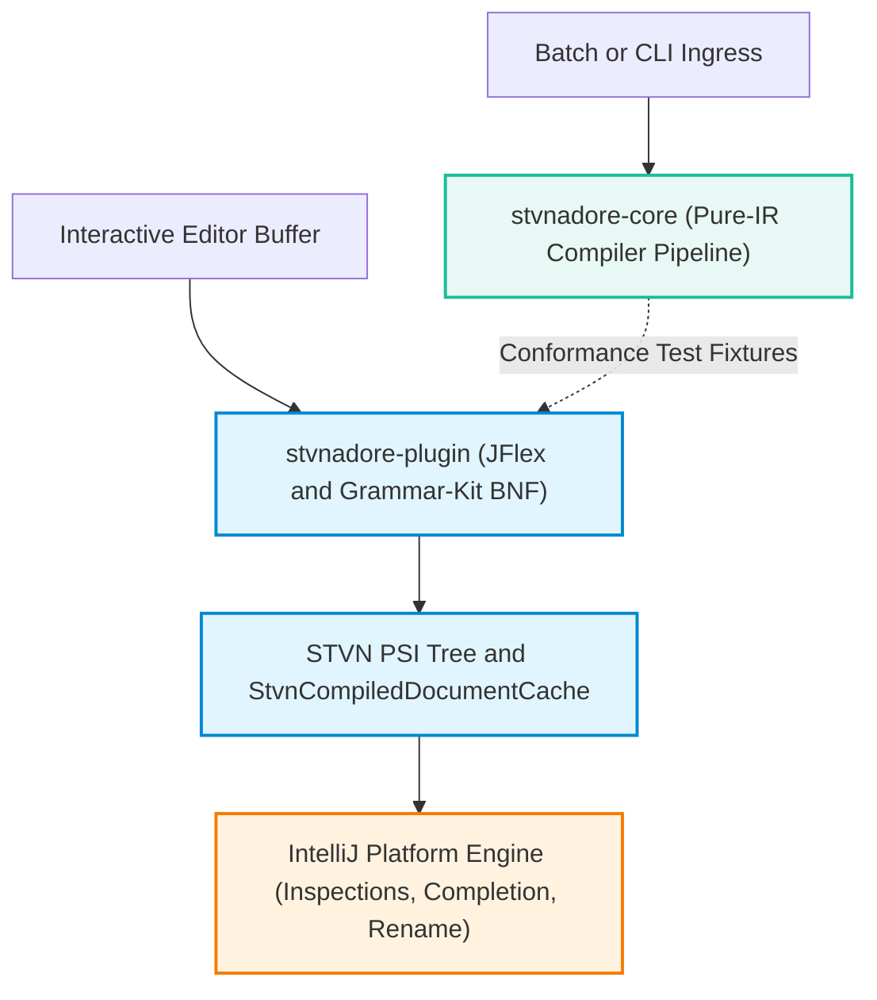
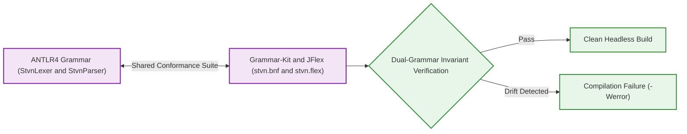
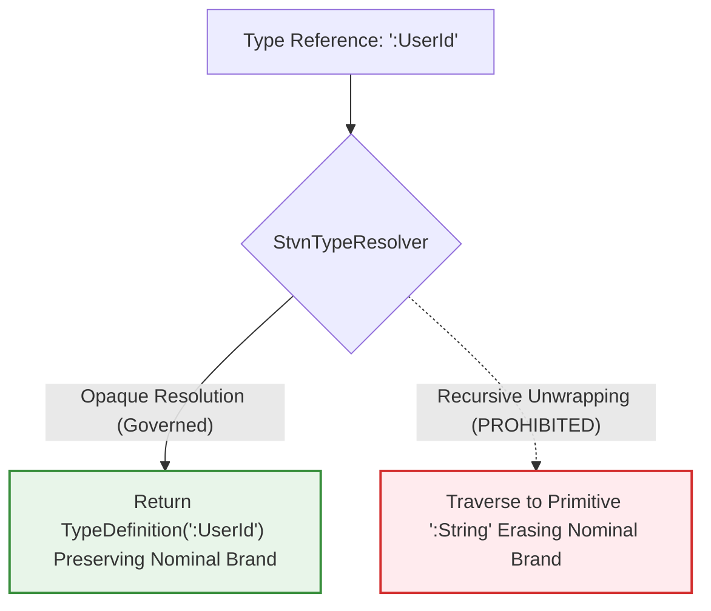
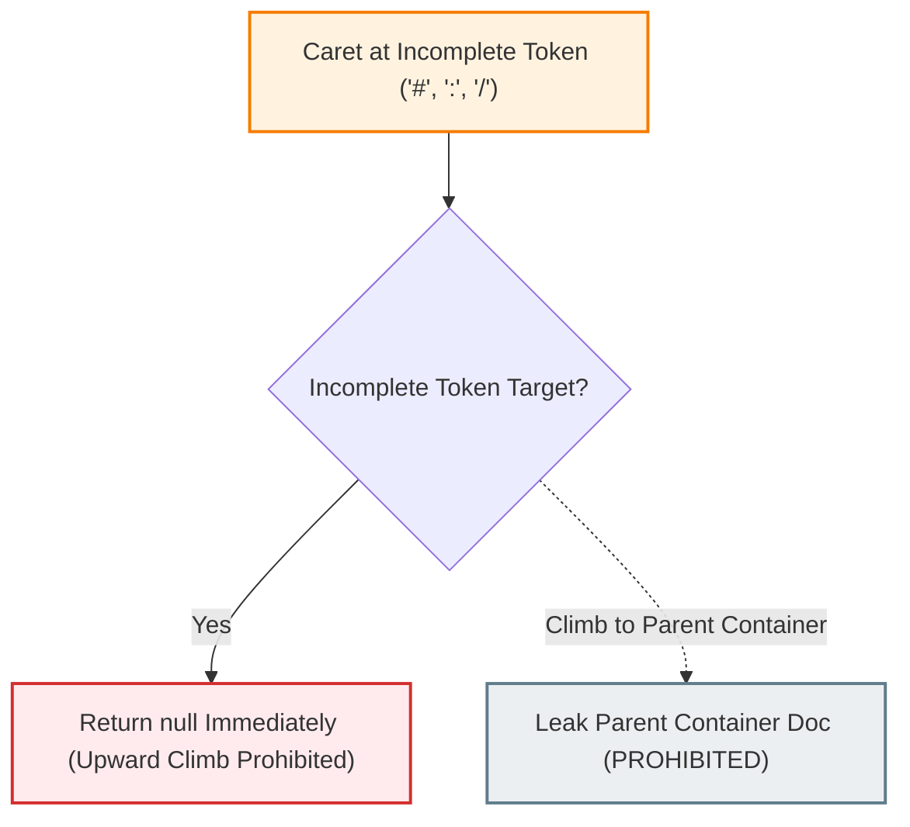
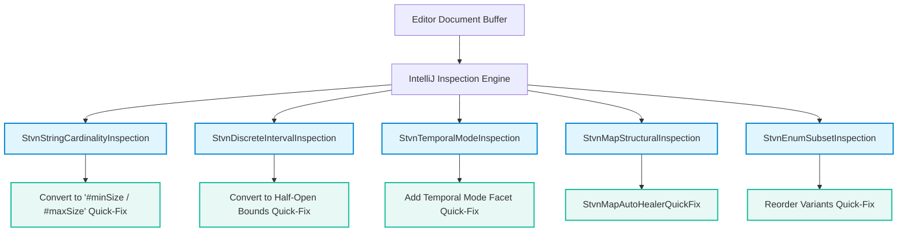

# STVN Architecture Specification: IntelliJ Platform Plugin & Interactive PSI Governance

**Document ID:** `STVN-SPEC-PLUGIN-01`  
**Status:** Canonical Architecture Specification  
**Version:** `2.0.0`  
**Target Repository:** `stvnadore-plugin` (`ij_stvnadore_plugin`)  
**Target Version Baseline:** `2.0.0-SNAPSHOT`  
**Governing Standard:** Simplified Technical English (STE-01 through STE-07)  
**Foundational Baselines:**  
- `STVN_LANGUAGE_SPEC.md` (STVN 2.0.0 baseline)  
- `STVN-VOP-MANIFESTO.md` (Value-Oriented Programming Canonical Foundations)  
- [`docs/architecture/STVN_REPOSITORY_SPEC.md`](file:///c:/Projects/Java/stvnadore/ij_stvnadore_repository/docs/architecture/STVN_REPOSITORY_SPEC.md) (STVN 2.0.0 baseline)  
- [`docs/architecture/STVN_CHESS_SHOWCASE_SPEC.md`](file:///c:/Projects/Java/stvnadore/ij_stvnadore_example_chess/docs/architecture/STVN_CHESS_SHOWCASE_SPEC.md) (STVN 2.0.0 baseline)  
**Toolchain:** Java 21 LTS | Gradle 8.x | IntelliJ Platform SDK 2025.3  

---

## 1. Scope & Dual-Grammar Synchronization Invariant

### 1.1 The Ecosystem Role of the IntelliJ Plugin

The STVN IntelliJ Platform plugin (`stvnadore-plugin`) serves as the interactive developer experience (DX) surface for the STVN ecosystem. While the upstream compiler (`stvnadore-core`) operates in headless, batch, or CLI contexts, the plugin executes inside the interactive IntelliJ editor thread under partial, unclosed, and syntactically incomplete keystroke sequences.

The plugin provides six primary capabilities:
1. **Interactive Lexical & Syntax Highlighting:** Provides token-accurate lexical classification via JFlex (`stvn.flex`) and Grammar-Kit BNF (`stvn.bnf`).
2. **Program Structure Interface (PSI) Tree Construction:** Builds an incremental PSI representation enabling code folding, navigation, and structural search.
3. **Opaque Nominal Reference Resolution:** Resolves cross-file and intra-file type references while strictly preserving opaque nominal type wrappers.
4. **Context-Aware In-Flight Auto-Completion:** Contributes schema-directed value templates, enum variants, and sum constructors without leaking parent container scopes.
5. **Real-Time Inspections & Automated Quick-Fixes:** Flags syntax violations, invalid facets, discrete bound errors, and structural layout mistakes directly in the editor buffer.
6. **Value-Oriented Rename Refactoring:** Executes atomic symbol renaming across schema declarations, usage sites, and standard library namespaces.

### 1.2 The Dual-Grammar Synchronization Invariant

The STVN ecosystem enforces a strict dual-grammar architecture:
- **Headless Authority:** ANTLR4 (`StvnLexer.g4` and `StvnParser.g4` in `stvnadore-core`).
- **Interactive Authority:** Grammar-Kit BNF (`stvn.bnf`) and JFlex (`stvn.flex` in `stvnadore-plugin`).

To prevent architectural drift and syntax divergence, the plugin adheres to the **Dual-Grammar Synchronization Invariant**:

$$\mathcal{T}_{\text{ANTLR4}} \equiv \mathcal{T}_{\text{JFlex}} \quad \land \quad \mathcal{P}_{\text{ANTLR4}}(s) \cong \mathcal{P}_{\text{Grammar-Kit}}(s)$$

For every source document $s \in \Sigma^*$:
1. **Token Taxonomy Identity:** Every terminal token recognized by `StvnLexer.g4` must have an exact equivalent token in `stvn.flex` with identical boundary rules.
2. **Parse Tree Homomorphism:** The hierarchical structure of the ANTLR4 parse tree must map homomorphically to the Grammar-Kit generated PSI tree.
3. **Compound Token Elimination:** All legacy compound tokens removed from ANTLR4 in STVN 2.0.0 (`:Uint4`, `:Int16`, `:String8`, `:StringFixed36`, `:SeqNonEmpty`, `:MapInv`) must be removed from `stvn.bnf` and `stvn.flex`. Both grammars parse base types qualified by metadata facet blocks.
4. **Strict Fenced String Delimiter & `MALFORMED_FENCE` Slot Isolation Invariant (Rule STR-04):** Both ANTLR4 (`StvnLexer.g4` / `StvnParser.g4`) and JFlex / Grammar-Kit (`stvn.flex` / `stvn.bnf`) strictly enforce delimiter pattern `"""[TAG]` without directional arrow syntax. Malformed triple-quoted openings (`"""->[TAG]`, inline `"""..."""`, untagged `"""\n...\n"""`, or invalid `[tag]`) scan as a single `MALFORMED_FENCE` token admitted into `string_literal` so enclosing `:Tuple`, `:Seq`, and `MetadataMap` slots preserve exact sibling positional arity while `StvnFencedStringInspection` highlights only the opening delimiter line (`[startOffset, endOffset)`) and offers body-preserving `RemoveProhibitedArrowQuickFix`.
5. **27-Keyword `reserved_facet_keyword` Lookahead Boundary:** In `stvn.bnf`, `metadata_value` guards `facet_const_ref` with `!reserved_facet_keyword` across all 24 schema constraint facets plus `#name`, `#domain`, and `#kind`, preventing bare boolean traits (`#preserveIndent`, `#equatable`, `#comparable`) from consuming a following sibling facet as a `#CONST` argument.
6. **Layered Single-Line Escape Highlighting Invariant:** `StvnParserDefinition.createLexer()` preserves single-token `StvnTypes.LITERAL_STRING_SIMPLE` PSI `StringLiteral` nodes for exact AST homology with `StvnParser.g4`, whereas `StvnSyntaxHighlighter.getHighlightingLexer()` wraps `FlexAdapter(_StvnLexer)` in an IntelliJ `LayeredLexer` registering `StvnSimpleStringHighlightingLexer` strictly on `StvnTypes.LITERAL_STRING_SIMPLE`. Valid STVN escapes (`\"`, `\\`, `\/`, `\b`, `\f`, `\n`, `\r`, `\t`, `\uXXXX`) emit `StringEscapesTokenTypes.VALID_STRING_ESCAPE_TOKEN` (`VALID_STRING_ESCAPE`), invalid escapes emit `INVALID_CHARACTER_ESCAPE_TOKEN` or `INVALID_UNICODE_ESCAPE_TOKEN` (`INVALID_STRING_ESCAPE`), and Rule STR-04 verbatim fenced strings (`LITERAL_STRING_FENCED`, `MALFORMED_FENCE`) remain completely unsplit.

---

## 2. PSI Accessor & Opaque Nominal Resolution Governance

### 2.1 The Prohibition of Recursive Nominal Unwrapping

Under Value-Oriented Programming (VOP), nominal types represent distinct domain entities even when their structural definitions are identical:
$$\text{NominalSchema}(:UserId) \neq \text{NominalSchema}(:AccountId)$$

Legacy PSI resolvers implemented recursive schema unwrapping inside `StvnTypeResolver.resolveNominalSchema`. When resolving a nominal alias, the resolver repeatedly traversed the reference chain until reaching a primitive base type. This recursive unwrapping produced three severe architectural defects:
1. **Nominal Erasure:** Collapsed unique domain types into bare primitives (`:String`), destroying nominal boundaries in type inference.
2. **False Type Equivalence:** Treated `:UserId` and `:AccountId` as interchangeable types during auto-completion and validation.
3. **Cyclic Traversal Loops:** Induced editor thread hangs on recursive type definitions.

**Governance Mandate:** Recursive nominal unwrapping is prohibited. `StvnTypeResolver.resolveNominalSchema` must execute shallow resolution:
- When given a nominal reference (e.g. `:UserId`), the resolver must resolve to the authoritative `TypeDefinition` node representing that alias.
- The resolver must retain the nominal wrapper (`:UserId`) as an opaque type brand.
- The underlying structural schema is accessed only when evaluating physical payload conformance or formatting underlying type documentation.

### 2.2 PSI Navigation Contracts & Mixin Taxonomy

The plugin structures PSI nodes using dedicated mixins and navigation interfaces:

| Interface / Mixin | Implementing PSI Node | Architectural Role | Navigation & Reference Contract |
|:---|:---|:---|:---|
| `StvnTypeDefinitionMixin` | `TypeDefinition` (`:defs`) | Root type definition in `:defs`. | Implements `PsiNamedElement`, `StvnTypeDefinitionNode`. Provides `getName()`, `setName()`, and `getPresentation()`. |
| `StvnSchemaTypeMixin` | `SchemaType` (`:type`, `:defs`) | Schema expression container. | Resolves underlying constructor (`AtomicType`, `CollectionType`, `ProductType`, `SumType`) or nominal `TypeKeyword`. |
| `StvnConstantDefinitionMixin`| `ConstantDefinition` (`:defs`) | Value constant declaration. | Implements `PsiNameIdentifierOwner`. Enables navigation to constant references in `:body`. |
| `StvnIncludeMapAliasMixin` | `IncludeMapAlias` (`:include`) | Renaming alias in import block. | Implements `PsiNamedElement`. Connects local alias to remote schema target. |
| `StvnUseMapAliasMixin` | `UseMapAlias` (`:use`) | Namespace-level import alias. | Implements `PsiNamedElement`. Maps fully qualified namespace identifiers. |

### 2.3 Pure-IR Compilation Cache & Diagnostic Routing Governance

The plugin enforces a strict pure-IR boundary (`HYGIENE-PLUGIN-03`) between IntelliJ PSI services and `stvnadore-core`:
- **Single-Pass Workspace Snapshot (`StvnCompiledDocumentCache`):** Compiles the active `PsiFile` and unsaved `:include` workspace overlays once per modification stamp into an immutable `StvnCompilationResult<StvnDocument>` snapshot (`StvnDefsCatalog`, `StvnSchema`, `StvnValue`, and `List<StvnDiagnostic>`). Zero ANTLR CST, `core.parser`, `core.ast`, or `core.lowering` classes cross into plugin source sets.
- **Sum-Type Trajectory (`StvnSumTrajectory`):** Computes explicit and implicit `:Option`, `:Either`, and `:Union` step trajectories directly over pure-IR `StvnValue` (`StvnOption`, `StvnEither`, `StvnUnion`) and `StvnSchema` nodes for inlay badges and hover documentation.
- **Cross-File Diagnostic Attribution (`StvnDiagnostic.sourcePath()`):** `StvnExternalAnnotator` compares normalized `diag.sourcePath()` against the active editor file path. Diagnostics originating in an included `.stvn_d` or `.stvn_di` module route directly to the matching `:include` `StringLiteral` with `OpenIncludedFileQuickFix`, while `StvnDiagnosticAnnotatorMapping` resolves governing local inspections by prioritizing `diag.symbolicId()` over many-to-one `diag.canonicalCode()` buckets.

### 2.4 Two-Hop `:use` Alias Navigation, Transitive Constant Hover & Nearest-Explicit `#VARIANT` Navigation

- **Two-Hop `:use` Alias Navigation (`StvnGotoDeclarationHandler`):**
  - **Hop 1 (Usage Site -> Local `:use` Alias):** Invoking `Goto Declaration` (`Ctrl+Click` / `Ctrl+B`) on a renamed `:use` constant reference (`#ACTIVE_RELEASE`) or type reference (`:ReleaseTag`) across `:defs`, `:type`, or `:body` navigates first to the local `UseMapAlias` RHS declaration token inside the enclosing file's `:use` directive.
  - **Hop 2 (`:use` Alias -> Upstream Declaration):** Invoking `Goto Declaration` on either the LHS (`index 0`) or RHS (`index 1`) token inside `UseMapAlias` (`{ #LEDGER_VERSION #ACTIVE_RELEASE }`, `{ :LedgerRelease :ReleaseTag }`) navigates directly to the upstream `ConstantDefinition` or `TypeDefinition` inside the target `:package` enclosure (across `:include` files and the Standard Library Prelude).
  - **1-Hop `#strip` & FQNI Direct Resolution:** Unrenamed `{ #strip }` projections (`:SettlementEntry`) and package-qualified FQNIs (`#acme/security/SEC_CONTACT`) continue to navigate directly to the upstream declaration in 1 hop.
  - **`PsiReference.resolve()` Caller Isolation:** `StvnTypeReference.resolve()` and `StvnConstantReference.resolve()` continue returning the local `UseMapAlias` RHS token on renamed aliases so `Shift+F6` Rename and `Find Usages` rename only local alias bindings without mutating upstream package declarations. Package-local `:use` directives remain isolated inside their enclosing `PackageEnclosure` and never leak into top-level file lookups.
- **Transitive `:use` Constant Hover (`StvnDocumentationProvider`):** Hovering on a `:use`-imported `#CONST` reference displays `Renamed Reference: #LOCAL -> #pkg/REMOTE` (using canonical `#` value sigils via `StvnConstantReference.buildPackageConstantFqni`) chained with the full upstream `ConstantDefinition` documentation card (`Typed Constant`, `Type`, terminal `Value`, and Four-Locus temporal `UTC Preview` / `UTC Time`).
- **Nearest-Explicit `#VARIANT` Navigation Guarded by `#filterExcl` (`StvnTypeResolver.resolveEnumVariantNavigationTarget`):**
  - **Root `:Enum[...]` & Unconstrained Projections:** Navigating from `#VARIANT` in `:body` or `ConstantDefinition` RHS governed by a root `:Enum[...]`, an unconstrained nominal alias, an implicit sum wrapper (`:Option(:SettlementState)`), or a `#strip` import lands directly on the `#VARIANT` `ValueKeyword` inside `:Enum[...]`.
  - **Positive `#filterIncl` Two-Hop Narrowing:** When governed by a schema declaring `#filterIncl [...]` (without `#filterExcl`), Hop 1 lands on the matching `#VARIANT` inside `#filterIncl [...]`; Hop 2 from `#filterIncl [...]` lands on the ancestor `#filterIncl` or root `:Enum[...]` `#VARIANT`.
  - **Negative `#filterExcl` & Degraded Mutex Guard:** When the nearest restricting schema declares `#filterExcl [...]` (or conflicting `#filterIncl` + `#filterExcl`), `#VARIANT` is not positively listed on that subtype, so navigation halts at the restricting `TypeDefinition` (or inline `SchemaType`) rather than bypassing the exclusion boundary.

---

## 3. Interactive In-Flight DX & Caret Resolution Invariants

### 3.1 Strict Upward Traversal Prohibition

During typing, an author frequently leaves tokens in an incomplete state (such as `#`, `:`, `/`, or unclosed quotes `"`). 

**The Strict Upward Traversal Invariant:** When resolving the caret context or hover documentation for an incomplete token, PSI visitors and documentation providers must never climb the AST to parent container nodes.

If the element under the caret matches any of the following conditions:
1. An unadorned sigil token (`#` or `:`),
2. A path separator token (`/`),
3. A `TokenType.BAD_CHARACTER`,
4. A `PsiErrorElement`,
5. Interior whitespace within a container literal (`PsiWhiteSpace`),

The resolver must immediately return `null`. It must not ascend to the enclosing `TupleLiteral`, `ListLiteral`, `MapLiteral`, or `BodyEntry`.

### 3.2 Container Documentation Isolation

Hovering over interior whitespace, delimiters, or incomplete elements within a collection literal must never display the documentation of the parent collection. Documentation is isolated strictly to:
- Explicit container boundary delimiters (when hovering directly on `(` or `{`),
- Fully completed inner elements.

### 3.3 Sigil Prefix Matching Discipline

Code completion must adhere to strict sigil prefix matching:
- Typing numeric digits (e.g. `1`, `2`) must never pro-offer `#`-prefixed auto-completion items (such as `#1`, `#2`, or enum variants) unless the author has explicitly typed the `#` sigil.
- The plugin enforces this discipline via `StvnSigilPrefixMatcher`, which wraps the IntelliJ platform `PrefixMatcher` and filters out `#` suggestions for numeric inputs.

### 3.4 Degraded Schema Sentinel Preservation

When a schema in `:defs` contains constraint errors (such as discrete bound violations, conflicting mutually exclusive facets, incomplete trait facets, invalid facets, or syntax errors), the PSI resolver must not crash with `NullPointerException` or discard the schema entirely.

The plugin treats the schema as a **Degraded Schema Sentinel**:
- Concise base-type formatting (`StvnSchemaFormatter.formatDegradedUnderlyingBaseIr` / `formatDegradedUnderlyingBasePsi`) collapses degraded `:Enum` and `:EnumSubset` schemas to `:Enum` without inline variant lists across `PW006`, `:type` warnings, and hover banners.
- Hovering over a `:body` value governed directly by a degraded or ungrounded schema — or nested inside an enclosing `:body` container (`:Seq`, `:Set`, `:Map`, `:Tuple`, `:Option`, `:Either`, `:Union`) whose container schema is degraded — routes `StvnDocumentationProvider` to the governed `Value` compliance card, rendering the yellow **Degraded Schema Warning** banner and `Compliance Status: Suspended (Degraded Schema)` (omitting `Exemplar Value:` and never falsely reporting `Satisfied`) while keeping `PsiReference.resolve()` (`Ctrl+Click`) symbol navigation intact:
  > **⚠️ Degraded Schema Warning**  
  > Nominal type `:<alias>` contains constraint errors in `:defs` (underlying base type: `:<base>`).  
  > Payload evaluation is suspended.
- Payloads in `:body` continue to receive syntax highlighting, multi-hop degraded type traces (`⚠ :Child -> :Parent -> :Enum`), and basic base-type auto-completion based on the fallback schema.

### 3.5 Four-Locus Temporal `UTC Preview` / `UTC Time`, Anti-Wrap `<nobr>` & Concise `Default (:Enum)` Origin Contracts

- **Four-Locus Temporal Hover Parity (`:TimeEpoch` & `:DateTime`):** `StvnDocumentationProvider` renders deterministic ISO-8601 `UTC Preview` and human-readable `UTC Time` (`HOUR_12` / `HOUR_24` user preference via `StvnTimeEpochFormatter.formatInstantHumanUtc`) rows across all four temporal authoring and reference loci:
  1. `:defs` LHS `#CONST` declaration (`ConstantDefinition` card),
  2. `:defs` RHS literal or chained `#CONST` value (`Constant Value` card with `Locus: Constant Definition (:defs clause)`),
  3. `:body` `#CONST` reference across top-level, nested `:Tuple`/`:Seq`/`:Set`/`:Map`, and implicit `:Option`/`:Either`/`:Union` slots (`Slot Schema` + `Temporal Scale` / `Temporal Mode` + `UTC Preview` + `UTC Time`), and
  4. `:body` direct integer or string literal (`Payload Value` card).
- **Schema Header `<nobr>` Anti-Wrap Protection:** Single-line schema metadata rows (`Type:`, `Slot Schema:`, `Temporal Scale:`, `Temporal Mode:`, `Value Type:`, and `Governing Schema:`) wrap their `<b>Label:</b> <code>...</code>` segments in `<nobr>...</nobr>` so Swing `HTMLEditorKit` never splits compound signatures such as `{ #offset } :DateTime` across lines.
- **Canonical Quoted Fenced `[REGEX]` Hover Presentation:** Fenced string `#regex` facets and `:String` bounds (`"""[REGEX]...[REGEX]"""` in `prelude.stvn_core.stvn_d` and user schemas) are decoded via `StvnPsiLiteralEvaluator.decodeStringLiteral(..., false)` (`Rule STR-04`) and rendered in hover tables and constraint headers as compact canonically escaped double-quoted strings via `StvnPsiLiteralEvaluator.formatCanonicalQuotedString(...)`.
- **128-Bit Floor-Adjusted Epoch & DST-Gap Safety:** `StvnTimeEpochFormatter` parses decimal, underscore, hexadecimal (`0x`), binary (`0b`), and octal (`0o`) tick literals via `StvnPsiLiteralEvaluator.parseBigInteger`, floor-adjusts negative sub-second remainders (`-1` `#ms` -> `1969-12-31T23:59:59.999Z`), and converts arbitrary-precision 128-bit ticks into proleptic Gregorian ISO-8601 UTC strings using pure-`BigInteger` 400-year (`146,097`-day) era arithmetic without `Instant` range overflow. For `:DateTime` (`#offset`, `#zoned`, `#audited`), `UTC Preview` and `UTC Time` render strictly when `StvnCompiler.validateDateTimeLiteral(rawQuoted, mode).isEmpty()`, suppressing nonexistent Spring-forward DST-gap timestamps and mismatched `#audited` offsets without throwing exceptions.
- **Concise `Default (:Enum)` Origin:** In `Effective Facets & Traits` hover tables, `formatDefaultOriginBaseType` normalizes `:Enum [...]` constructor signatures to `:Enum` so default trait rows display `Default (:Enum)` (`STE-07`) while `Underlying Structure:` continues to display the full active variant list.

---

## 4. Live Inspection & Intention Quick-Fix Contracts

The plugin provides real-time in-editor inspections and automated intention quick-fixes to maintain language standards:

### 4.1 `StvnStringCardinalityInspection`
- **Target Locus:** `TypeDefinition` and `SchemaType` nodes containing `:String`.
- **Defect Detection:** Detects `#size` applied to `:String`. Under MCT § 3.1.3, `#size` represents physical bit-width and is prohibited on strings.
- **Diagnostic Code:** `ERR_INVALID_METADATA_FACET`.
- **Intention Quick-Fix:** Converts `{ #size <N> } :String` to `{ #minSize 1 #maxSize <N> } :String`. For exact-length strings, provides an intention to declare `{ #minSize <N> #maxSize <N> } :String`.

### 4.2 `StvnDiscreteIntervalInspection`
- **Target Locus:** `TypeDefinition` nodes defining discrete numeric domains (`:Int` and `{ #exact } :Float`).
- **Defect Detection:** Flags closed upper bounds (`#maxIncl`) and open lower bounds (`#minExcl`). STVN 2.0.0 enforces half-open intervals $[minIncl, maxExcl)$ on discrete types.
- **Diagnostic Code:** `ERR_DISCRETE_BOUND_KIND_PROHIBITED`.
- **Intention Quick-Fix:** 
  - Converts `#maxIncl <N>` to `#maxExcl <N+1>`.
  - Converts `#minExcl <N>` to `#minIncl <N+1>`.

### 4.3 `StvnTemporalModeInspection`
- **Target Locus:** Declarations of `:TimeEpoch` and `:DateTime`.
- **Defect Detection:**
  - Flags bare `:TimeEpoch` lacking an explicit standalone scale flag (`#ns`, `#us`, `#ms`, `#s`), pinned directly to the `:TimeEpoch` `AtomicType` token.
  - Flags bare `:DateTime` lacking an explicit mode facet (`#offset`, `#zoned`, `#audited`), pinned directly to the `:DateTime` `AtomicType` token.
  - Flags mutually exclusive temporal scale or mode facets declared simultaneously in the same metadata block, pinning `GENERIC_ERROR` strictly to conflicting facets (`i >= 1`) while exposing silent `INFORMATION`-level `Alt+Enter` fixes on `i == 0`.
- **Diagnostic Codes:** `ERR_MISSING_TEMPORAL_FACET` (`E008`), `MUTUALLY_EXCLUSIVE_BOUNDS` (`E008`).
- **Intention Quick-Fixes:** Inserts default standalone temporal flags (`{ #ms } :TimeEpoch` or `{ #offset } :DateTime`), keeps only the selected facet, or removes a conflicting facet (`Remove conflicting facet '<facet>'`).

### 4.4 `StvnMapStructuralInspection`
- **Target Locus:** Map literals and map collection type declarations.
- **Defect Detection:**
  - Flags flat list literals (`[ k v k v ]`) supplied to map slots.
  - Enforces canonical map literal envelope `{ [ key value ] }`.
  - Enforces `#invertible` dual-set uniqueness on map payloads.
- **Diagnostic Code:** `ERR_MAP_STRUCTURE_INVALID`.
- **Intention Quick-Fix:** `StvnMapAutoHealerQuickFix` automatically restructures flat list entries into paired bracket tuples `[ key value ]` inside outer curly braces.

### 4.5 `StvnEnumSubsetInspection` & Per-Variant Enum Quick-Fixes
- **Target Locus:** Type definitions declaring `#filterIncl` or `#filterExcl`, plus `:body` and `ConstantDefinition` values governed by `:Enum` or `:EnumSubset` schemas.
- **Defect Detection:**
  - Enforces monotonic narrowing (`E014 / ENUM_SUBSET_NOT_SUBSET`), root declaration ordering (`E015 / ENUM_SUBSET_ORDER_VIOLATION`), non-empty active subsets (`E016 / ENUM_SUBSET_EMPTY`), and `#filterIncl` / `#filterExcl` mutual exclusivity (`E008 / MUTUALLY_EXCLUSIVE_BOUNDS` pinned to `i >= 1`).
  - Flags subset-excluded variants with `E012 / ERR_CONSTRAINT_VIOLATION` and undeclared variants with `E028 / ERR_TYPE_MISMATCH` across both `:body` slots and nominal `#CONST` RHS values while exempting declared `#CONST` references.
- **Intention Quick-Fixes:** `StvnReorderEnumFilterVariantsQuickFix` sorts filter variants into root declaration order; `RemoveRedundantFacetQuickFix` (`Remove conflicting facet '<facet>'`) removes a conflicting filter facet; `StvnPayloadValueQuickFixProvider` offers ordered per-variant `Replace with '<#VARIANT>'` actions across all active variants.

### 4.6 `RemoveInvertibleFacetQuickFix`
- **Target Locus:** `#invertible` `MetadataEntry` nodes and non-equatable map values in inverted map declarations.
- **Defect Detection:** Intercepts `ERR_TRAIT_VIOLATION` with diagnostic message `"Inverted map values require types to be #equatable #TRUE"`.
- **Resolution Behavior:** Removes the `#invertible` facet from nominal map definitions or anonymous map constructors.
- **Syntax Hygiene Guard:** If `#invertible` is the sole entry in the metadata block, the fix deletes the entire `{}` block to prevent `ERR_EMPTY_METADATA_BLOCK` (STVN Spec § 3.5.1).
- **Co-Located Availability:** The action is offered both when the caret is on `#invertible` and when the caret is on the offending value.

### 4.7 `AddExactConstraintQuickFix`
- **Target Locus:** Built-in continuous `:Float` `SchemaType` nodes in equatability-requiring positions (`#invertible` map values, standard map keys, and set elements).
- **Defect Detection:** Intercepts `ERR_TRAIT_VIOLATION` targeting continuous `:Float`.
- **Resolution Behavior:** Replaces unadorned `:Float` with `{ #exact } :Float`, or inserts `#exact` into existing metadata blocks.
- **Capability Restoration:** Under STVN Spec § 6.2, `#exact` elevates `:Float` to discrete arbitrary-precision decimal representation, restoring `#equatable #TRUE` without requiring nominal wrapping in `:defs`.
- **Conflict Prevention:** Purges any conflicting `#size` facet per STVN Spec § 6.1 mutual exclusivity rules.

### 4.8 Comment-Preserving `:meta` & `MetadataMap` Reordering and `:meta` Token Authority
- **Target Locus:** Root `:meta` sections (`StvnMetadataOrderInspection` / `StvnReorderMetaEntriesQuickFix`), schema `MetadataMap` constraint blocks (`StvnReorderMetadataFacetsQuickFix`), `Ctrl+Alt+L` pre/post-format processors (`StvnMetadataOrderPreFormatProcessor`, `StvnCoreDelegationPostFormatProcessor`), and root `:meta` identity inspections (`StvnMissingMetaInspection`, `StvnStemMismatchInspection`).
- **Comment & Blank-Line Slice Invariant (Golden Quartet #14 Parity):**
  - Partitioning attaches contiguous standalone `//` comments and same-line `//` comments to each `:meta` or `MetadataMap` entry slice (`CommentedEntrySlice`) while preserving trailing footer `//` comments before `}`.
  - Blank lines emit strictly when `newlinesSincePrevItem >= 2`; consecutive standalone `//` comments (`newlines == 1`) never fabricate blank lines, and enclosure-top blank lines immediately after `{` (`entryIdx == 0`) never fabricate inter-entry blank lines after permutation.
  - In `PSI_STRUCTURE_PRESERVING` mode, `StvnMetadataOrderPreFormatProcessor` snapshots pre-format coordinates so `StvnBlock` and `StvnCoreDelegationPostFormatProcessor.reanchorAlignedTrailingComments` collapse interior multi-spaces and pad aligned trailing comments (`>= 2` authored spaces) to their original target columns, matching `StvnSourceFormatter` (`source_pretty/14_comment_preserving_meta_and_facet_reordering.core_fmt.stvn_i` and `source_pretty/15_const_trait_facets_and_temporal_enum_comments.core_fmt.stvn_i`) byte-for-byte.
  - **Mutex-Group Rank Stabilization (`createMutexStabilizedEntryRanker`):** Across all 6 mutually exclusive facet groups (`#ns..#s`, `#offset..#audited`, `#size`/`#exact`, `#minIncl`/`#minExcl`, `#maxIncl`/`#maxExcl`, `#filterIncl`/`#filterExcl`), `StvnMetadataOrderInspection` suppresses secondary `E037 / ERR_FACET_ORDER_VIOLATION` cascades on 2nd+ co-occurring group members and stabilizes their sort rank to the first encountered group member so `Ctrl+Alt+L` and `StvnReorderMetadataFacetsQuickFix` never flip reverse-ordered mutually exclusive pairs (`{ #s #ms }`).
- **Authoritative 5-Character `KW_META` Pinning & In-Flight `#kind` Suppression:**
  - `W002` (`WARN_DOCUMENT_DOMAIN_OMITTED_IN_META`) and non-empty `:meta` omitted-`#kind` `E031` (`ERR_DOCUMENT_KIND_MISMATCH`) anchor strictly to the 5-character `KW_META` (`:meta`) token across both `StvnExternalAnnotator` (via upstream `StvnDefsLowerer`) and governed local inspections (`StvnStemMismatchInspection`, `StvnMissingMetaInspection`) with zero downstream coordinate clamping and zero duplicate highlights.
  - During active typing inside `:meta`, `StvnMissingMetaInspection` suppresses secondary `E031` cascades whenever `#kind` is pinned without a value (`MetaKindFacet.getMetaKindValue() == null`) or appears as an in-flight `#kind` tag inside `MetaBlock`.

### 4.9 `StvnRedundantFacetOverrideInspection` (`W003 / WARN_REDUNDANT_METADATA_FACET` 1:1 Deconfliction)
- **Target Locus:** All schema `MetadataMap` blocks across `:defs` (`TypeDefinition`, `ConstantDefinition`), root `:type` (`TypeEntry`), and inline schema constructors (`SchemaType`).
- **1:1 Core Deconfliction:** Mapped in `StvnDiagnosticAnnotatorMapping` to `DiagnosticBag.WARN_REDUNDANT_METADATA_FACET` (`W003`). When enabled, `StvnExternalAnnotator` yields `W003` emission exclusively to `StvnRedundantFacetOverrideInspection` (`[stvn-plugin:W003-WARN_REDUNDANT_METADATA_FACET]` + `RemoveRedundantFacetQuickFix`). When disabled in the user's inspection profile, `StvnExternalAnnotator` surfaces the identical `[startOffset, endOffset)` `MetadataEntry` spans and STE prose as `[stvn-core:W003-WARN_REDUNDANT_METADATA_FACET]` with zero stacked warnings (`count(range, code) == 1`).
- **Pure-PSI Fallback:** When unrelated Pass 1 syntax errors prevent full Pass 2 compilation, the inspection evaluates root tautologies (`#size 32` on `:Int`, `#size 64` on continuous `:Float`, `#minSize 0`, `#maxSize 16777216`, `#preserveIndent #FALSE` on `:String`, natural bit-width bounds, intrinsic `#equatable` / `#comparable` traits) and nominal-parent overrides across `:Int`, `:Float`, `:String`, `:TimeEpoch`, `:DateTime`, and `:Enum` `#filterIncl` subsets directly over PSI and `#CONST` chains.

### 4.10 `StvnFlatDocumentIncludeInspection` (Hermetic `:include` `E005` & Scoped `:use` `E035` 1:1 Governance)
- **Target Locus:** `IncludeStmt` and `UseStmt` (`UseTarget`) nodes inside hermetic compilation units (`.stvn`, `.stvn_d`, `.stvn_b`, `.stvn_bd`, or explicit `:meta` `#kind #BODY` / `#DEFS`).
- **Defect Detection & 1:1 Core Parity:**
  - Flags `:include` statements in hermetic units via `prohibitsIncludeStatements(file)` with exact `StvnDefsLowerer` coordinate and STE prose parity (`Hermetic document or schema (.stvn, .stvn_d, .stvn_b, .stvn_bd) cannot contain include statements: <fileName>`, `E005 / ERR_INCLUDES_PROHIBITED_IN_FLAT_DOCUMENT`), while suppressing secondary duplicate `:defs` cascades via `StvnMetaTemplateUtil.isInSecondaryRootSection`.
  - Flags scoped `:use` directives in hermetic documents targeting packages outside `StvnPrelude.isPreludePackageTarget(target)` and locally declared non-reserved `:defs` packages (`:package :pkg`, `:pkg/Type`, `#pkg/CONST` with hierarchical prefix matching and `StvnNamespaceRules.isReservedPackage` exclusion), pinned strictly to `useStmt.getUseTarget()` (`E035 / ERR_UNRESOLVED_PACKAGE_IN_HERMETIC_DOCUMENT`) while suppressing secondary emission when `StvnTrailingSlashInspection.hasTrailingSlash(useTarget)` (`E002`) or incomplete bare `:` tokens are present.
  - Modular include units (`.stvn_i` and `.stvn_di`) remain governed by `StvnExternalAnnotator` (`E030 / UNDEFINED_TYPE`) across transitive `:include` graphs with zero duplicate highlights.
- **Intention Quick-Fixes, `:meta` Synthesis & Preview Guard:**
  - Offers `RemoveIncludeStatementQuickFix` (`Remove :include directive [for '<path>']`, `Priority.HIGH`) on `E005` and `RemoveUseStatementQuickFix` (`Remove :use directive for '<target>'`, `Priority.HIGH`) on `E035`. Both share comment-preserving line deletion that omits comment-free sole-element `:defs` sections in `#BODY` documents (`.stvn`) while retaining canonical `:defs {\n  }` enclosures in `#DEFS` schemas (`.stvn_d`, `.stvn_bd`).
  - Offers `StvnConvertToModularQuickFix` (`Convert document/schema to modular format (.stvn_i / .stvn_di)`, `Priority.LOW`) strictly on textual `.stvn` and `.stvn_d` units when the target modular filename does not collide in the directory (suppressing binary `.stvn_b` / `.stvn_bd` units). Conversion updates `#kind` (`#BODY_INCLUDE` / `#DEFS_INCLUDE`), inserts missing `#kind` in out-of-order or partial `:meta` blocks, synthesizes a `Rule STR-STEM` `:meta` section when converting `:meta`-less 1-stem or 2-stem files, commits buffer edits prior to `VirtualFile.rename`, and renders a VFS-safe `IntentionPreviewInfo.CustomDiff` preview (`<oldName> -> <newName>`). `StvnPackageCompletionContributor` filters `:use` completion items in hermetic units to Prelude and local non-reserved `:defs` packages.

### 4.11 `StvnConvertEscapedStringToFencedIntention` (1-Click Escaped-to-Fenced String Conversion)
- **Target Locus:** Escaped simple `StringLiteral` (`LITERAL_STRING_SIMPLE`) tokens in `MetadataEntry` string facets (`#regex`, `#minIncl`, `#minExcl`, `#maxIncl`, `#maxExcl`), `ConstantDefinition` RHS values, and `:body` payload values.
- **Availability & Lossless Round-Trip Soundness Guards (`Rule STR-04`):**
  - Strictly excludes root `:meta` entries (`MetaEntry`), `:include` path strings (`IncludeStmt`), and `:DateTime` bounds/literals (which require simple double-quoted literals under the STVN grammar).
  - Decodes simple string escapes strictly across the STVN escape set (`\"`, `\\`, `\/`, `\b`, `\f`, `\n`, `\r`, `\t`, `\uXXXX`) via `StvnPsiLiteralEvaluator.decodeStringLiteral` and evaluates `StvnPsiLiteralEvaluator.shouldEmitFencedPretty(decoded, preserveIndent)` (`1:1` parity with `AstPrettyPrinter`: requires `\n`, `\t`, `\"`, or `\\`, rejects `\r` and control chars `< 0x20` other than `\n`/`\t`, and under `#preserveIndent #FALSE` rejects ASCII-space-only strings, space-only interior lines, and strings where `trimCommonIndent(decoded)` strips common leading spaces).
- **Tag Selection, Local Formatting & Sibling Isolation:**
  - Selects `"""[REGEX]` on `#regex` facets and `*REGEX` / `*_REGEX` constants (`StvnPsiLiteralEvaluator.isRegexConstantIdentifier`), and `"""[RAW]` elsewhere, escalating deterministically via `StvnPsiLiteralEvaluator.chooseSafeFenceTag` (`[RAW_1]`, `[REGEX_1]`, ...) when `[TAG]"""` collides with content.
  - Expands enclosing single-line `MetadataMap` (`{ #regex "..." }`) or single-line payload containers (`[...]`, `(...)`, `{ [ ... ] }`) directly with canonical `+2`-space STVN indentation (leaving unrelated sibling declarations and out-of-order metadata blocks in `:defs` byte-for-byte untouched), and aligns the body margin to `ownerIndent + 2` (`#preserveIndent #FALSE`) or verbatim `0` (`#preserveIndent #TRUE`).

### 4.12 Workspace Flattening Actions (`StvnFlattenWorkspaceAction` & `StvnCopyFlattenedSchemaAction`)
- **Popup Menu Surfacing & Visual Branding:** Both `StvnFlattenWorkspaceAction` (`Flatten STVN Workspace`) and `StvnCopyFlattenedSchemaAction` (`Flatten Active STVN Schema to Clipboard`) are registered inside `StvnEditorPopupMenu` (`STVN >`) across both `EditorPopupMenu` and `ProjectViewPopupMenu` between `<separator/>` dividers (with `StvnFlattenWorkspaceAction` additionally retained under `BuildMenu`), bound to `/icons/stvn_file.svg` (`StvnIcons.STVN`) and `ActionUpdateThread.BGT`.
- **Non-Destructive Pretty-Printed Clipboard Flattening:** `StvnCopyFlattenedSchemaAction` collects unsaved editor buffers and disk workspace files via `StvnFlattenWorkspaceAction.collectWorkspaceSources`, resolves transitive `:include` graphs via `StvnSchemaFlattener.flatten`, maps both 1-stem (`foo.stvn_i` -> `foo.stvn_d`) and 2-stem (`bar.core_test.stvn_i` -> `bar.core_test.stvn_d`) filenames via `deriveDefsStemName` (`Rule E032`), compiles with `allowSystemSubstrate = true` (`StvnParserConfig`) into `StvnDocument`, and formats via `AstPrettyPrinter.print` to the system clipboard without creating or mutating `.stvn_d` files on disk.

---

## 5. Benchmarking & Quality Assurance Gates

### 5.1 Compilation & Verification Standards
- **Compiler Compliance:** Java 21 LTS (`<release>21</release>`), `-Werror`, `-Xlint:all`.
- **Platform Compatibility:** IntelliJ Platform SDK 2025.3 (`sinceBuild = "253.0"`).
- **Javadoc Validation:** `<doclint>all</doclint>`, `<failOnError>true</failOnError>`.

### 5.2 Performance & Responsiveness Invariants
- **Typing Latency:** Highlight passes on keystrokes must complete in $< 50\text{ ms}$ for documents up to 5,000 lines.
- **Completion Response:** In-flight completion results must return within $< 30\text{ ms}$.
- **Memory Footprint:** Cached AST and diagnostic values must use soft references (`CachedValuesManager`) to avoid memory leaks during long-running IDE sessions.
